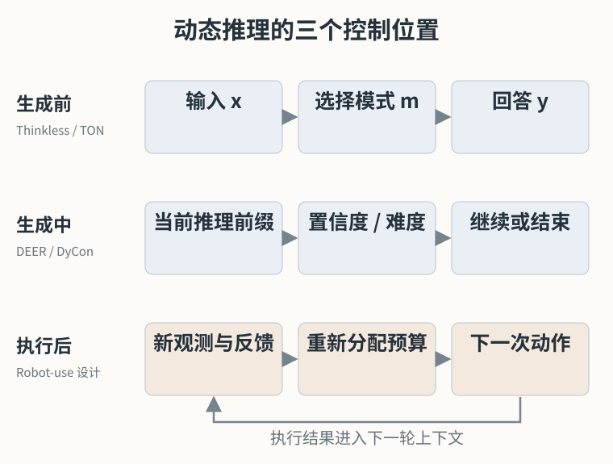
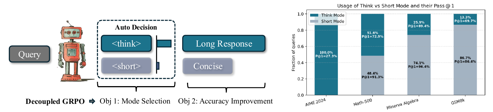
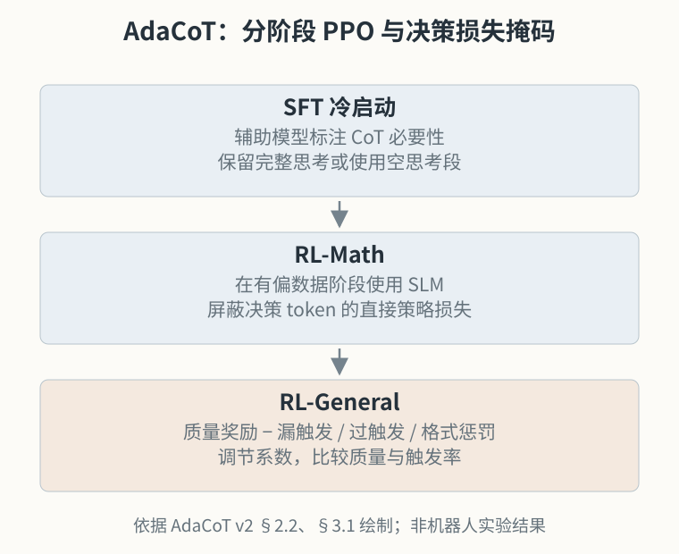
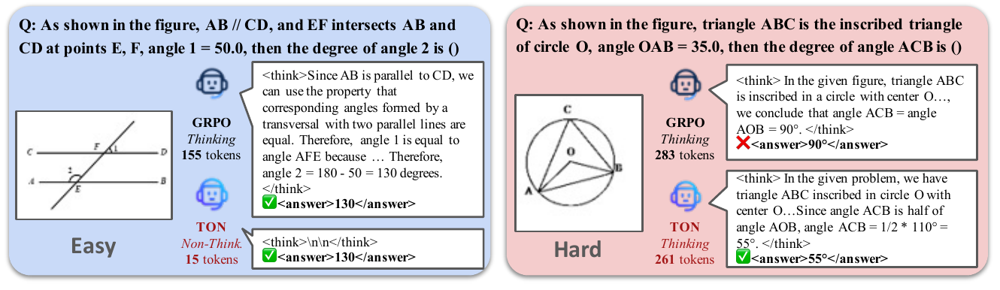
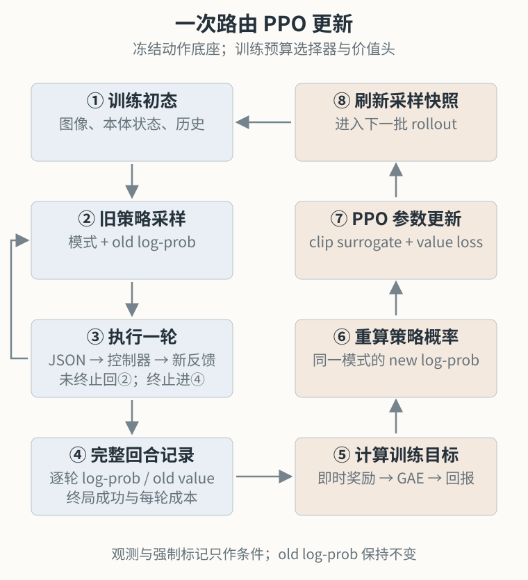
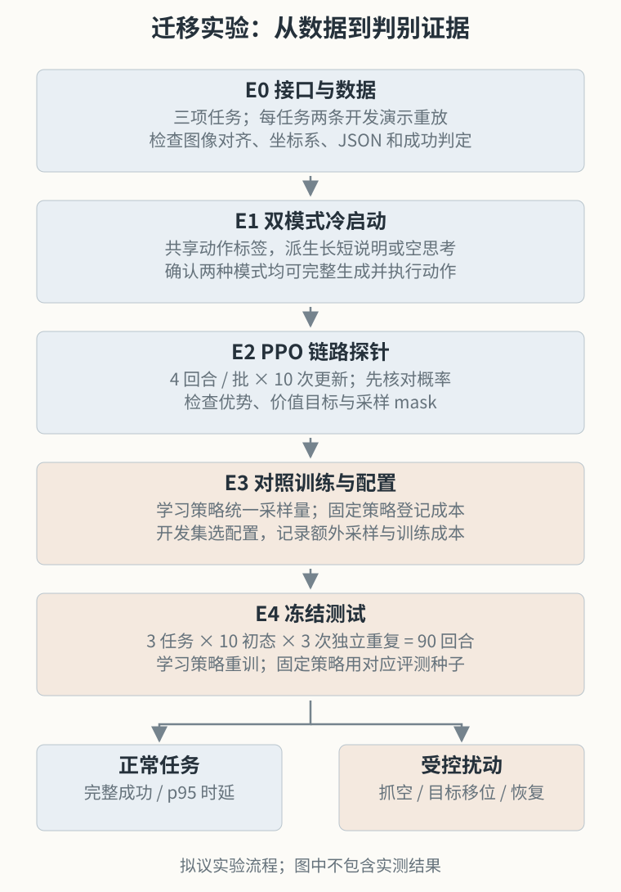
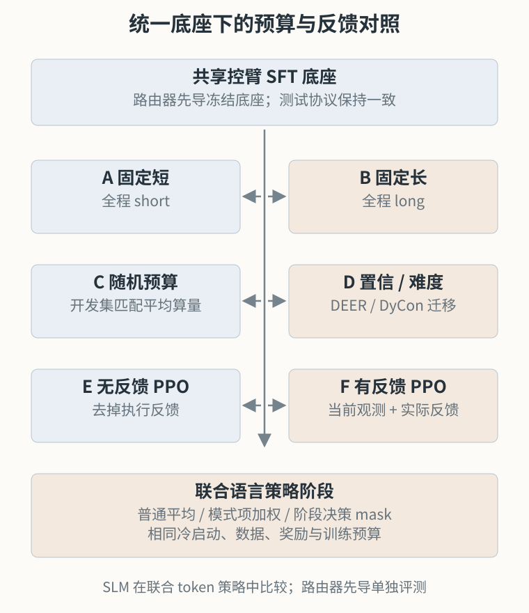

# 动态推理：让模型学会何时思考

**动态推理根据当前问题、推理进度或执行反馈调整计算。** 核心控制只有三类：生成前选模式、生成中决定停止、收到反馈后重新分配预算。

*图 1．控制位置示意；前两行对应已有方法，第三行对应机器人迁移设计。*

## Mode Selection: Thinkless

Thinkless 把模式选择放在首个控制 token 上。后续文本以该标记为条件生成。

*图 2．Fang、Ma、Wang，Thinkless，原论文 Figure 1，arXiv v2；裁剪，[CC BY 4.0](https://creativecommons.org/licenses/by/4.0/)。[原文 §3](https://arxiv.org/html/2505.13379v2#S3)。*

输入 $x$，模式 $m$，回答 $y=(y_1,\ldots,y_K)$，共享参数 $\theta$：

$$
\begin{aligned}
\pi_\theta(m,y\mid x)
&=\pi_\theta(m\mid x)\,\pi_\theta(y\mid x,m),\\
\pi_\theta(y\mid x,m)
&=\prod_{k=1}^{K}
\pi_\theta(y_k\mid x,m,y_{<k}).
\end{aligned}
$$

### Cold Start → Reward → Advantage

**成对长短回答 → 模式标记 SFT → 同题多次采样 → 任务奖励 → DeGRPO。**

冷启动保证两种模式可用，RL 学习何时选择。Thinkless 对正确长模式收取固定成本 $\kappa$，$0<\kappa<1$：

$$
R_i=
\begin{cases}
1,& \text{短模式且正确},\\
1-\kappa,& \text{长模式且正确},\\
-1,& \text{错误}.
\end{cases}
$$

同一输入采样 $G$ 条，$i$ 为样本编号。该版本使用中心化优势，**不除以标准差**：

$$
\widehat A_i=R_i-\frac{1}{G}\sum_{h=1}^{G}R_h.
$$

只比较两种模式，平分时选短模式。设正确概率为 $p_s,p_l$，由上述奖励直接得到：

$$
\begin{aligned}
\mathcal U_s&=2p_s-1,\\
\mathcal U_l&=(2-\kappa)p_l-1,\\
m^\star=\mathrm{long}
&\iff(2-\kappa)p_l>2p_s.
\end{aligned}
$$

这是期望回报分析；训练中用采样奖励学习，部署时无需知道真实正确概率。

### Separate the Control Token

模式 token 只有一个，回答可能很长。DeGRPO 将两部分分开归一化：

$$
\begin{aligned}
\rho_{i,k}
&=\frac{\pi_\theta(y_{i,k}\mid c_{i,k})}
        {\pi_{\theta_{\mathrm{old}}}(y_{i,k}\mid c_{i,k})},\\
F(\rho,A)
&=\min\!\left[
\rho A,\,
\operatorname{clip}(\rho,1-\epsilon,1+\epsilon)A
\right].
\end{aligned}
$$

$k=0$ 为模式 token；$c_{i,k}$ 为采样前缀。新旧策略评价同一个采样 token，$\epsilon$ 为裁剪宽度。

$$
\begin{aligned}
M_i&=\alpha F(\rho_{i,0},\widehat A_i),\\
T_i&=\frac{1}{K_i}\sum_{k=1}^{K_i}
F(\rho_{i,k},\widehat A_i),\\
J_{\mathrm{DeGRPO}}
&=\frac{1}{G}\sum_{i=1}^{G}
\left(M_i+T_i-\beta D_i\right).
\end{aligned}
$$

$\alpha$ 固定模式项的相对权重；$D_i$ 是参考策略 KL 项，$\beta$ 为其系数。KL 参考策略与产生样本的 old policy 分别登记。[Thinkless，式 (1)–(4)](https://arxiv.org/html/2505.13379v2#S3.SS2)

## AdaCoT: PPO and Selective Loss Masking

AdaCoT 用辅助模型标注 CoT 必要性，再依次进行 SFT、RL-Math 和 RL-General；两个 RL 阶段均使用 PPO。

*图 3．依据 AdaCoT v2 §2.2、§3.1 绘制的训练示意。*

通用阶段在质量奖励上加入三类惩罚。将原文系数统一记为非负的 $\lambda$：

$$
\begin{aligned}
R_i^{\mathrm{Ada}}&=R_{\mathrm{base},i}\\
&\quad-\lambda_{\mathrm{miss}}P_{\mathrm{miss},i}\\
&\quad-\lambda_{\mathrm{over}}P_{\mathrm{over},i}
-\lambda_{\mathrm{fmt}}P_{\mathrm{fmt},i}.
\end{aligned}
$$

$P_{\mathrm{miss}},P_{\mathrm{over}},P_{\mathrm{fmt}}$ 分别标记漏触发、过触发和格式错误。[AdaCoT，式 (4)](https://arxiv.org/html/2505.11896v2)

RL-Math 的数据容易把模式推向始终思考。SLM 将 think 标记后首个 token 作为决策位置 $k_i^{\mathrm{dec}}$，暂时屏蔽其直接策略损失：

$$
\begin{aligned}
w_{i,k}&=
\begin{cases}
0,&k=k_i^{\mathrm{dec}},\\
1,&\text{其余位置},
\end{cases}\\
L_{\mathrm{SLM}}&=\sum_i\sum_k w_{i,k}\ell_{i,k}.
\end{aligned}
$$

$\ell_{i,k}$ 为单 token 策略损失。共享参数仍会更新，所以 mask 不保证触发概率完全冻结。[AdaCoT，式 (5)、§3.1](https://arxiv.org/html/2505.11896v2)

Thinkless 单独加权模式项，AdaCoT 在偏置阶段屏蔽该项，分别处理两种训练失衡。AdaCoT 的必要性标注也属于额外监督，应与只使用任务终局回报的设置区分。

## Skip or Continue: TON, DEER and DyCon

*图 4．Wang 等，Think or Not?，原论文 Figure 1，arXiv v3；裁剪，[CC BY 4.0](https://creativecommons.org/licenses/by/4.0/)。[原文 §4](https://arxiv.org/html/2505.16854v3#S4)。*

TON 的 SFT 保留答案，随机将思考替换为空段；GRPO 按格式和任务结果打分，主方法没有额外长度收费。同样正确的长短输出可以同分，因此效率收益需实测。[TON §4、附录 B](https://arxiv.org/html/2505.16854v3#S4)

DEER 根据试答决定退出；DyCon 调整反思触发词 logits，其难度标签与剩余推理长度有关。两者适合作为学习型预算控制的对照。[DEER §3](https://arxiv.org/html/2504.15895v3#S3)；[DyCon §3](https://arxiv.org/html/2606.07108v2#S3)

## Robot-Use: A PPO Training Loop

下面给出迁移实验设计。先共享一个已具备闭环控臂能力的 SFT 底座，**冻结动作模型，只训练预算选择器与价值头**，隔离调度的作用。

*图 5．路由 PPO 实验的训练闭环。观测、执行反馈和强制标记作为条件，只有采样模式进入此阶段的 actor loss。*

### 1. Sample a Budget

$c_t$ 为当前图像、本体状态和历史；$m_t$ 为预算档位。$\theta_0$ 冻结，$\phi$ 训练：

$$
\begin{aligned}
m_t&\sim q_\phi(\cdot\mid c_t),\\
y_t&\sim p_{\theta_0}(\cdot\mid c_t,m_t),\\
\rho_t&=\frac{q_\phi(m_t\mid c_t)}
              {q_{\phi_{\mathrm{old}}}(m_t\mid c_t)}.
\end{aligned}
$$

模型生成完整动作 JSON 后执行；新图像和实际反馈进入下一轮。思考上限与动作输出上限分开，避免预算耗尽截断 JSON。

### 2. Assign Outcome and Cost

完整成功为 $S(\tau)\in\{0,1\}$，总计算为 $C(\tau)$，共用有限上限为 $C_{\max}$。$\Delta C_t$ 计入本轮 prefill、路由、生成及试答，$\eta$ 为成本权重：

$$
\begin{aligned}
R(\tau)&=S(\tau)-\eta\frac{C(\tau)}{C_{\max}},\\
r_t&=-\eta\frac{\Delta C_t}{C_{\max}}\\
&\quad+\mathbf1[t=H]S(\tau).
\end{aligned}
$$

$H$ 为回合轮数，$C(\tau)=\sum_t\Delta C_t$。每份成本只计一次，$\sum_t r_t=R(\tau)$。

### 3. Estimate Advantages

有限回合取折扣为 1，价值函数 $V_\psi$ 预测剩余回报：

$$
\begin{aligned}
\delta_t
&=r_t+(1-d_t)V_{\psi_{\mathrm{old}}}(c_{t+1})
-V_{\psi_{\mathrm{old}}}(c_t),\\
\widehat A_t
&=\delta_t+\lambda_{\mathrm{GAE}}(1-d_t)\widehat A_{t+1},\\
\widehat G_t
&=\widehat A_t+V_{\psi_{\mathrm{old}}}(c_t).
\end{aligned}
$$

$d_t$ 标记真实终止。训练分块需 bootstrap；$\widehat A_t,\widehat G_t$ 在更新时停止梯度。

### 4. Update and Collect Again

$$
\begin{aligned}
J_{\mathrm{gate}}
&=\mathbb E_t F(\rho_t,\widehat A_t),\\
L_{\mathrm{PPO}}
&=-J_{\mathrm{gate}}
+c_V\mathbb E_t
\left[\left(V_\psi(c_t)-\widehat G_t\right)^2\right].
\end{aligned}
$$

$c_V$ 为价值损失权重。有限轮更新后刷新采样快照，收集新数据。[PPO](https://arxiv.org/abs/1707.06347v2)；[GAE](https://arxiv.org/abs/1506.02438v6)

## Experimental Protocol

先导采用 LIBERO-Long 的三类任务：**碗入抽屉并关闭、杯子入微波炉并关闭、双物体入篮**。以下流程与参数为拟议设置。

*图 6．从数据到判别证据的实验流程，未包含实测结果。*

### Shared Settings

按原轨迹和初态划分数据，长短说明共用 split；固定底座、坐标系、控制器和成功判定。

先导的思考上限为 $B_s,B_l$，动作输出上限为 $B_a$：

$$
\begin{aligned}
(B_s,B_l,B_a)&=(64,256,128),\\
(\epsilon,\lambda_{\mathrm{GAE}})&=(0.2,0.95),\\
n_{\mathrm{epoch}}&=2.
\end{aligned}
$$

这些是开发候选值，$n_{\mathrm{epoch}}$ 为每批更新轮数。E2 先用每批 4 回合、10 次更新核对链路；正式采样量按实测成本确定。成本权重先取 $\eta=0$，再在开发集比较 0.05／0.1。

每个训练种子测试三项任务的十个初态，三次独立训练对应：

$$
N_{\mathrm{eval}}=3\times10\times3=90.
$$

固定策略使用相同底座、初态和对应评测种子。测试前冻结配置，额外采样和训练 GPU 时单列。

### Budget and Loss Ablations

*图 7．先隔离预算与反馈，再比较 token 策略的损失处理。*

随机预算在开发集匹配平均算量，测试报告实际偏差。E 与 F 仅改变执行反馈输入。

联合语言策略阶段固定输出格式与决策位置，再比较普通平均、DeGRPO 风格加权和 AdaCoT 风格阶段 mask，保持数据、奖励与训练预算一致。这里迁移的是损失处理，并非完整复现原算法；SLM 不用于只训练独立路由器的先导阶段。

### Measurements and Decision Gates

$$
\begin{aligned}
P_{\mathrm{success}}
&=\frac{1}{N_{\mathrm{eval}}}\sum_i S_i,\\
C_{\mathrm{per\ success}}
&=\frac{\sum_i C_i}{\sum_i S_i}.
\end{aligned}
$$

$N_{\mathrm{eval}}$ 为评测回合数；成功数为 0 时不报告虚假的有限成本。

**质量**：正常任务与扰动任务分别报告完整成功率和区间，记录干预未触发的比例。

**成本**：记录动作前 p50／p95、整回合耗时与全部重试；试答和估计器开销计入。

**判据**：更新前核对概率比接近 1，再扩大训练；通过随机预算、移除反馈和零成本权重定位收益来源。

按任务和初态处理重复测量，开发集选 checkpoint。若固定短预算或随机分配达到同等结果，复杂选择器的必要性缺乏支持。

## References

- [Thinkless v2](https://arxiv.org/html/2505.13379v2)，§3.1–3.2、式 (1)–(4)。[PDF](https://arxiv.org/pdf/2505.13379v2)。
- [AdaCoT v2](https://arxiv.org/html/2505.11896v2)，§2.2、§3.1。[PDF](https://arxiv.org/pdf/2505.11896v2)。
- [Think or Not? v3](https://arxiv.org/html/2505.16854v3)，§4、附录 B。[PDF](https://arxiv.org/pdf/2505.16854v3)。
- [DEER v3](https://arxiv.org/html/2504.15895v3)，§3。[PDF](https://arxiv.org/pdf/2504.15895v3)。
- [DyCon v2](https://arxiv.org/html/2606.07108v2)，§3。[PDF](https://arxiv.org/pdf/2606.07108v2)。
- [PPO](https://arxiv.org/abs/1707.06347v2)；[GAE](https://arxiv.org/abs/1506.02438v6)。
- [LIBERO](https://github.com/Lifelong-Robot-Learning/LIBERO)；[官方演示数据 libero_10](https://huggingface.co/datasets/yifengzhu-hf/LIBERO-datasets/tree/f13aa24a3da8c43c7225569f28c562979fa0e35a/libero_10)。
- [The Value of Thinking v1](https://arxiv.org/html/2611.16961v1)，§2.2、附录 F：冻结骨干路由与整回合回报的近邻工作。

## Figure Sources

图 1、3、5、6、7 为流程示意图，未填入模拟或实测性能数据。图 3 依据 AdaCoT v2 §2.2、§3.1 绘制。

图 2 来自 Fang、Ma、Wang 的 Thinkless v2 Figure 1；图 4 来自 Wang 等的 Think or Not? v3 Figure 1。两图由 PDF 裁剪，保留原图标签，按 [CC BY 4.0](https://creativecommons.org/licenses/by/4.0/) 使用。逐项来源见[图片记录](assets/dynamic_reasoning/figure-sources.json)。
