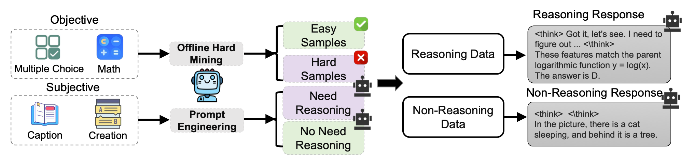
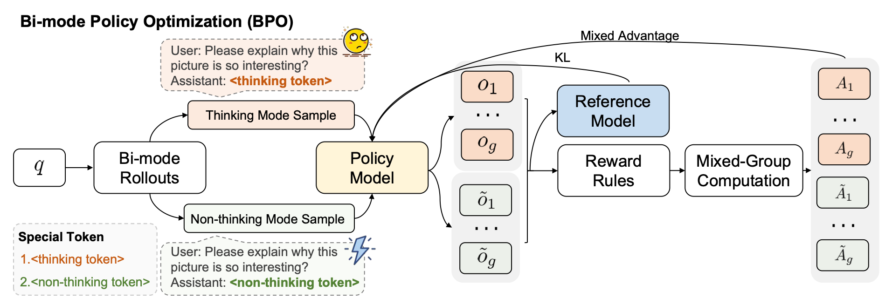
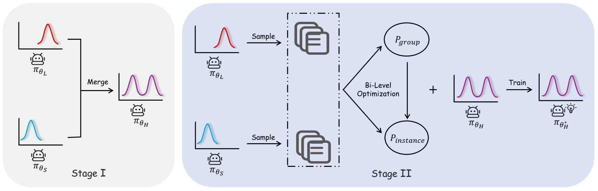
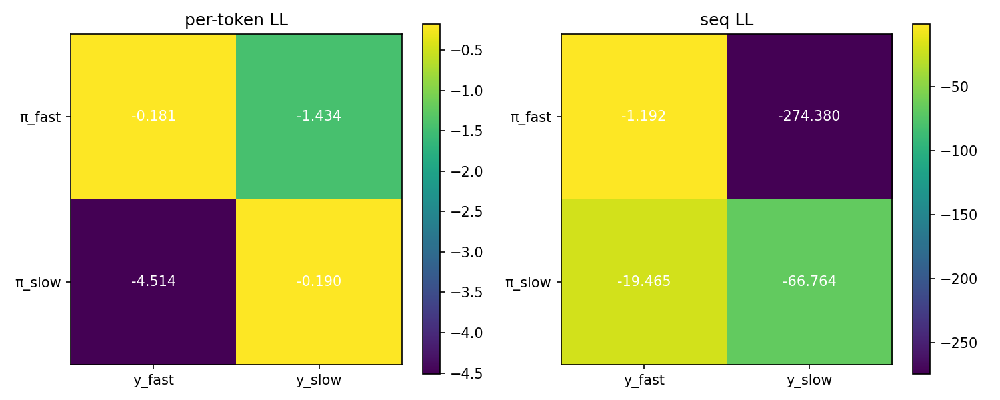

# Towards Efficient Closed-Loop Agents via Hybrid Reasoning

## Introduction

把具备长链推理能力的 LLM 和 VLM 接进机器人闭环（Robot-Use Agent, RUA），最直接的矛盾其实不在“能不能想明白”，而在“来不来得及想”。单轮问答里多吐几百个 thinking token 顶多慢上几秒，可放到连续交互的闭环里，每一步都要读新观测、调技能、等执行，物理环境不会停下来等模型把冗长的 CoT 慢慢写完；反过来，为了压延迟干脆关掉思考，遇到长视界规划、环境扰动或意外失败时又很容易走偏。这两年 LLM、VLM 和桌面 CUA 社区已经探出了不少让模型“该快就快、该慢再慢”的混合推理做法，这篇笔记想探讨的问题很直接：这些面向语言、多模态与桌面任务的 reasoning 加速方法，背后到底抓住了什么机制，又有多大机会迁移到 RUA 里？

沿着这条迁移线索，下文挑出五条代表性路线，依次拆解 RACE、R-4B、STEPWISE、Ada-R1 与 DR-BOLT 五篇代表工作。其中既有在多轮交互里通过在线 RL 按轮跳过冗余思考的方案，也有在多模态底座上靠 Bi-Mode Annealing 与均衡 rollout 训出 auto-thinking 的做法；既有不动底座权重、靠外置轻量 monitor 级联大小模型的事件驱动 routing，也有在 offline 阶段通过 Model Merging 或双参考分布对齐把快慢双模收进单模型的尝试。先把它们各自的问题建模与方法细节理清，才能进一步判断哪些机制可以直接搬进机器人闭环，哪些还需要针对物理执行重新改造。

## Multi-Turn Step-Level RL Reasoning Control

### RACE — Adaptive Reasoning via Cross-Turn Estimation

*2026 · [arXiv:2610.12061](https://arxiv.org/abs/2610.12061) · [GitHub](https://github.com/HututuAI/RACE)*

#### Abstract

> 多轮 agent 通常在每一轮动作前都重写一遍思考，可很多时候前几轮的规划已经把后面几步安排好了；直接在 RL 里惩罚总长度，又会把关键节点上必要的思考一起压扁。RACE 用一个廉价信号判断哪一轮可以不想：删掉这一轮的思考之后，后续参考动作的 log-likelihood 掉得多不多。据此标出可跳过的轮次，再用 Masked GRPO 和显式闭合监督让模型学会按需跳过。

#### Methodology

多轮轨迹写作 $\tau = (u, r_1, a_1, o_1, \dots, r_T, a_T)$，$r_t$ 是第 $t$ 轮的思考。要检验“删掉某轮思考后动作还对不对”，最直接的办法是反复和环境交互 rollout 重采样，代价太高。RACE 发现了一个好用的代理：删掉思考后，参考动作 $a_j^*$ 的 teacher-forcing 平均 log-likelihood 跌得越少，重采样时动作越能复现。于是“找出最少的必要思考”变成了一串前向 log-likelihood 检验。这个算法叫 LoGiC。它保留第一轮全局规划，从第二轮起依次尝试把 $r_t$ 换成空闭合符 $e$（直接输出 `</think>`），然后重新计算当前和之后所有轮次参考动作的 log-likelihood，看最大跌幅是否在容差 $\epsilon$ 之内：

$$
\begin{aligned}
\widetilde{\ell}_j^{(t)} &= \begin{cases} \ell_j^{(t-1)}, & j < t, \\
\ell\!\bigl(a_t^* \mid x^{(t)},\, e\bigr), & j = t, \\
\ell\!\bigl(a_j^* \mid x^{(t)},\, e,\, a_t^*,\, o_t,\, \tau_{t+1:j-1}^*,\, r_j\bigr), & j > t, \end{cases} \\[6pt]
\Delta_{\max}^{(t)} &= \max_{j \ge t}\bigl(\ell_j^{(t-1)} - \widetilde{\ell}_j^{(t)}\bigr) \le \epsilon
\end{aligned}
$$

$x^{(t)}$ 是已经压缩过的 prefix，$\ell^{(t-1)}$ 是上一步留下的基准 log-likelihood。条件满足，说明已保留的思考和观测足以支撑后续动作，这一轮思考就删掉，基准更新为 $\widetilde{\ell}^{(t)}$；否则保留它，作为新的推理锚点。每次判断都建立在前面已生效的删减之上，避免了各轮独立裁剪时的误差累积。下图画出了这个逐轮检验的过程。

训练分两步：先用 LoGiC 压缩后的稀疏轨迹做 SFT 冷启动，再做在线 RL。RACE 对成功的在线轨迹运行 LoGiC（失败轨迹按标准 GRPO 处理），标出可跳过轮集合 $S_i$，把其中的冗余思考 token 从 policy gradient 里 mask 剔除，防止 GRPO 继续强化多余思考，只对有效 token 集 $\mathcal{K}_i$ 求和，分母仍用总生成长度来稳定梯度量级；而单靠 mask 并不能教会模型主动停下来，因此在成功轨迹的可跳过轮上再加一项闭合 loss：

$$
\begin{aligned}
\mathcal{L}_{\mathrm{GRPO}}(\theta) &= -\frac{1}{\sum_{i \in \mathcal{B}} \lvert \mathcal{P}_i \rvert} \sum_{i \in \mathcal{B}} \sum_{k \in \mathcal{K}_i} \\[4pt]
&\;\; \min\!\Bigl(\rho_{i,k}\hat{A}_i,\, \operatorname{clip}\bigl(\rho_{i,k}, 1-\epsilon_{\mathrm{clip}}, 1+\epsilon_{\mathrm{clip}}\bigr)\hat{A}_i\Bigr), \\[6pt]
\mathcal{L}_{\mathrm{close}}(\theta) &= -\frac{1}{\sum_{i \in \mathcal{B}} T_i} \sum_{i \in \mathcal{I}_{\mathrm{succ}}} \sum_{t \in S_i} \log \pi_\theta\!\bigl(e \mid x_i^{(t)}\bigr), \\[6pt]
\mathcal{L}_{\mathrm{actor}}(\theta) &= \mathcal{L}_{\mathrm{GRPO}}(\theta) + \lambda\,\mathcal{L}_{\mathrm{close}}(\theta)
\end{aligned}
$$

$\rho_{i,k}$ 是 importance ratio，$\mathcal{P}_i$ 是第 $i$ 条轨迹的全部生成 token，$\lambda$ 控制闭合监督的强度。这样一来，“把锚点思考写好”和“跳过惯性思考”被拆成两件事分别优化。

## Bi-Mode Annealing and Balanced-Rollout RL — Auto-Thinking MLLMs

### R-4B — Auto-Thinking MLLM via Bi-Mode Annealing and Bi-Mode Policy Optimization

*2025 · [arXiv:2508.21113](https://arxiv.org/abs/2508.21113) · [GitHub](https://github.com/yannqi/R-4B)*

#### Abstract

> MLLM 一旦默认展开长链思考，在简单视觉识图或 OCR 查询上会产生大量冗余推理；若依靠手工标注难度或精细调节的 reward shaping 训练自适应切换，又容易在 RL 阶段发生 mode collapse。R-4B 提出两阶段训练范式：先以自动化双启发式数据筛选与 Bi-Mode Annealing 让单模型在同一模板下兼备 thinking 与 non-thinking 两种能力，再通过 Bi-Mode Policy Optimization（BPO）强制每个查询生成对等数量的双模 rollout 并纳入同一 GRPO 混合组对比优化，仅凭简洁的规则 reward 即可激发跨领域通用的 auto-thinking 切换能力。

#### Methodology

要让单个 MLLM 在通用多模态场景下自主决定是否思考，前提是底座本身已经扎实掌握 thinking 与 non-thinking 两种行为模式。R-4B 的第一阶段围绕 Bi-Mode Annealing 展开，先借助强 MLLM 标注器设计了两套免人工难度标注的数据划分启发式：对于答案可验证的客观题（如数学与选择题），采用基于表现的 offline hard mining，对每题多次采样，仅当全部尝试失败时划入 reasoning 数据，能够答对的简单题划入 non-reasoning 数据；对于难以直接核验正误的主观开放题（如看图描述与开放创作），则通过 prompt engineering 判别其内在复杂度。被划为 reasoning 的样本交由强多模态推理模型补全思维链，再经一致性检验、关键词过滤与去重清洗。

所有退火数据封装进统一的结构化输出模板，避免双模之间出现格式割裂：需要推理的样本写为 `<think>reasoning steps</think>answer`，适合直答的样本则保留空思考块写为 `<think> </think>answer`。随后把多领域 thinking 与 non-thinking 精料混合在一起执行单阶段 Bi-Mode Annealing，在 learning rate 衰减期同时把深思考与简洁直答揉进同一组权重，防止只训推理或串行两段训练带来的通用视觉能力遗忘。下图展示了这套自动化双模数据构建流程。

退火完成后得到的基座虽然分别具备双模能力，但直接开启 auto-thinking 推理时会出现明显的 thinking atrophy（思考萎缩）——由于退火数据里直答样本占比更高，模型面对复杂题也倾向偷懒输出空思考块。而直接沿用 vanilla GRPO 做在线 RL 又容易陷入单模偏置：一旦某一种模式在组内暂时占优，另一种模式的 rollout 数量就会迅速萎缩直至坍缩。

为在不引入复杂 reward engineering 的前提下根治 mode collapse，第二阶段提出 Bi-Mode Policy Optimization（BPO）。BPO 在 GRPO 框架内改写采样方式：对每个输入 query $q$，在前缀显式拼接模式专属 special token（`<thinking token>` 与 `<non-thinking token>`），强制策略确定性地生成两组等量回复——$g$ 条 thinking rollout $\{o_1, \dots, o_g\}$ 与 $g$ 条 non-thinking rollout $\{\tilde{o}_1, \dots, \tilde{o}_g\}$，并把全部 $2g$ 条轨迹合并进同一个 mixed group 里，统一依据简洁的数学规则正确性 reward 计算 token-level importance ratio $R_k$ 与组相对 advantage $A_k$：

$$
\begin{aligned}
o_k' &= \begin{cases} o_k, & 0 < k \le g, \\
\tilde{o}_{k-g}, & g < k \le 2g, \end{cases} \\[6pt]
\mathcal{J}_{\mathrm{BPO}}(\theta) &= \mathbb{E}_{q \sim P(Q)}\!\Biggl[\frac{1}{2g}\sum_{k=1}^{2g} \min\!\Bigl(R_k(o_k')\,A_k(o_k'), \\[2pt]
&\qquad\quad \operatorname{clip}\bigl(R_k(o_k'),\, 1 - \epsilon,\, 1 + \epsilon\bigr)\,A_k(o_k')\Bigr)\Biggr] \\[6pt]
&\quad - \beta\,D_{\mathrm{KL}}\!\bigl[\pi_\theta(\cdot \mid q) \,\Vert\, \pi_{\mathrm{ref}}(\cdot \mid q)\bigr]
\end{aligned}
$$

其中 $\epsilon$ 与 $\beta$ 分别控制 clip 区间与参考策略 KL 正则强度。通过在同题同组里强制对照两种路径的成败效用，模型清晰分辨出哪些题必须展开思考才能得分、哪些题直答即可拿满回报，且仅凭数学领域的规则 reward 便能将这种难度判别泛化至非数学通用多模态任务。下图描绘了 BPO 的双模采样与混合组优化架构。

推理阶段仅部署训练后的单模型，依据输入末尾附带的触发前缀即可灵活支持三种运行方式：附带 `<think>\n\n</think>` 强制快答，附带 `<think>\n` 强制慢想，而仅附带 `<think>` 时进入 auto-thinking 模式，由模型自己在下一 token 自主决定展开推导还是立刻闭合 `</think>` 直接作答。

## Dynamic Reasoning via Fast–Slow Routing — Event-Driven Cascade

### STEPWISE — Event-Driven Fast–Slow Cascade for Computer-Use Agents

*2026 · [arXiv:2604.27151](https://arxiv.org/abs/2604.27151)*

#### Abstract

> 在桌面和网页的长任务里，全程使用前沿大模型太慢也太贵，只用小模型又容易出两种毛病：在原地反复点击的进展停滞，以及漏掉条件却自信宣布完成的静默漂移。STEPWISE 让小模型默认推进，旁边挂两个轻量文本 monitor 扫描最近几步的推理与动作：发现卡死，就让大模型接管一步；发现到达子目标 milestone，就把 checkpoint 前后两张截图交给大模型审核。

#### Methodology

按固定周期切换大模型效率不高，因为小模型的失败有两种截然不同的样子。一种是外显的，轨迹变长，局部动作反复重复；另一种是隐蔽的，既不报错也不打转，只是漏掉关键条件后提前发出 `done`。两种失败需要两种探测方式。STEPWISE 把最近 $K$ 步的推理 $r$ 与动作 $a$ 压成纯文本窗口 $w_t$，省掉监控端的图像编码，在上面并行运行两个轻量的 ModernBERT 分类器：

$$
\begin{aligned}
w_t &= \bigl\{(r_{t-K+1}, a_{t-K+1}),\, \dots,\, (r_t, a_t)\bigr\}, \\[6pt]
p_t^{\mathrm{stuck}} &= S_\phi(w_t), \qquad p_t^{\mathrm{mile}} = M_\psi(u,\, w_t)
\end{aligned}
$$

Stuck Monitor $S_\phi$ 故意不看用户指令 $u$，只盯与任务无关的局部死循环，比如反复点击同一个无效坐标；Milestone Monitor $M_\psi$ 结合 $u$ 识别阶段边界，比如提交表单、保存文件或宣布完成。

milestone 概率越过阈值 $\theta_m$ 时，系统把用户指令、上一个 checkpoint $\tau_t$ 以来的推理动作片段和首尾两张截图 $(I_{\tau_t}, I_t)$ 交给大模型 Verifier $V_{\mathrm{large}}$。审核通过，checkpoint 更新为当前步，小模型继续；审核不通过，或者卡死概率越过 $\theta_s$，就由大模型亲自生成下一步动作，再交还控制权：

$$
\begin{aligned}
v_t &= V_{\mathrm{large}}\!\bigl(u,\, \{(r_k, a_k)\}_{k=\tau_t+1}^{t},\, I_{\tau_t},\, I_t\bigr) \in \{0, 1\}, \\[6pt]
E_{t+1} &= \mathbb{I}\!\Bigl[p_t^{\mathrm{stuck}} \ge \theta_s \;\lor\; \bigl(p_t^{\mathrm{mile}} \ge \theta_m \land v_t = 0\bigr)\Bigr], \\[6pt]
m_{t+1} &= \begin{cases} \pi_{\mathrm{large}}, & E_{t+1} = 1, \\
\pi_{\mathrm{small}}, & E_{t+1} = 0 \end{cases}
\end{aligned}
$$

两路信号各管一类失败：Stuck Monitor 拦不住语义跑偏，Milestone Verifier 管不住局部死循环，并联起来才能同时堵住两个口子，而大模型只在这些事件发生时才被调用。

## Model Merging for Hybrid Reasoning — Weight Fusion and Bi-Level DPO

### Ada-R1 — Hybrid-CoT via Bi-Level Adaptive Reasoning Optimization

*NeurIPS 2025 · [arXiv:2504.21659](https://arxiv.org/abs/2504.21659) · [GitHub](https://github.com/StarDewXXX/AdaR1)*

#### Abstract

> Long-CoT 模型面对简单题目也会习惯性展开冗长的反思与验算，可如果只在长推理模型自身内部做长度惩罚或剪枝，模型依然困在“先绕一大圈再作答”的分布里，很难真正切回简洁短链路。Ada-R1 改用“先融合、再 bi-level 对齐”的两阶段路线：先将同源的 Long-CoT 模型与 Short-CoT 模型做线性 weight merging，得到同时覆盖两种思维风格的单模型底座；再用 group-level 偏好教它按题目难度决定走长链还是短链，用 instance-level 偏好在选定风格内压缩多余步骤，把快慢双模收进同一组参数里。

#### Methodology

从单分布 Long-CoT 模型出发做压缩，探索空间天然偏向长链。Ada-R1 的第一阶段先用最直接的线性 weight merging，把 Long-CoT 模型 $\theta_L$ 和 Short-CoT 模型 $\theta_S$ 合成一个混合底座 $\theta_H$：

$$
\theta_H = \alpha\,\theta_L + (1 - \alpha)\,\theta_S, \qquad \alpha \in [0, 1]
$$

融合后的策略 $\pi_{\theta_H}$ 同时保留了长链深度探索与短链直答的能力，让后续对齐不必从零塑造另一种输出风格，也不依赖外部 router。下图概括了融合与 bi-level DPO 训练的完整流程。

但单纯融合后的模型并不知道哪道题该长想、哪道题该短答。第二阶段构造两类互补的偏好数据。对训练集中的每道题 $x$，先分别从原长模型 $\theta_L$ 和短模型 $\theta_S$ 各采样 $K$ 条解答 $\{y_i^L\}_{i=1}^K$ 与 $\{y_j^S\}_{j=1}^K$，用 Monte Carlo 估计两组风格在这道题上的期望正确率 $\hat{\mathbb{E}}[C^L(x)]$ 与 $\hat{\mathbb{E}}[C^S(x)]$。只有当长链的正确率优势超过边界阈值 $\epsilon$ 时，才把长风格组 $g_L$ 选为更优组（$g_L \succ g_S$），否则偏爱更省算力的短风格组 $g_S$（$g_S \succ g_L$），并从两组的笛卡尔积中抽取跨组偏好对构成数据集 $\mathcal{D}_{\mathrm{group}}$：

$$
\begin{aligned}
\hat{\mathbb{E}}\bigl[C^m(x)\bigr] &= \frac{1}{K}\sum_{i=1}^{K}\mathbb{I}\bigl[\mathrm{Correct}(y_i^m)\bigr], \quad (m \in \{L, S\}), \\[4pt]
g^*(x) &= \begin{cases} g_L, & \hat{\mathbb{E}}[C^L(x)] - \hat{\mathbb{E}}[C^S(x)] > \epsilon, \\
g_S, & \text{otherwise} \end{cases}
\end{aligned}
$$

选出最优风格组 $g^*(x)$ 之后，组内样本的长度仍然参差不齐。因此在 $g^*$ 组内继续构造 instance-level 偏好 $\mathcal{D}_{\mathrm{instance}}$，挑出最短的正确解答作为正样本 $y_w$，与该组内最长的 $M_2$ 条解答配对，把两种风格各自内部的冗余展开再拧干一层。最后把两份数据合并，以融合模型为参考策略 $\pi_{\theta_{\mathrm{ref}}}$，通过最大化统一的 DPO 目标一步优化：

$$
\begin{aligned}
y_w &= \operatorname*{arg\,min}_{y \in \{y_i\}_{g=g^*}^{\mathrm{correct}}} \, \lvert y \rvert, \\[6pt]
y_l &\in \operatorname*{arg\,max}_{y \in \{y_i\}_{g=g^*}}{}^{\!(M_2)} \, \lvert y \rvert, \\[6pt]
\mathcal{J}_{\mathrm{Ada\text{-}R1}}(\theta_H) &= \mathbb{E}_{(x, y_w, y_l) \sim \mathcal{D}_{\mathrm{group}} \cup \mathcal{D}_{\mathrm{instance}}} \\[4pt]
&\quad \Biggl[\log \sigma\!\Biggl(\beta\log\frac{\pi_{\theta_H}(y_w \mid x)}{\pi_{\theta_{\mathrm{ref}}}(y_w \mid x)} \\[4pt]
&\qquad\quad - \beta\log\frac{\pi_{\theta_H}(y_l \mid x)}{\pi_{\theta_{\mathrm{ref}}}(y_l \mid x)}\Biggr)\Biggr]
\end{aligned}
$$

group-level 偏好负责“跨风格选档位”，instance-level 偏好负责“同风格去冗余”。两者合在同一套 offline DPO 里，使单个模型就能根据输入复杂度内生切换长短推理。

## Dual-Reference Offline Alignment — Boltzmann Projection for Fast–Slow VLMs

### DR-BOLT — Dual-Reference Offline Optimization for Adaptive VLM Reasoning

*NeurIPS 2026 · [arXiv:2611.09154](https://arxiv.org/abs/2611.09154) · [GitHub](https://github.com/HongbinLin3589/DR-BOLT)*

#### Abstract

> VLM 学会长链推理之后，面对简单的视觉识别也会惯性展开冗长反思。想用 offline 数据教单模型该快就快、该慢就慢，难点在于快直答和慢推理分别采自不同的 behavior policy，只拿其中一个当参考，模型就会整体坍缩到全快或全慢。DR-BOLT 把 offline 快慢对齐写成双参考 Boltzmann 投影问题：以快慢两策略的混合分布作为目标参考，在样本权重里补入仅取决于样本来源的校正常数，并让两种模式的 partition function 自然竞争，从而在无需外挂 router 与在线 rollout 的前提下让单个 VLM 内生习得快慢切换。

#### Methodology

先看单参考 offline 对齐为何会坍缩。面对图文输入 $x$，快策略 $\pi_{\mathrm{f}}$ 直接输出简短答案 $y_{\mathrm{f}}$，慢策略 $\pi_{\mathrm{s}}$ 先写 `<think>` 推理链再作答 $y_{\mathrm{s}}$。下图展示了两个 behavior policy 互相打分的 cross log-likelihood 热力图：慢策略在回答开头强烈偏置 `<think>`，导致快答案在首个 token 即遭遇 prefix 格式壁垒；反过来，快策略对长推理链每个 token 略低的似然在数百个 token 上累乘，使单参考权重比在常见低精度格式下直接下溢归零。只要沿用单一参考策略，另一侧模态就会被指数级压制。

DR-BOLT 的解法是用先验权重 $\alpha(x) \in (0, 1)$ 构造目标混合参考分布 $\rho{(y \mid x)} = \alpha(x)\pi_{\mathrm{f}}{(y \mid x)} + {(1 - \alpha(x))}\pi_{\mathrm{s}}{(y \mid x)}$，配合兼顾正确性 $r_{\mathrm{acc}}$、格式合法性 $r_{\mathrm{fmt}}$ 与归一化长度 $\ell(y)$ 的标量 reward $r{(x, y)} = r_{\mathrm{acc}}{(x, y)} + \gamma r_{\mathrm{fmt}}(y) - \lambda \ell(y)$。在温度 $\beta > 0$ 的 KL 正则目标下，最优策略是 $\rho$ 上的 Boltzmann 重加权闭式解 $\pi_{\mathrm{DR}}^\star{(y \mid x)} \propto \rho{(y \mid x)}\exp{(r(x, y)/\beta)}$。把总 partition function 按两种模式拆为 $Z_{\mathrm{f}}(x)$ 与 $Z_{\mathrm{s}}(x)$ 并对快模态求边缘概率，便自然导出免外挂 router 的配分竞争切换律：

$$
\begin{aligned}
Z_m(x) &= \mathbb{E}_{y \sim \pi_m(\cdot \mid x)}\!\Bigl[\exp\!\bigl(r(x, y)/\beta\bigr)\Bigr],\; m \in \{\mathrm{f}, \mathrm{s}\}, \\[6pt]
P^\star(z = \mathrm{f} \mid x) &= \frac{\alpha(x)\,Z_{\mathrm{f}}(x)}{\alpha(x)\,Z_{\mathrm{f}}(x) + \bigl(1 - \alpha(x)\bigr)\,Z_{\mathrm{s}}(x)}
\end{aligned}
$$

当题目简单、快慢两路都能答对时，快答更小的长度惩罚令 $Z_{\mathrm{f}}(x)$ 胜出；当视觉关系复杂、快答容易出错时，正确率回报差距令 $Z_{\mathrm{s}}(x)$ 占优。实际 offline 训练时，候选池按经验采样比例 $q(x)$ 采自行为混合分布 $\mu{(y \mid x)} = q(x)\pi_{\mathrm{f}}{(y \mid x)} + {(1 - q(x))}\pi_{\mathrm{s}}{(y \mid x)}$。对 forward KL 做测度变换会引入行为–参考密度比 $\kappa{(x, y)} = \rho{(y \mid x)}/\mu{(y \mid x)}$；得益于快慢格式在支撑集上几乎分离（跨模式交叉似然比极小），$\kappa{(x, y)}$ 无需再跑双模型前向打分，直接简化为仅取决于样本来源的模态常数近似 $\widehat{\kappa}{(x, y)}$。结合 Monte Carlo 混合配分估计 $\widehat{Z}_\rho(x)$，模型只需在离线池 $\mathcal{D}_{\mathrm{DR}}$ 上最小化 weighted NLL：

$$
\begin{aligned}
\widehat{\kappa}(x, y) &= \begin{cases} \dfrac{\alpha(x)}{q(x)}, & y \sim \pi_{\mathrm{f}}, \\[12pt]
\dfrac{1 - \alpha(x)}{1 - q(x)}, & y \sim \pi_{\mathrm{s}}, \end{cases} \\[8pt]
\mathcal{L}_{\mathrm{DR\text{-}BOLT}}(\theta) &= -\mathbb{E}_{(x, y) \sim \mathcal{D}_{\mathrm{DR}}}\!\Biggl[\frac{\widehat{\kappa}(x, y)\exp\!\bigl(r(x, y)/\beta\bigr)}{\widehat{Z}_\rho(x)} \\[4pt]
&\qquad\qquad\quad \cdot \log\pi_\theta(y \mid x)\Biggr]
\end{aligned}
$$

这样既把单模型快慢分配收束为纯 offline weighted SFT，又从分布层面根除了单参考失配引发的模式坍缩。

## Synthesis — Composing the Five Hybrid-Reasoning Paradigms

上述五项工作从五个正交层次切入闭环 agent 的快慢混合推理，在介入时机、训练成本与多模态扩展性上形成清晰互补。在多轮在线 RL 层面，RACE 通过跨轮动作 log-likelihood 覆盖估计与 Masked GRPO 实现按轮按需的思考剪枝；在通用多模态双模训练层面，R-4B 通过 Bi-Mode Annealing 统一双模底座并以强制等量 rollout 的 BPO 仅凭数学规则 reward 激发跨领域 auto-thinking；在外置 routing 层面，STEPWISE 面向桌面长视界任务以轻量事件 monitor 级联大小模型，无需微调底座权重即可按事件唤醒强模型；在单模型 offline 后训练层面，Ada-R1 经由长短参数线性 weight merging 与 bi-level DPO、DR-BOLT 经由双参考 Boltzmann 投影分别从权重空间与分布空间赋予单模型内生的快慢切换能力。五类机制分别作用于步级策略学习、退火与双模采样、外置级联调度、参数融合与分布对齐，共同构成了面向闭环 agent 的高效混合推理技术栈。

## References

*When Should Agents Think? Adaptive Reasoning via Cross-Turn Estimation*. 2026. [arXiv:2610.12061](https://arxiv.org/abs/2610.12061)

*R-4B: Incentivizing General-Purpose Auto-Thinking Capability in MLLMs via Bi-Mode Annealing and Reinforce Learning*. 2025. [arXiv:2508.21113](https://arxiv.org/abs/2508.21113)

*Step-level Optimization for Efficient Computer-use Agents*. 2026. [arXiv:2604.27151](https://arxiv.org/abs/2604.27151)

*Ada-R1: Hybrid-CoT via Bi-Level Adaptive Reasoning Optimization*. NeurIPS 2025. [arXiv:2504.21659](https://arxiv.org/abs/2504.21659)

*Learning When to Think: Dual-Reference Offline Optimization for Adaptive VLM Reasoning*. NeurIPS 2026. [arXiv:2611.09154](https://arxiv.org/abs/2611.09154)
