# Towards Efficient Robot-Use Agents via Efficient Reasoning

## Why Robot-Use Agents Need Efficient Reasoning

我们关注由 LLM/VLM 直接生成动作的 robot-use agent：模型读取图像与机器人状态，输出末端位姿等动作指令，控制器执行后返回新观察。一次动作会改变环境，新的反馈又会改变下一步决策所需的信息。长任务因此需要持续分配推理计算，而每一步的推理需求并不相同。

在这篇文章中，我们从多轮 agent，尤其是 computer-use 的研究中整理可以借鉴的机制。两者都通过“观察 → 决策 → 执行 → 新观察”推进任务；computer-use 已围绕上下文管理、计算分配和模型协作形成具体方案。我们先讲清这些方案在原任务中的运行方式、训练信号与实验证据，最后讨论迁移到机器人时需要重新验证的条件。

我们的关注点是完整任务的效率：推理节省的时间，需要与摘要、调度、核验及执行等开销一起计算，并与任务成功率共同评价。减少 token、降低计算量和缩短总耗时分别对应不同证据。

## Four Routes to Efficient Reasoning

上下文长度、推理预算、重复思考和模型分工对应四类资源开销：

1. **Context Management：** CompactionRL、ContextBudget。压缩交互历史，在有限上下文窗口中继续执行长任务。
2. **Adaptive Compute Allocation：** TAB、CogRouter。根据当前交互选择推理预算或认知深度。
3. **Reasoning Reduction and Reuse：** PUMA、RACE。截去冗余生成，保留对当前及后续动作有用的思考。
4. **Model Collaboration and Execution：** STEPWISE、SpecAgent。按事件升级模型，或让强模型批量核验小模型草稿。

我们按主要干预位置组织这四类方法。上下文管理改变模型每轮读取的信息；计算分配决定当前投入多少思考；推理削减与复用减少重复生成；模型协作调整生成和核验的分工。这些机制可以组合，但各自报告的窗口容量、token 数、模型调用和真实耗时仍需分别理解。文末综述提供了工具 agent 的上下文、调用、推理与执行视角。

下文各节的 Abstract 为原论文摘要的中文转述，其中“我们”沿用论文作者的口吻；方法解读和最后的迁移讨论另行展开。

## Context Management

这一类改变交互历史的保存方式。CompactionRL 将摘要与执行联合训练，ContextBudget 将剩余容量和新观察长度纳入压缩决策。

### CompactionRL — Jointly Learn Execution and Compaction

#### Abstract

> 长任务 agent 的交互轨迹可能在任务完成前超过上下文上限。将已有交互压缩为摘要，再从压缩上下文继续执行，是延长任务轨迹的自然途径；但如何把这一过程纳入强化学习，仍缺少充分研究。
>
> 在这篇文章中，我们提出 CompactionRL，将任务执行与摘要生成联合优化。训练结合 token 级损失归一化和跨段广义优势估计，使策略能够从包含多次上下文压缩的长轨迹中学习。在两个规模的开放底座上，实验均显示 agent 编程任务的表现优于仅在推理时压缩的底座，说明压缩行为本身也可以通过训练得到改善。

#### Method and RL Recipe

CompactionRL 联合优化任务执行与摘要生成，两者共享最终任务回报。

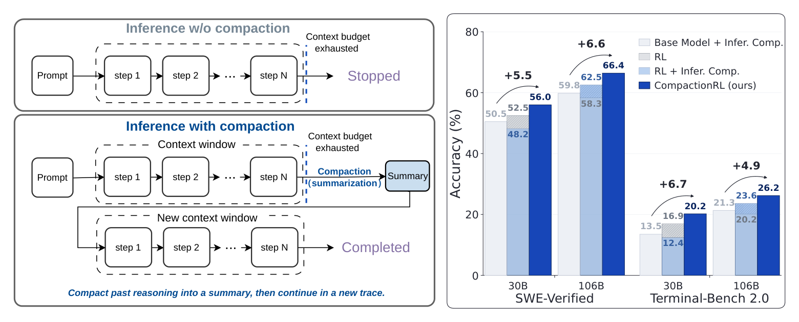

上下文剩余容量低于阈值时，同一个策略生成摘要，再从“摘要＋最近交互”继续执行。每个动作与工具反馈作为完整单元保留，默认逐字保留最近两轮。

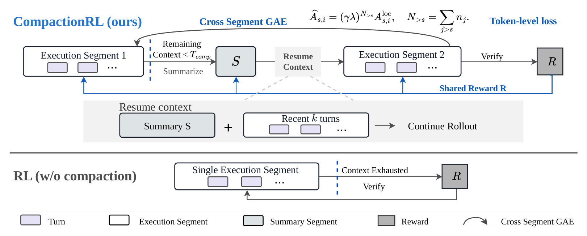

训练按 §3.1–3.2 的顺序进行：

1. 每个问题采样一条完整 rollout，执行过程中允许触发多次 compaction。
2. 将 rollout 切成执行段与摘要段，保存各段生成 token、old log-probability 和 loss mask。
3. 用最终任务正确性给整条 rollout 计分，执行段和摘要段共享该回报。
4. critic 在各段上下文上预测价值，计算本段的局部 GAE，再按后续段的 token 数做位置修正。
5. 汇总执行与摘要的有效生成 token，计算 PPO actor loss 和 critic loss。观察、重复的上下文前缀不参与策略损失。

设 $s$ 为分段编号，$k$ 为段内 token 位置，$n_s$ 为本段参与优化的 token 数。后续段的 token 总数为 $N_{>s}$：

$$
\begin{aligned}
N_{>s}&=\sum_{j>s}n_j,\\
\widehat A_{s,k}
&=(\gamma\lambda)^{N_{>s}}A^{\mathrm{loc}}_{s,k}.
\end{aligned}
$$

$A^{\mathrm{loc}}_{s,k}$ 是用本段价值估计和 TD residual 得到的局部 GAE；$\gamma$ 为折扣，$\lambda$ 为 GAE 参数。位置修正让较早段的终局回报按实际距离衰减。它是便于各段并行处理的近似，不递归重建后续各段的全部 TD residual。

PPO 更新对所有有效 token 统一归一化：

$$
\begin{aligned}
\rho_{s,k}
&=\frac{\pi_\theta(y_{s,k}\mid x_{s,k})}
{\pi_{\mathrm{old}}(y_{s,k}\mid x_{s,k})},\\
\overline\rho_{s,k}
&=\operatorname{clip}(\rho_{s,k},1-\epsilon,1+\epsilon),\\
\ell_{s,k}
&=\min(\rho_{s,k}\widehat A_{s,k},
\overline\rho_{s,k}\widehat A_{s,k}),\\
\mathcal L_\pi
&=-\frac1{|\mathcal M|}\sum_{(s,k)\in\mathcal M}\ell_{s,k}.
\end{aligned}
$$

$x_{s,k}$ 是该 token 的上下文，$\mathcal M$ 包含执行段和摘要段的有效 assistant token，$\epsilon$ 是裁剪宽度。按 token 归一化，避免分段数量直接决定一条 rollout 的权重。

Appendix A.2 中，actor 与 critic 从同一底座初始化，critic 增加标量价值头。actor 学习率为 $2\times10^{-6}$，critic 为 $3\times10^{-6}$，每次策略更新配两次 critic 更新。

#### Results

v2 在相同峰值上下文下比较训练与推理 compaction。GLM-4.7-Flash 使用 64K 窗口，相对仅在推理时压缩的底座，SWE-bench Verified 的 200 题子集由 50.5% 提高到 56.0%，Terminal-Bench 2.0 由 13.5% 提高到 20.2%。

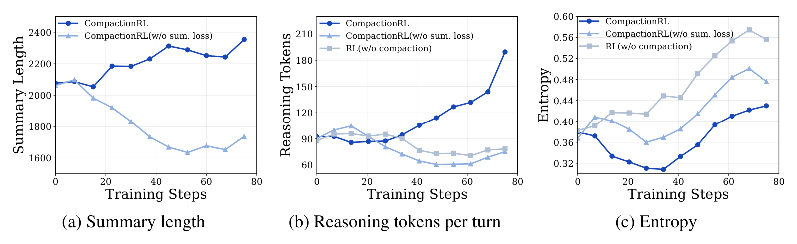

摘要参与训练后变得更详细，任务成功率随训练提升。去掉摘要损失、token 归一化或跨段修正的消融用于检验各部分作用。这些结果支持固定窗口下的长任务质量提升，尚未给出逐步推理的延迟收益。

### ContextBudget — Manage History Before Loading Observations

#### Abstract

> LLM agent 能够执行长程推理，但部署时的显存、延迟和成本限制了可用上下文。随着交互历史不断增长，保留既有信息与遵守窗口限制之间的矛盾日益突出，压缩决策需要考虑当前还剩多少容量，以及新的观察将占用多少空间。
>
> 在这篇文章中，我们提出预算感知的上下文管理框架 BACM，将历史压缩建模为受上下文预算约束的序贯决策。agent 在载入新观察前评估剩余预算，决定何时压缩、压缩多少历史。进一步提出的 BACM-RL 通过端到端课程强化学习，在逐渐变化的上下文预算下学习压缩策略。组合多目标问答和长程网页浏览实验显示，该方法在不同模型规模、任务复杂度与窗口预算下均具有优势。

#### Method and RL Recipe

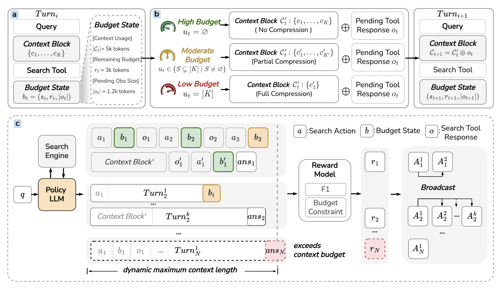

在读取新观察的内容前，agent 先获得当前剩余容量与新观察的 token 长度，再决定如何处理旧历史。设上下文窗口为 $B$，历史缓冲区为 $\mathcal C_t$，待加载观察为 $o_t$：

$$
\begin{aligned}
r_t&=B-|\mathcal C_t|,\\
u_t&\sim\pi_\theta(\cdot\mid s_t,r_t,|o_t|),\\
\mathcal C_{t+1}&=\mathcal C'_t\oplus o_t,\\
|\mathcal C'_t|&\le B-|o_t|.
\end{aligned}
$$

$s_t$ 是当前推理状态，$r_t$ 是剩余 token 容量；$u_t$ 选择不压缩、聚合部分历史块或聚合全部历史块。$\mathcal C'_t$ 是处理后的历史，$\oplus$ 表示追加观察。选择要聚合的历史块后，模型生成合并摘要替换这些块。决策时可见观察长度，内容要等处理完成后才载入。

BACM-RL 用多轮 GRPO 联合更新压缩决策与任务生成：

1. 用二目标组合 QA 构造训练任务，采样同题的多条完整交互轨迹。
2. 计算最终答案的 F1；若轨迹任一轮超过当前阶段窗口限制，将该轨迹奖励置为 0。
3. 在同题 rollout 组内标准化奖励，将同一轨迹优势分配给各轮生成 token。
4. 使用 clipped policy objective 与参考策略 KL 更新模型。
5. 逐阶段收紧窗口，沿用当前模型继续训练。

在课程阶段 $j$，奖励为：

$$
\begin{aligned}
\widetilde R_i^{(j)}
&=\begin{cases}
R_i,&\forall t:\ |\mathcal C_{i,t}|\le B^{(j)},\\
0,&\text{otherwise},
\end{cases}\\
\widehat A_i^{(j)}
&=\frac{\widetilde R_i^{(j)}-\mu_j}{\sigma_j+\varepsilon}.
\end{aligned}
$$

$R_i$ 是答案 F1，$\mu_j,\sigma_j$ 由当前同题组的预算约束奖励计算，$\varepsilon$ 用于数值稳定。模型同时生成压缩操作与任务响应，两类 token 都参与训练。

Appendix A.5 的课程共有 300 个更新，每阶段 60 个，窗口依次为 8,192、7,168、6,144、5,120、4,096 token；组内采样 5 条 rollout，actor 学习率为 $10^{-6}$。评测扩展到更多目标的组合题与 BrowseComp-Plus。

#### Results

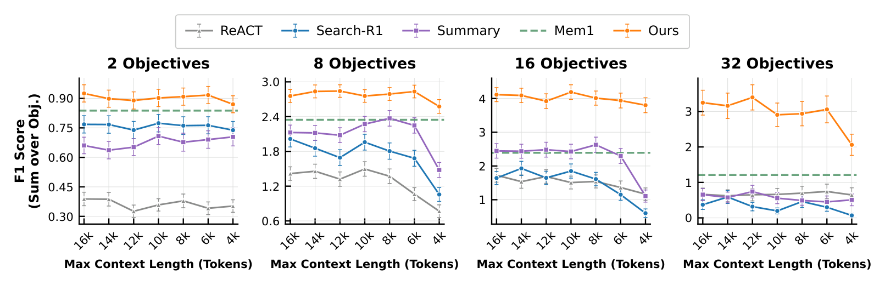

组合题的累计 F1 为各子目标 F1 之和，取值上限等于目标数。实验在 16K–4K 窗口下比较该指标，并分别去掉预算信息、延迟加载和递减窗口课程。指标同时反映任务完成质量与受限窗口下的信息保留。

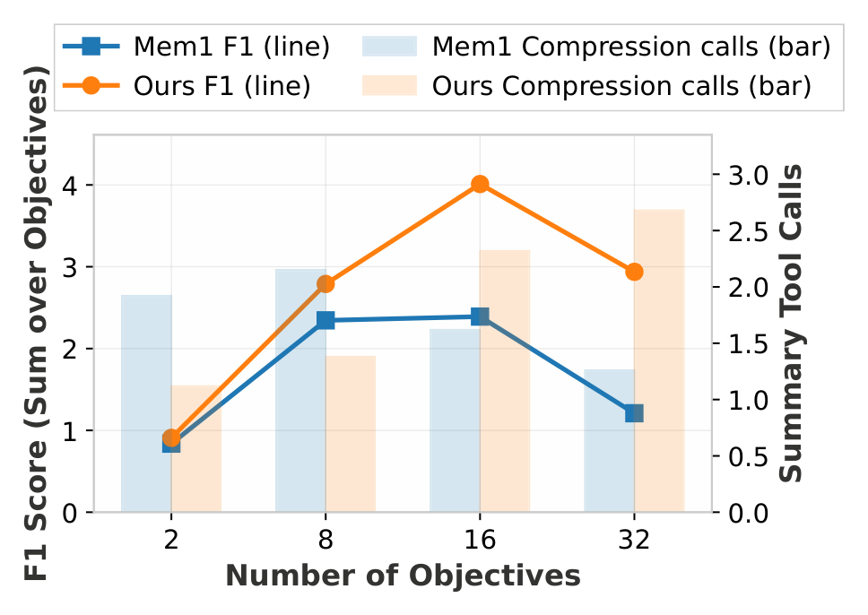

固定 8K 窗口时，二目标任务相对 MEM1 的平均压缩调用从 1.92 降到 1.12，累计 F1 从约 0.84 提高到 0.91。目标数增多后，方法增加压缩调用以维持任务表现；节省资源与保留信息随任务负载共同变化。

## Adaptive Compute Allocation

这一类决定当前轮次使用多少推理。TAB 输出外部预算，CogRouter 在同一策略中选择认知层级并生成动作。

### TAB — Allocate Budgets Across Turns

#### Abstract

> 长推理模型在简单问题上也会生成过多思考，带来额外 token 与延迟。已有长度正则、动态路由和按难度分配预算的方法主要面向单轮任务，难以直接处理多轮交互的序贯依赖：某一轮花费多少计算，还会影响后续关键步骤能够获得的预算。
>
> 为此，我们提出 TAB，将多轮推理建模为带有全局 token 约束的序贯计算分配问题。预算策略根据交互历史，为不同轮次分配思考预算，在任务准确率与总计算开销之间权衡。我们先在分层规划与执行的数学推理系统上训练，再将同一策略直接用于工具调用、模拟对话和终端任务。数学实验最多节省 35% token 与 30% 延迟，迁移实验最多节省 20% token 与 15% 延迟，同时保持任务准确率。

#### Method and RL Recipe

TAB 分开使用 Budgeter 和 Solver。每轮 Budgeter 根据历史与当前输入输出难度档位，再映射成 Solver 的 token 预算或 reasoning-effort 设置。Solver 在这个设置下生成回答，新的反馈进入下一轮。

每轮的预算选择与回答生成分别为：

$$
b_t\sim\pi_\phi(\cdot\mid h_t),
\qquad
y_t\sim f_\theta(\cdot\mid h_t;b_t).
$$

$t$ 是交互轮次；$h_t$ 包括当前输入与之前的交互；$\phi$ 是预算策略参数，$\theta$ 是 Solver 参数。RL 更新 Budgeter，Solver 提供预算动作后的反馈。

训练数据来自 MATH 训练集的 Level-5 问题。Planner 先分解问题，Budgeter 逐轮选择档位，固定的 Solver 在对应预算下生成回答。训练只更新 Budgeter。完成训练后，同一预算策略直接用于 BFCL、Tau-Bench 和 Terminal-Bench。

训练用 GRPO：

1. 同一道训练题采样多条完整交互，每条使用不同的预算分配序列。
2. 到终局检查答案，同时统计实际消耗的 Solver token。
3. 根据全局预算计算奖励，在同题轨迹组内标准化。
4. 将轨迹优势用于该轨迹中所有预算决策的 clipped policy 更新。

训练使用实际消耗的 token。记第 $t$ 轮消耗为 $n_t$，轨迹奖励为：

$$
R_i=S_i-\lambda\max\!\left(0,\sum_t n_{i,t}-B\right).
$$

$S_i$ 是终局正确性，$B$ 是整项任务的目标预算，$\lambda$ 是超额成本系数。低于 $B$ 时成本项为零，策略可以把预算集中到关键轮次。

$$
\widehat A_i
=\frac{R_i-\operatorname{mean}_{j\in\mathcal G(x)}R_j}
{\operatorname{std}_{j\in\mathcal G(x)}R_j}.
$$

$\mathcal G(x)$ 是同一道题的完整轨迹组。**同一条轨迹的各轮共享这个优势**；它学习哪些整体分配方案更好，尚未给每一轮提供独立的因果贡献估计。

Qwen3-4B Budgeter 使用 LoRA rank 64、学习率 $10^{-5}$，训练 125 个更新。全局预算 $B\in\{3k,5k,8k,10k\}$ 各自对应一个独立策略。模型输出 0–4 五个档位，映射到 Solver 的 256–4096 token 预算。

数学任务中的预算分布如下；全局预算收紧时，小预算档位的使用比例上升。

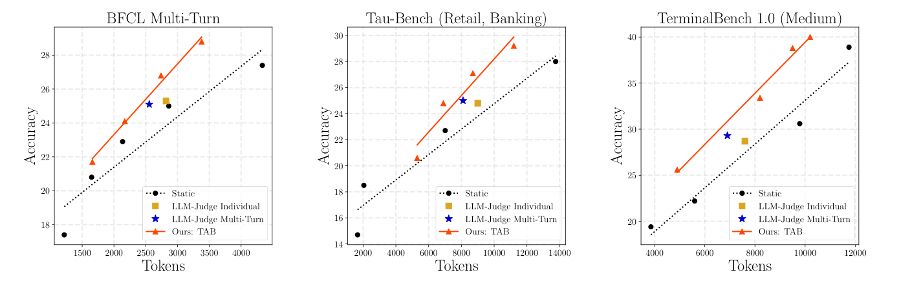

迁移实验最多节省约 20% token 与 15% 延迟，计时包含 Budgeter 开销。两张图分别给出准确率与总 token、准确率与端到端延迟的关系。

### CogRouter — Choose Cognitive Depth at Each Step

#### Abstract

> 现有多轮 agent 往往采用固定的认知模式：非思考模型每步立即响应，思考模型每步都进行深度推理。长任务中，不同步骤的需求却差异很大，既包含常规执行，也包含反思与战略规划；固定模式难以让计算投入与当前步骤的需求相匹配。
>
> 在这篇文章中，我们提出 CogRouter，使 agent 逐步调整认知深度。基于 ACT-R 理论，我们设计从直觉响应到战略规划的四个层级，先用 CoSFT 建立稳定的层级行为，再用 CoPO 根据动作置信度重分配优势，进行步骤级信用分配。其核心依据是：合适的认知深度应当提高后续动作的置信度。ALFWorld 与 ScienceWorld 的实验显示，这种训练能够同时改善任务表现与推理效率。

#### Method and RL Recipe

四个层级依次对应直接响应、当前状态分析、结合执行历史的反思、评价候选动作未来影响。每轮按 `<level>`、`<think>`、`<action>` 的结构生成。

CoSFT 使用 GPT-4o 的成功轨迹。在每步均衡随机指定一个层级，再让专家根据历史和固定参考动作补写该层级的思考，对完整结构化输出做交叉熵训练。

CoPO 随后执行：

1. 当前策略与环境交互，采样同题多条完整轨迹。
2. 计算任务成功与格式奖励，再得到组相对优势。
3. 对成功轨迹的每一步，固定观察与动作，补生成四种层级的思考。
4. 对同一个参考动作做 teacher-forced scoring，比较四种思考下的平均动作 token log-probability。
5. 将分数标准化并转换成 softmax 权重，重新分配该步优势，再用 clipped policy loss 更新层级、思考与动作 token。

轨迹奖励为任务成功与格式检查的乘积：

$$
R_i=R_i^{\mathrm{task}}R_i^{\mathrm{format}}.
$$

两个因子均为 0/1；任何一步格式不符合要求，格式项就为 0。$\widehat A_i$ 由同题轨迹组的奖励计算。

在成功轨迹 $i$ 的第 $t$ 步，层级 $c$ 的思考与历史构成 $h_{i,t}^{(c)}$。固定参考动作 $a_{i,t}$ 有 $M_{i,t}$ 个 token，其置信度为：

$$
C_{i,t}^{(c)}=\frac1{M_{i,t}}
\sum_{k=1}^{M_{i,t}}
\log\pi_\theta\!\left(a_{i,t,k}\mid h_{i,t}^{(c)},a_{i,t,<k}\right).
$$

$c\in\{1,2,3,4\}$ 是层级编号。对同一步四个分数标准化，再计算权重：

$$
\begin{aligned}
\widetilde C_{i,t}^{(c)}
&=\frac{C_{i,t}^{(c)}-\mu_{i,t}}{\sigma_{i,t}},\\
w_{i,t}^{(c)}
&=\frac{\exp(\eta\widetilde C_{i,t}^{(c)})}
{\sum_{b=1}^{4}\exp(\eta\widetilde C_{i,t}^{(b)})},\\
\widehat A_{i,t}^{(c)}
&=w_{i,t}^{(c)}\widehat A_i.
\end{aligned}
$$

$\mu_{i,t},\sigma_{i,t}$ 仅由该步四个层级的置信度计算；$\eta$ 控制分布尖锐程度，原文设为 2。失败轨迹不扩展四组思考，继续使用原轨迹优势。CoPO 保留组相对优势，没有 learned critic。

#### Results

ALFWorld、ScienceWorld 的实验同时比较任务表现、token 数和层级分布。图中 CoPO 随任务进度及复杂度调整层级；标准 GRPO 更集中于最深层。四种思考是在固定参考动作上比较置信度，未分别重新执行为四条环境分支。

## Reasoning Reduction and Reuse

PUMA 处理单次生成中的语义冗余，RACE 检查已有思考对后续动作的持续支持。

### PUMA — Stop When Reasoning Converges

#### Abstract

> 长推理模型经常在解法已经稳定后继续生成，增加 token 消耗与等待时间。已有早停方法主要依赖答案置信度或试答一致性；这些信号反映答案是否就绪，却可能在探索和自我修正完成前触发，损害最终正确性与保留推理链的语义完整性。
>
> 我们将推理步骤的语义冗余作为补充信号：当连续步骤不再带来新进展，而是反复验证已有结论时，推理更可能已经收敛。基于这一观察，PUMA 用轻量冗余检测器寻找候选退出点，再用答案级核验确认停止条件。在五个推理模型和五个基准上的实验中，该方法平均减少 26.2% token，同时保持答案正确性与保留 CoT 的质量。代码生成和视觉语言推理实验进一步检验了这一信号的适用范围。

#### Method and Training Recipe

PUMA 用推理步骤的语义冗余定位候选退出点，再核验答案，截去收敛之后的重复生成。

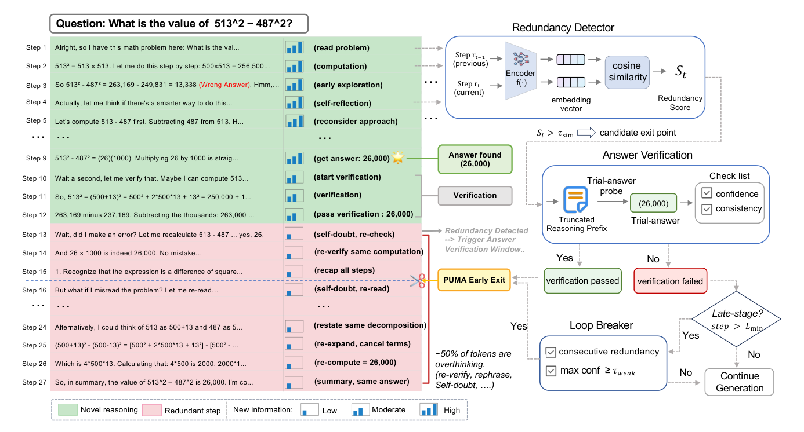

**Redundancy Detector Training**

PUMA 的主推理模型保持冻结，另行训练 Qwen3-Embedding-0.6B 冗余检测器。Appendix B.2 的数据与训练流程为：

1. 从四个长推理模型收集 AMC23、GSM8K 推理轨迹，并加入 Open-Thoughts-114K，覆盖约 5,098 道不同问题。
2. 切分推理步骤，用 GPT-5-mini 标注当前步骤相对前文是否带来新信息，得到 40,844 条种子样例。
3. 用 GPT-4o-mini 将新颖步骤改写为语义冗余版本，扩充重复、重述和无进展验证等模式。
4. 整理为 anchor、冗余正样本、新颖负样本，去重后得到 701,641 条对比训练数据。
5. 用 InfoNCE 训练检测器：LoRA rank 32、学习率 $10^{-4}$、5 epochs。冗余步骤被拉近，有新进展的步骤被拉远。

**Inference-Time Exit**

在线流程是：

1. 按自然段或步骤边界切分当前 CoT。
2. 检测器比较当前步骤与最近的历史步骤，标出可能冗余的位置。
3. 仅在这些候选位置，从当前前缀诱导一个试答，取得答案及其 token 置信度。
4. 在后续候选位置继续试答，检查答案一致、置信度足够且没有明显下降。
5. 检查通过就结束思考；否则继续生成。晚期持续重复时，另有带最低置信度门槛的 Loop Breaker。

将当前推理步骤记为 $r_t$，检测器记为 $f$，回看窗口为 $k$：

$$
s_t=\max_{\max(1,t-k)\le j<t}
\cos\!\left(f(r_j),f(r_t)\right).
$$

$s_t$ 超过相似度阈值时，只产生候选退出点。原文默认 $k=1$。试答的置信度来自其 token 概率的几何平均；连续候选之间还要比较答案一致性。这个二阶段结构把较便宜的检测放在前面，减少试答调用。

原文同时统计检测、试答和总耗时。在 DS-7B、DS-14B 上，平均加速分别约为 1.40×、1.28×。部分对照因频繁试答而更慢，说明检测触发频率直接影响时间收益。

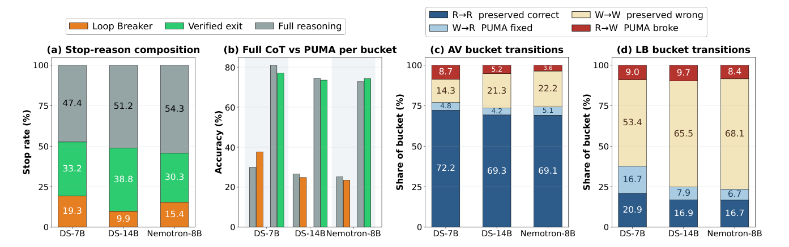

退出行为进一步分为核验通过、Loop Breaker 和完整生成。上图同时比较各分组的答案正确性，检查早停是否打断自我修正。

**Model Internalization**

§6.2 与 Appendix F 使用 12K 道数学训练题，让底座生成完整 CoT，再运行 PUMA 记录候选退出点与通过核验的停止点。随后分别构造：

- **SFT：** 保留提前退出后仍正确、且前缀长度低于完整 CoT 的 60% 的样例，约 6.5K 条；训练目标是截断推理与答案。
- **DPO：** 长短版本都正确时，以 PUMA 截断链为 chosen、完整链为 rejected，约 5.8K 对。
- **GRPO：** 将问题、候选位置前缀和结束思考标记拼成输入，约 15K 条；每个输入采样 4 个答案 completion。

三种训练均在 DS-R1-Distill-Qwen-7B 上使用 LoRA rank 64。GRPO 的 rollout 从给定前缀后的答案阶段开始，奖励为：

$$
R_i=c_i\!\left[1+0.5\!\left(1-\frac{\ell_i}{4096}\right)\right]
+b_i^{\mathrm{rank}}.
$$

$c_i$ 表示答案正确性，$\ell_i$ 是该前缀之后的 completion 长度，$b_i^{\mathrm{rank}}$ 是组内排序奖励，取值为 $\{0.5,0.25,0,-0.25\}$，偏好更短的正确 completion。原文用 GRPO 更新，比较相同 recipe 下的固定位置前缀。

GRPO 训练最多 1,500 个更新，学习率 $10^{-6}$，completion 上限为 4,096 token。训练后的变体直接用 vLLM 推理，不调用冗余检测器和答案核验模块。训练中的长度项统计给定前缀之后的答案阶段。

### RACE — Preserve Cross-Turn Reasoning Support

#### Abstract

> LLM agent 通常在每次行动前推理，但较早轮次的思考能够继续支持后续动作，因此每轮重新思考并非总有必要。关键在于判断已有思考何时仍然充分、何时需要补充，同时避免逐次生成动作进行验证所带来的高开销。
>
> 在这篇文章中，我们观察到，删除额外思考后，后续参考动作的似然下降与这些动作能否被恢复密切相关。基于这一轻量信号，我们提出 RACE：先用 LoGiC 渐进识别对当前及后续参考动作影响较小的可删除思考，再将删除信号用于 SFT 和 agentic RL，使策略学会选择思考或直接行动。四个 agent 基准上的实验显示，该方法能够显著降低推理 token 开销，同时保持或改善任务表现。

#### Method and RL Recipe

原文先删除部分思考，检查后续参考动作是否仍能生成，再比较动作恢复率与似然下降的关系。

似然下降较小时，参考动作通常仍可恢复。RACE 用这个关系构造跨轮推理删减信号。

LoGiC 从已有轨迹出发，保留第一轮思考，从第二轮起依次尝试删除。一次删除需要同时通过当前及后续参考动作的检查；已接受的删除会进入下一次评估的上下文。

先对固定参考动作做 teacher-forced scoring：

$$
\ell(a_j^*\mid h)
=\frac1{M_j}\sum_{k=1}^{M_j}
\log\pi_\theta(a_{j,k}^*\mid h,a_{j,<k}^*).
$$

$a_j^*$ 是原轨迹第 $j$ 轮动作，$M_j$ 是其 token 数。这个量来自已有动作的前向打分，无需重新生成多个候选动作。

在当前已经压缩的轨迹上，尝试删除第 $t$ 轮思考。定义：

$$
\begin{aligned}
d_j^{(t)}&=
\ell_{j,\mathrm{before}}^{(t)}
-\ell_{j,\mathrm{after}}^{(t)},\\
\mathrm{SKIP}_t=1
&\iff \max_{j\ge t}d_j^{(t)}\le\varepsilon_{\mathrm{del}}.
\end{aligned}
$$

before、after 分别表示本次删除前后的上下文，后续参考动作和观察保持原样。阈值 $\varepsilon_{\mathrm{del}}$ 控制允许的似然下降。已接受的删除会保留在下一次检查的上下文中。

**Supervised Fine-Tuning**

1. 使用 DeepSeek-V4-Pro-0813 标注的成功轨迹。
2. 由 Qwen3.5-9B 运行 LoGiC，似然下降阈值设为 $0.001$。
3. 删除通过检查的思考，保留动作和观察，构成 THINK／SKIP 混合轨迹。
4. 对模型生成的思考与动作 token 计算交叉熵，得到 RACE-SFT checkpoint。

**Agentic Reinforcement Learning**

1. 从 RACE-SFT 初始化，在同一任务上采样多条完整轨迹。每批 16 个任务、每个任务 8 条，共 128 条轨迹。
2. 计算任务回报和组相对优势。对成功轨迹运行 LoGiC，得到 SKIP 轮次；失败轨迹沿用普通 GRPO。
3. **Reasoning masking：** SKIP 轮次的思考 token 不进入 GRPO 策略损失，动作 token 继续参与。归一化分母保留原始 token 数。
4. **Reasoning closure：** 在 SKIP 轮次的压缩上下文上，将结束思考 token 作为监督目标，提高立即结束当前思考段的概率，随后继续生成动作。
5. 联合计算 masked GRPO 与 closure 损失，更新同一策略模型。

mask 移除 SKIP 思考 token 的策略梯度项；closure 在同一压缩上下文上监督结束思考的 token，使模型学会直接进入动作生成：

$$
\begin{aligned}
\mathcal L_{\mathrm{close}}
&=-\frac1{\sum_iT_i}
\sum_{i\in\mathcal I_{\mathrm{succ}}}
\sum_{t\in\mathcal S_i}
\log\pi_\theta(e\mid\widetilde h_{i,t}),\\
\mathcal L_{\mathrm{actor}}
&=\mathcal L_{\mathrm{GRPO,masked}}
+\lambda_{\mathrm{close}}\mathcal L_{\mathrm{close}}.
\end{aligned}
$$

$T_i$ 是轨迹轮数，$\mathcal I_{\mathrm{succ}}$ 是成功轨迹集合，$\mathcal S_i$ 是 LoGiC 判为 SKIP 的轮次；$e$ 是思考终止 token，$\widetilde h_{i,t}$ 是对应压缩上下文。closure 使用目标 token 的交叉熵。其权重在 ScienceWorld、WebShop、AppWorld 中设为 0.02，在 DeepSearch 中设为 0.01。RL 学习率为 $10^{-6}$，每批 rollout 更新 1 epoch。

与标准 SFT＋GRPO 相比，RACE-SFT-RL 在四个基准上的任务表现差距均不超过 1.40 个百分点，推理 token 分别减少 32.3%、80.2%、46.4% 和 62.0%。这里统计的是整条轨迹的推理 token，不能直接换算为机器人任务的时间收益。

在相同底座的消融中，RACE 相对普通 SFT＋GRPO 减少约 32%–80% 的推理 token，四个基准上的成功率变化不超过 1.4 个百分点。效率指标是推理 token 数。

## Model Collaboration and Execution

这一类调整大小模型的执行分工。STEPWISE 用事件触发升级和核验，SpecAgent 用片段核验减少强模型串行生成。

### STEPWISE — Escalate at Events

#### Abstract

> computer-use agent 可以直接操作 GUI，但强模型几乎参与每一步，使实际部署仍然昂贵且缓慢。长程 GUI 轨迹包含大量常规步骤，错误则往往集中在少数高风险时刻，主要表现为进展停滞，以及动作局部合理却已偏离任务目标的语义漂移。统一分配计算难以适应这种步骤间差异。
>
> 我们提出事件驱动的步骤级级联框架：默认由小策略执行，轻量学习式监测器发现风险后，再调用强模型。Stuck Monitor 检测进展恶化并触发恢复，Milestone Monitor 选择适合稀疏核验的语义检查点。框架可以叠加在现有 agent 上，无需重新训练大型策略模型。OSWorld 与 WebArena 的实验显示，它能恢复始终使用强模型的大部分任务表现，并减少强模型调用、延迟与费用。

#### Method and Training Recipe

小模型默认执行，两个 ModernBERT 监测器分析最近的推理与动作记录：

- **Stuck Monitor** 读局部历史，检测循环、重复与停滞。
- **Milestone Monitor** 额外读任务要求，选择有意义的进展检查点。

Stuck 超阈值后，下一步交给强策略恢复。Milestone 超阈值后，先让强验证器检查“上次核验到现在”的任务进展：输入包括任务、分段动作记录，以及当前和上次检查点的截图；检查通过就继续使用小模型，失败才升级。

checkpoint 用于选择核验位置。监测器的训练目标是事件分类。

Appendix B 使用 300 条 GUI 执行轨迹训练两个 ModernBERT-base 分类器：

1. 每条轨迹由 GPT-5.2 独立标注 5 次，分别识别 stuck 和 milestone。
2. 至少 3 次标为正例的步骤保留为正例；5 次都未标中的保留为负例；只出现 1–2 次的样例丢弃。
3. 输入包含当前步骤及最多 5 个前序步骤；milestone 输入额外包含任务描述。
4. 在 `[CLS]` 表征上接二分类头，用逆类别频率加权的交叉熵训练。
5. 两个分类器各训练 5 epochs，AdamW 学习率为 $5\times10^{-5}$，最大序列长度为 2,048。

运行时，两个监测器读取文本推理与动作记录；只有触发 milestone 后的强核验才读取截图。

OSWorld 与 WebArena 的消融分别启用 stuck、milestone 和两种监测器，完整配置取得最高成功率。原文还比较固定间隔核验；成本表中的延迟按单次请求统计。

### SpecAgent — Draft, Verify, and Repair

#### Abstract

> 工具 agent 的长交互通常由单个强模型逐步生成，尽管大量常规步骤可以由小模型处理。已有路由和协作方法仍按查询或步骤分配生成工作；推测方法通常逐步核验草稿，并以强模型自身的动作为参照，强模型仍承担较多串行生成。
>
> 我们提出 SpecAgent，让小模型起草、强模型审核多步片段。小模型可以执行只读调用，取得真实观察，遇到会修改环境的动作时暂停；强模型一次读入整段，接受语义上有效的最长前缀，并修复首个错误。并行 prefill 因而替代了一部分自回归解码，强模型只需生成短判定与必要修复。在 τ²-Bench 上，成功率与强模型相差不到一个百分点，内存流量和耗时约减半；其他基准则在降低开销的同时恢复了部分大小模型间的质量差距。

#### Execution Protocol

SpecAgent 让小模型起草多步片段，由强模型一次读入并核验。强模型只生成短判定与必要修复，以并行 prefill 替代一部分自回归解码。

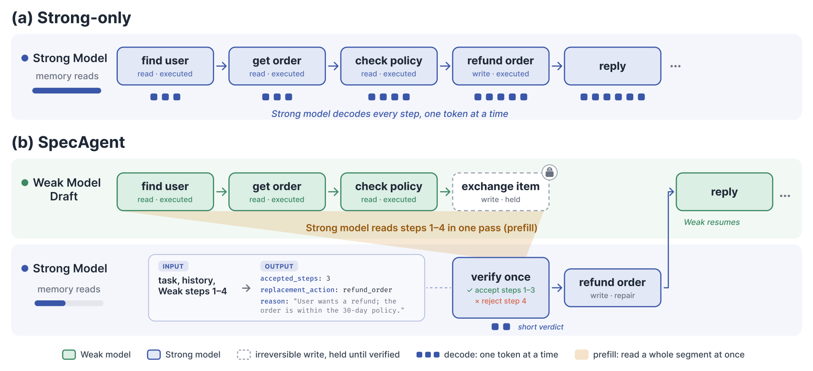

两个模型保持冻结，按以下协议交互：

1. **Draft：** 小模型连续起草；只读工具调用可以执行并取得真实结果，后续步骤依赖这些实际观察。
2. **Hold：** 遇到第一个会修改环境的动作，将其暂存，并结束当前草稿段。
3. **Verify：** 强模型读历史和整段草稿，返回语义上可接受的最长前缀，以及首个错误的解释和可选替换动作。
4. **Commit or repair：** 全部通过才执行暂存动作；被拒绝的后缀丢弃，必要时由强模型补一个修复步骤，再从已提交历史重新起草。

纯只读片段达到长度上限时，原文允许不经强核验直接提交。核验标准是动作能否合理推进任务，允许接受与强模型自身选择不同的有效动作。

原文用强模型的权重读取次数近似解码成本。设一段有 $n$ 步、每步被接受的概率约为 $p$，强模型完整生成一步需 $d$ 次权重读取，而短核验需 $v$ 次。若拒绝后额外调用强模型修复的概率为 $q$，强模型成本相对值为：

$$
\mathcal R=
\frac{1-p}{1-p^n}\frac{v}{d}
+q(1-p).
$$

在同一近似下，若小模型起草一步的耗时是强模型生成一步的 $\kappa$ 倍，总延迟相对值为：

$$
\mathcal L=
\mathcal R+
\kappa\frac{n(1-p)}{1-p^n}.
$$

$q$ 表示额外修复调用的概率。成本模型假设强模型处于 decode-bound 的服务区间、片段内接受近似独立，并忽略工具时间。较短判定、较高接受率和更快的小模型都会降低相对延迟。

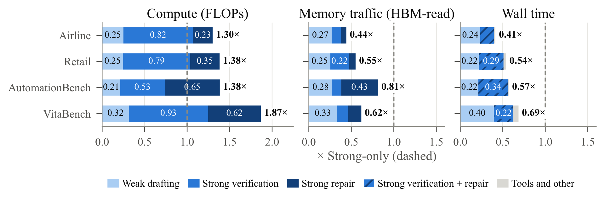

原文用相同大小模型部署和相同并发比较不同协议，并计入草稿、拒绝片段、核验、修复与重试。其 Table 2 中，Airline 的成功率均为 86.0%，平均任务时间从 305.2 秒降至 126.2 秒；其他任务的质量恢复程度不一致。

FLOPs 和 HBM-read 按请求 token 与模型架构估算，耗时实际计量。SpecAgent 的估算 FLOPs 可以上升：强模型对草稿做较大的并行 prefill，同时减少反复读取权重的逐 token 解码。下图进一步改变核验边界、修复方式和语义接受标准：额外核验每个片段会增加开销，取消融合修复或语义核验也会降低成功率。

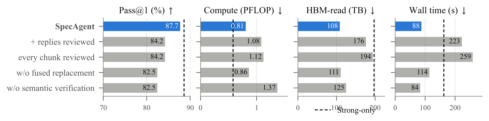

## Transfer to Robot Use

这些工作分别改变历史表示、每轮计算、思考保留和模型分工。我们希望迁移的是这些控制计算的机制，而迁移后的收益需要在图像、本体状态、执行反馈与实际动作构成的闭环中重新验证。

首先，上下文压缩需要保留任务约束、已完成步骤和最新物体状态。我们应检查压缩后能否继续完成任务，以及摘要本身花费的时间。Context Management 中的结果主要支持有限窗口下的任务质量，部署时还需要单独测量总耗时。

其次，预算分配、早停与跨轮复用都依赖对当前信息是否充分的判断。我们需要把这类判断与执行结果联系起来：停止思考后，动作是否仍正确；复用过去的推理时，环境变化是否使其中的依据失效。原论文中的动作似然与语义冗余是可借鉴的信号，其在机器人闭环中的可靠性仍需实验验证。

最后，模型协作受到动作可执行性的约束。机械臂动作会改变环境，后续观察依赖真实执行；因此，SpecAgent 中连续执行只读调用的条件不能直接套用于连续物理操作。我们可以比较事件触发的强模型介入与固定频率介入，检验恢复能力和额外核验开销。

如果后续采用 PPO，我们需要先明确更新的是推理调度策略、动作策略，还是二者。调度动作、可见反馈、任务回报和计算成本确定后，再设计对应的优势估计与更新。评测在相同动作接口和环境预算下进行，同时报告完整任务成功率、异常恢复率和总耗时，并计入摘要、调度、核验、重试及失败轨迹的成本。

## References

- Yujiang Li et al. **CompactionRL: Reinforcement Learning with Context Compaction for Long-Horizon Agents.** First released 2026-07-06; version 2607.05378v2, 2026-10-01. [Paper](https://arxiv.org/html/2607.05378v2). §3.1–3.2, Table 2, §4.3, Appendix A.2.
- Yong Wu et al. **ContextBudget: Budget-Aware Context Management for Long-Horizon Search Agents.** 2604.01664v1, 2026-04-02. [Paper](https://arxiv.org/html/2604.01664v1). §3.1–3.3, §4.4–4.5, Appendix A.5.
- Neharika Jali et al. **Not All Turns Are Equally Hard: Adaptive Thinking Budgets For Efficient Multi-Turn Reasoning in Agents.** First released 2026-04-06; version 2604.05164v4, 2026-11-15. [Paper](https://arxiv.org/html/2604.05164v4). §3.3, §4.3, Appendix A.
- Ruihan Yang et al. **Think Fast and Slow: Step-Level Cognitive Depth Adaptation for LLM Agents.** First released 2026-02-13; reviewed ICML 2026 proceedings, PMLR 306. [Proceedings](https://proceedings.mlr.press/v306/yang26cz.html). §3.3–3.4, Algorithm 1, Figure 5, Table 5.
- Dehai Min et al. **Stop When Reasoning Converges: Semantic-Preserving Early Exit for Reasoning Models.** 2605.17672v1, 2026-05-17. [Paper](https://arxiv.org/html/2605.17672v1). §3, §5.2, §6.2, Appendix F.
- Yiruo Cheng et al. **When Should Agents Think? Adaptive Reasoning via Cross-Turn Estimation.** 2610.12061v1, 2026-10-08. [Paper](https://arxiv.org/html/2610.12061v1). §3.1–3.3, Table 2, Figure 4.
- Jinbiao Wei et al. **Step-level Optimization for Efficient Computer-use Agents.** 2604.27151v1, 2026-04-29. [Paper](https://arxiv.org/html/2604.27151v1). §4, §6, Appendix B.
- Zilin Wang et al. **Trajectory-Level Speculation with Semantic Verification for Tool-Using Agents.** 2610.21463v1, 2026-10-15. [Paper](https://arxiv.org/html/2610.21463v1). §3.2–3.3, Table 2, §5.

Taxonomy reference: Yunuo Hu et al. **How to Make Tool-Using LLM Agents Efficient? A Survey.** Preprints.org v1, posted 2026-08-06. [Survey](https://www.preprints.org/manuscript/202608.0365). §3: tool context, calling, reasoning, and execution.
