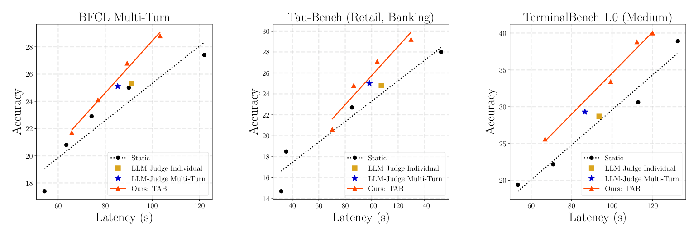
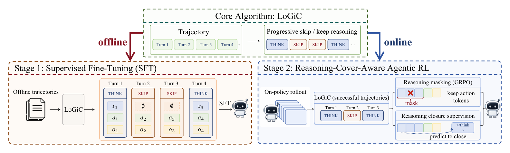
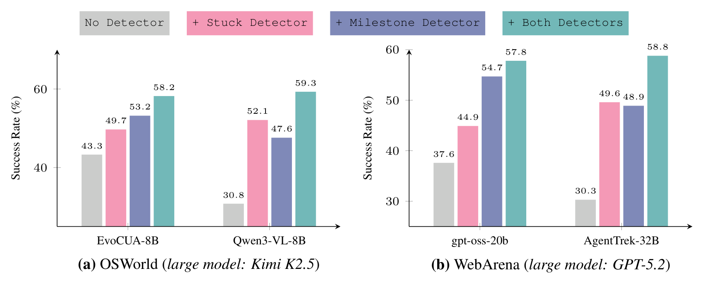

# Adaptive Reasoning: From Computer Use to Robot Use

## Why Robot Use Needs Adaptive Reasoning

考虑一个闭环：模型读取相机画面与机器人状态，生成末端位姿 JSON，控制器执行，再把实际结果送回模型。夹爪顺利接近杯子时，下一步可能只需沿用计划；抓取落空、杯子被碰动时，模型需要重新判断位置、接触状态与后续动作。

推理调度的目标是根据执行状态分配计算，同时保持完整任务的成功率。

computer-use 与 robot-use 都通过“观察 → 决策 → 执行 → 新观察”推进任务。机器人还受到接触、动力学和感知误差的影响，动作结果需要通过新的观察确认。

## Where Acceleration Comes From

- **Adaptive Budgets — TAB：** 根据交互历史分配每轮推理预算。
- **Early Exit — PUMA：** 检测推理冗余，在答案通过核验后提前停止。
- **Cross-Turn Reuse — RACE：** 利用历史推理对后续动作的支持，省略重复思考。
- **Selective Escalation — STEPWISE：** 小模型执行常规步骤，强模型处理异常与关键核验。
- **Speculative Verification — SpecAgent：** 小模型起草多步，强模型批量审核。

TAB、PUMA、RACE 减少重复或过量推理；STEPWISE、SpecAgent 调整大小模型的分工。生成量、成功率与耗时共同决定加速收益。

## Adaptive Budgets — TAB

### Problem

多轮任务的预算存在前后依赖：前面少花一点，可能节省计算，也可能因为漏掉约束导致后面反复补救。每轮独立估计难度，无法充分评价这种影响。

TAB 将整条交互视为预算分配问题，优化**完成任务与总预算之间的折中**。

### Method and RL Recipe

TAB 分开使用 Budgeter 和 Solver。每轮 Budgeter 根据历史与当前输入输出难度档位，再映射成 Solver 的 token 预算或 reasoning-effort 设置。Solver 在这个设置下生成回答，新的反馈进入下一轮。

每轮的预算选择与回答生成分别为：

$$
b_t\sim\pi_\phi(\cdot\mid h_t),
\qquad
y_t\sim f_\theta(\cdot\mid h_t;b_t).
$$

$t$ 是交互轮次；$h_t$ 包括当前输入与之前的交互；$\phi$ 是预算策略参数，$\theta$ 是 Solver 参数。RL 更新 Budgeter，Solver 提供预算动作后的反馈。

原文只在便宜的多轮数学任务上训练 Budgeter，随后不再微调，迁移到 BFCL、Tau-Bench、Terminal-Bench。预算策略在这些环境上保持冻结。

训练用 GRPO：

1. 同一道训练题采样多条完整交互，每条使用不同的预算分配序列。
2. 到终局检查答案，同时统计实际消耗的 Solver token。
3. 根据全局预算计算奖励，在同题轨迹组内标准化。
4. 将轨迹优势用于该轨迹中所有预算决策的 clipped policy 更新。

训练使用实际消耗的 token。记第 $t$ 轮消耗为 $n_t$，轨迹奖励为：

$$
R_i=S_i-\lambda\max\!\left(0,\sum_t n_{i,t}-B\right).
$$

$S_i$ 是终局正确性，$B$ 是整项任务的目标预算，$\lambda$ 是超额成本系数。低于 $B$ 时成本项为零，策略可以把预算集中到关键轮次。

$$
\widehat A_i
=\frac{R_i-\operatorname{mean}_{j\in\mathcal G(x)}R_j}
{\operatorname{std}_{j\in\mathcal G(x)}R_j}.
$$

$\mathcal G(x)$ 是同一道题的完整轨迹组。**同一条轨迹的各轮共享这个优势**；它学习哪些整体分配方案更好，尚未给每一轮提供独立的因果贡献估计。

训练配置为 Qwen3-4B Budgeter、LoRA rank 64、125 个更新；每个全局目标预算分别训练一个策略。下图展示数学任务中的预算分布：预算收紧时，策略增加较小预算的使用比例。

迁移实验最多节省约 20% token 与 15% 延迟，计时包含 Budgeter 开销。两张图分别给出准确率与总 token、准确率与端到端延迟的关系。

### Transfer to Robot Use

在 robot-use 中，预算策略可以读取当前图像、执行历史与动作反馈，选择下一轮推理强度。

TAB 的跨域实验主要使用文本交互状态。迁移到机器人需要处理图像、接触与物体位移，并检验预算档位对控臂模型的作用。

Budgeter 本身还会增加延迟。对小型控臂模型，额外跑一次 4B Budgeter 可能不划算。实验应固定动作底座，对照轻量选择器与固定预算，统计整项任务耗时。

## Early Exit — PUMA

### Problem

模型可能很早就给出一个稳定答案，但后面的推理仍在发现约束或修正漏洞。只看答案置信度，会把“已经有答案”和“已经完成必要推理”混在一起。

原文用示意图区分答案就绪与推理收敛：置信度和答案一致性可能较早变高，步骤语义相似度则在重复验证阶段持续升高。

PUMA 据此用语义冗余定位候选退出点，再核验答案，截去收敛之后的重复生成。

### Method and Training Recipe

主方法在推理时运行，底座模型保持冻结。训练对象是一个从 Qwen3-Embedding-0.6B 初始化的冗余检测器：用对比学习区分“语义接近但有新进展”和“重复已有结论”的推理步骤，避免直接把通用 embedding 相似度当作逻辑冗余。

在线流程是：

1. 按自然段或步骤边界切分当前 CoT。
2. 检测器比较当前步骤与最近的历史步骤，标出可能冗余的位置。
3. 仅在这些候选位置，从当前前缀诱导一个试答，取得答案及其 token 置信度。
4. 在后续候选位置继续试答，检查答案一致、置信度足够且没有明显下降。
5. 检查通过就结束思考；否则继续生成。晚期持续重复时，另有带最低置信度门槛的 Loop Breaker。

将当前推理步骤记为 $r_t$，检测器记为 $f$，回看窗口为 $k$：

$$
s_t=\max_{\max(1,t-k)\le j<t}
\cos\!\left(f(r_j),f(r_t)\right).
$$

$s_t$ 超过相似度阈值时，只产生候选退出点。原文默认 $k=1$。试答的置信度来自其 token 概率的几何平均；连续候选之间还要比较答案一致性。这个二阶段结构把较便宜的检测放在前面，减少试答调用。

原文同时统计检测、试答和总耗时。在 DS-7B、DS-14B 上，平均加速分别约为 1.40×、1.28×。部分对照因频繁试答而更慢，说明检测触发频率直接影响时间收益。

退出行为进一步分为核验通过、Loop Breaker 和完整生成。上图同时比较各分组的答案正确性，检查早停是否打断自我修正。

原文随后比较三种训练方式：

- PUMA-SFT 训练正确的截断推理与答案。
- PUMA-DPO 在长短回答都正确时，偏好 PUMA 截断版本。
- **PUMA-RL 提供已经截断并闭合思考的前缀，让模型只生成答案阶段。**

RL 的四条同前缀采样使用：

$$
R_i=c_i\!\left[1+0.5\!\left(1-\frac{\ell_i}{4096}\right)\right]
+b_i^{\mathrm{rank}}.
$$

$c_i$ 表示答案正确性，$\ell_i$ 是该前缀之后的 completion 长度，$b_i^{\mathrm{rank}}$ 是组内排序奖励，取值为 $\{0.5,0.25,0,-0.25\}$，偏好更短的正确 completion。原文用 GRPO 更新，比较相同 recipe 下的固定位置前缀。

这组实验检验 PUMA 选出的前缀能否改善后续生成。RL 中受奖励的长度是答案阶段的 completion；自主选择退出位置仍需单独验证。

### Transfer to Robot Use

在固定当前观察的一轮决策中，可以从部分 CoT 诱导动作，检验推理继续展开时动作是否变化，以及最终执行是否成功。

但两个坐标 JSON 很相似，不代表动作正确；文本推理重复，也可能是反复检查关键接触条件。机器人中的“可停止”最终需要与完整任务成功和异常恢复联系起来。反复试动作与试答的成本也需计入总耗时。

用 PPO 学习自主停止时，需要加入继续／停止决策，并用后续动作的执行结果评价该决策。

## Cross-Turn Reuse — RACE

### Problem

前一轮形成的计划可以支持后面几轮动作。逐轮独立删掉看似多余的思考，可能忽略它对后续动作的作用；每次都重新采样动作来验证，又会增加训练成本。

原文先删除部分思考，检查后续参考动作是否仍能生成，再比较动作恢复率与似然下降的关系。

似然下降较小时，参考动作通常仍可恢复。RACE 用这个关系构造跨轮推理删减信号。

### Method and RL Recipe

LoGiC 从已有轨迹出发，保留第一轮思考，从第二轮起依次尝试删除。一次删除需要同时通过当前及后续参考动作的检查；已接受的删除会进入下一次评估的上下文。

先对固定参考动作做 teacher-forced scoring：

$$
\ell(a_j^*\mid h)
=\frac1{M_j}\sum_{k=1}^{M_j}
\log\pi_\theta(a_{j,k}^*\mid h,a_{j,<k}^*).
$$

$a_j^*$ 是原轨迹第 $j$ 轮动作，$M_j$ 是其 token 数。这个量来自已有动作的前向打分，无需重新生成多个候选动作。

在当前已经压缩的轨迹上，尝试删除第 $t$ 轮思考。定义：

$$
\begin{aligned}
d_j^{(t)}&=
\ell_{j,\mathrm{before}}^{(t)}
-\ell_{j,\mathrm{after}}^{(t)},\\
\mathrm{SKIP}_t=1
&\iff \max_{j\ge t}d_j^{(t)}\le\varepsilon_{\mathrm{del}}.
\end{aligned}
$$

before、after 分别表示本次删除前后的上下文，后续参考动作和观察保持原样。阈值 $\varepsilon_{\mathrm{del}}$ 控制允许的似然下降。已接受的删除会保留在下一次检查的上下文中。

这些信号进入两个训练阶段：

1. **SFT：** 删除通过检查的思考，得到有些轮次直接行动的示范。
2. **On-policy RL：** 先采样完整任务轨迹，对成功轨迹运行 LoGiC；失败轨迹继续普通 GRPO。
3. **Reasoning masking：** SKIP 轮次的思考 token 不进入 GRPO 策略梯度，动作 token 仍参与优化。原有 token 数继续用于损失归一化。
4. **Reasoning closure：** 在 SKIP 轮次的压缩上下文上，监督模型输出结束思考的 token。

仅仅 mask 会停止强化冗余思考，closure 则提供主动结束它的信号：

$$
\begin{aligned}
\mathcal L_{\mathrm{close}}
&=-\frac1{\sum_iT_i}
\sum_{i\in\mathcal I_{\mathrm{succ}}}
\sum_{t\in\mathcal S_i}
\log\pi_\theta(e\mid\widetilde h_{i,t}),\\
\mathcal L_{\mathrm{actor}}
&=\mathcal L_{\mathrm{GRPO,masked}}
+\lambda_{\mathrm{close}}\mathcal L_{\mathrm{close}}.
\end{aligned}
$$

$T_i$ 是轨迹轮数，$\mathcal I_{\mathrm{succ}}$ 是成功轨迹集合，$\mathcal S_i$ 是 LoGiC 判为 SKIP 的轮次；$e$ 是思考终止 token，$\widetilde h_{i,t}$ 是对应压缩上下文。任务回报优化成功率，closure 项提供结束思考的监督。

在相同底座的消融中，RACE 相对普通 SFT＋GRPO 减少约 32%–80% 的推理 token，四个基准上的成功率变化不超过 1.4 个百分点。效率指标是推理 token 数。

### Transfer to Robot Use

在 robot-use 中，已有计划可以支持连续的常规动作；抓取失败或目标移动会改变后续动作所需的信息。可以据此检验哪些轮次需要重新思考。

其似然信号也有物理迁移风险。JSON 数值的 token 概率与抓取质量之间需要校准；不同坐标可能产生等效动作，相似坐标也可能落在不同接触区域。

LoGiC 评估时保留原来的后续观察，因此它提供的是固定轨迹上的支持度代理。删掉思考后重新闭环执行，动作分布和后续状态都可能改变。迁移实验应把似然代理与实际任务结果对照，额外计算也需要计入训练成本。

## Selective Escalation — STEPWISE

### Problem

computer-use 的失败经常表现为两类：重复操作却没有进展，或操作看起来连贯，最终结果却偏离用户目标。每步都调用强模型核验很贵，等终局才发现错误又可能太晚。

STEPWISE 用轻量监测器寻找值得增加计算的时刻。

### Method and Training Recipe

小模型默认执行，两个 ModernBERT 监测器分析最近的推理与动作记录：

- **Stuck Monitor** 读局部历史，检测循环、重复与停滞。
- **Milestone Monitor** 额外读任务要求，选择有意义的进展检查点。

Stuck 超阈值后，下一步交给强策略恢复。Milestone 超阈值后，先让强验证器检查“上次核验到现在”的任务进展：输入包括任务、分段动作记录，以及当前和上次检查点的截图；检查通过就继续使用小模型，失败才升级。

checkpoint 用于选择核验位置。监测器的训练目标是事件分类。

监测器的训练流程为：

1. 收集小模型执行轨迹，切出局部历史窗口。
2. 用强 LLM 多次标注 stuck 与 milestone，保留高一致性标签。
3. 用带类别平衡的交叉熵训练两个分类器。
4. 在部署时选择阈值，权衡成功率与强模型使用成本。

约 300 条 GUI 轨迹用于监督训练两个分类器。轻量监测器逐步读取文本记录，触发 milestone 后的强核验再读取截图。

OSWorld 与 WebArena 的消融分别启用 stuck、milestone 和两种监测器，完整配置取得最高成功率。原文还比较固定间隔核验；成本表中的延迟按单次请求统计。

### Transfer to Robot Use

抓取持续失败时触发恢复，抓住物体或放入容器后核验阶段结果，可以分别对应两种事件。

但相同的末端动作重复几次，既可能是卡住，也可能是正常接触操作。只看模型自己的文本描述容易遗漏“它认为抓住了，实际上没有”的情况。机器人监测需要考虑图像、本体状态或实际动作结果。

一种直接的对照是固定动作模型，按可观测异常触发长推理，再与学习式调度比较成功率和耗时。

## Speculative Verification — SpecAgent

### Problem

长工具链中，让强模型逐步生成所有动作很慢。直接换成小模型可能损失质量；每步再请强模型重新生成一次，又容易付出两份解码成本。

SpecAgent 把强模型的主要工作改为**审核小模型已经写出的多步片段**。核验一次读入整段，强模型只需生成短判定与必要修复，因而有机会减少串行解码。

### Method and Training Recipe

两个模型保持冻结，按以下协议交互：

1. **Draft：** 小模型连续起草；只读工具调用可以执行并取得真实结果，后续步骤依赖这些实际观察。
2. **Hold：** 遇到第一个会修改环境的动作，将其暂存，并结束当前草稿段。
3. **Verify：** 强模型读历史和整段草稿，返回语义上可接受的最长前缀，以及首个错误的解释和可选替换动作。
4. **Commit or repair：** 全部通过才执行暂存动作；被拒绝的后缀丢弃，必要时由强模型补一个修复步骤，再从已提交历史重新起草。

纯只读片段达到长度上限时，原文允许不经强核验直接提交。核验标准是动作能否合理推进任务，允许接受与强模型自身选择不同的有效动作。

原文用强模型的权重读取次数近似解码成本。设一段有 $n$ 步、每步被接受的概率约为 $p$，强模型完整生成一步需 $d$ 次权重读取，而短核验需 $v$ 次。若拒绝后额外调用强模型修复的概率为 $q$，强模型成本相对值为：

$$
\mathcal R=
\frac{1-p}{1-p^n}\frac{v}{d}
+q(1-p).
$$

在同一近似下，若小模型起草一步的耗时是强模型生成一步的 $\kappa$ 倍，总延迟相对值为：

$$
\mathcal L=
\mathcal R+
\kappa\frac{n(1-p)}{1-p^n}.
$$

$q$ 表示额外修复调用的概率。成本模型假设强模型处于 decode-bound 的服务区间、片段内接受近似独立，并忽略工具时间。较短判定、较高接受率和更快的小模型都会降低相对延迟。

原文用相同大小模型部署和相同并发比较不同协议，并计入草稿、拒绝片段、核验、修复与重试。其 Table 2 中，Airline 的成功率均为 86.0%，平均任务时间从 305.2 秒降至 126.2 秒；其他任务的质量恢复程度不一致。

FLOPs 和 HBM-read 按请求 token 与模型架构估算，耗时实际计量。SpecAgent 的估算 FLOPs 可以上升：强模型对草稿做较大的并行 prefill，同时减少反复读取权重的逐 token 解码。下图进一步改变核验边界、修复方式和语义接受标准：额外核验每个片段会增加开销，取消融合修复或语义核验也会降低成功率。

### Transfer to Robot Use

小模型提案、强模型核验的分工可以用于候选计划。原文能够批量推进，依赖连续的只读操作，以及在修改环境的边界暂停草稿。

机械臂每次移动通常都会改变状态，后续画面需要执行后才能取得，可批量核验的片段可能很短。传感器读取、物体信息检索和仿真规划更适合先测试这类分工。

## Transfer to Robot Use

五种方法分别控制预算、停止位置、跨轮重复、模型升级与核验方式。迁移到机器人后，需要共同评价完整任务成功率、异常恢复率和任务总耗时；调度、试答、核验、重试都计入成本。

一种待验证的训练设置是冻结已有动作模型，用 PPO 训练推理强度选择器与价值头。选择器读取当前图像、历史和执行反馈，决定下一轮采用直接动作、短推理或完整重规划。

实验可在同一动作底座上比较固定预算、匹配预算的随机选择、异常触发和学习式选择。正常任务与抓取落空、物体移动等扰动任务分别报告结果，再比较加入执行反馈后的变化。

## References

- Neharika Jali et al. **Not All Turns Are Equally Hard: Adaptive Thinking Budgets For Efficient Multi-Turn Reasoning in Agents.** First released 2026-04-06; reviewed version 2604.05164v4, 2026-11-15. [Paper](https://arxiv.org/html/2604.05164v4). §3.3, §4.3, Appendix A.
- Dehai Min et al. **Stop When Reasoning Converges: Semantic-Preserving Early Exit for Reasoning Models.** 2605.17672v1, 2026-05-17. [Paper](https://arxiv.org/html/2605.17672v1). §3, §5.2, §6.2, Appendix F.
- Yiruo Cheng et al. **When Should Agents Think? Adaptive Reasoning via Cross-Turn Estimation.** 2610.12061v1, 2026-10-08. [Paper](https://arxiv.org/html/2610.12061v1). §3.1–3.3, Table 2, Figure 4.
- Jinbiao Wei et al. **Step-level Optimization for Efficient Computer-use Agents.** 2604.27151v1, 2026-04-29. [Paper](https://arxiv.org/html/2604.27151v1). §4, §6, Appendix B.
- Zilin Wang et al. **Trajectory-Level Speculation with Semantic Verification for Tool-Using Agents.** 2610.21463v1, 2026-10-15. [Paper](https://arxiv.org/html/2610.21463v1). §3.2–3.3, Table 2, §5.
