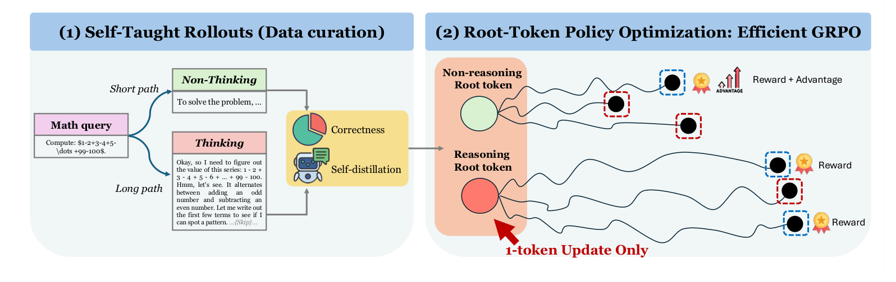
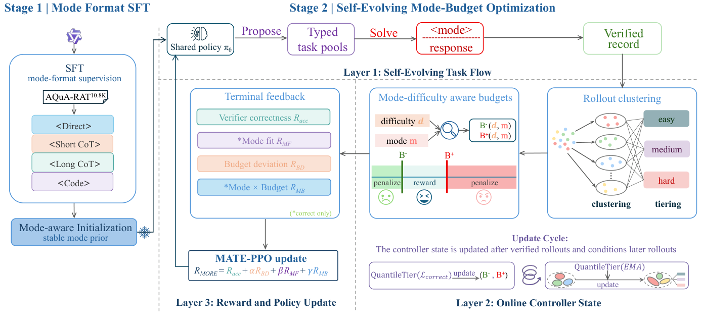
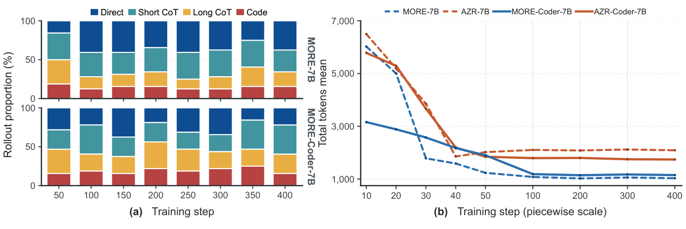
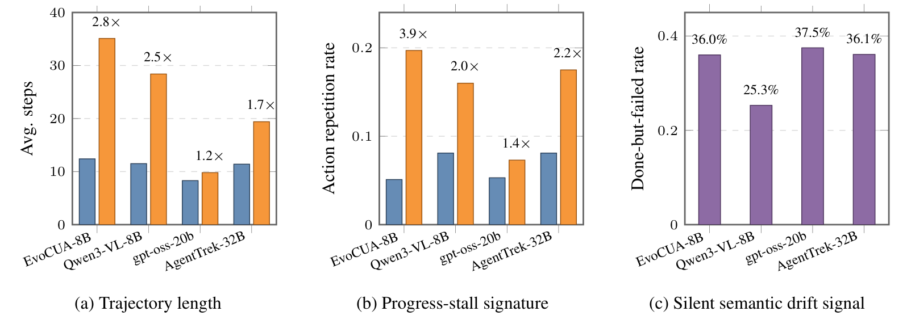

# Adaptive Reasoning: From Computer Use to Robot Use

## Why Robot Use Needs Adaptive Reasoning

考虑一个闭环：模型读入相机画面与机器人状态，生成末端位姿 JSON，控制器执行，再把实际结果送回模型。夹爪顺利接近杯子时，下一步可能只需要沿用已有计划；抓取落空、杯子被碰动时，模型需要重新判断位置、接触状态与后续动作。

如果每一步都完整思考，常规动作会反复支付推理成本。如果一直采用短推理，异常状态又可能沿着旧计划继续执行。**我们想控制的是计算在执行过程中的分布：何时思考、思考多少，以及何时重新检查。**

这里的 dynamic reasoning 指根据当前上下文、推理进度或执行反馈调整计算。本文聚焦有外部反馈的 agent；不展开连续 latent 推理。上述控臂接口也只是讨论对象，不能代表所有 VLA 的执行方式。

computer-use 是一个值得先看的相邻领域。点击与机械臂移动都遵循“观察 → 决策 → 执行 → 新观察”，任务成功取决于整条交互轨迹。两者也有实质差别：机器人动作受接触、动力学和感知误差影响，生成一个正确格式的坐标，并不能保证达到预期物理状态。

下面保留五个有区分度的切入点：**RPO** 缩小训练的决策位置；**MORE** 联合优化推理形式与预算；**TAB** 分配整条交互的预算；**RACE** 判断哪些跨轮思考可以省略；**STEPWISE** 在卡住或关键节点时升级核验。它们覆盖从单轮路由到多轮交互，STEPWISE 最直接研究 computer-use。

选文核对至 2026-11-25。RPO 采用 ACL 2026 正式版，其余采用文末列出的 2026 arXiv 版本。PPO 是我们关注的迁移路线，但原文中的算法分别保留：MORE 是 PPO-style 更新，RPO、TAB、RACE 使用组相对信号，STEPWISE 训练分类监测器。最后再讨论 actor–critic PPO 的适配。

## RPO — Learn the Root Decision

### Problem

模型可能已经具备长推理和直接回答两种能力，却不擅长选择。若目标主要是改善这个选择，对整段长 CoT 反向传播会花费大量显存与计算。

RPO 将问题收窄到**生成开头的分支决策**：当前输入应该进入长推理，还是直接回答？

### Method and RL Recipe

原文先用同一个模型强制生成 SHORT、LONG 两种输出，筛出格式正确且答案正确的样本做自蒸馏 SFT，让两个分支都能工作。SFT 数据分别从两个池中采样，并不要求同一道题在两个分支都答对。

分支使用模型原有的 tokenization：固定 `<think>` 前缀后，以不同换行 token 选择长短路径。这里将分支 token 记为 $z$，输入记为 $x$，策略参数为 $\theta$。

RL 的流程是：

1. 每道题各采样相同数量的 SHORT、LONG 完整回答。
2. 用答案验证器统计两种模式各自答对的次数 $C_S(x),C_L(x)$。
3. 把该模式的成功次数作为这道题的分支奖励，并给 SHORT 一个较小的偏好系数。
4. 在整个 minibatch 内，按模式分别标准化奖励。
5. **只对根 token 的 log-probability 求策略损失**，加上根分布相对 SFT checkpoint 的 KL。

对于第 $i$ 条采样，原文的奖励是：

$$
\begin{aligned}
r_i(x)&=\alpha_{z_i}C_{z_i}(x),\\
\alpha_L&=1,\qquad \alpha_S=1+\frac{1}{n}.
\end{aligned}
$$

$n$ 是每道题两种模式合计的采样数。$C_z(x)$ 来自完整回答的正确性检查，后续回答仍需实际生成。

$$
\widehat A_i(x)
=\frac{r_i(x)-\mu_{z_i}}{\sigma_{z_i}+\varepsilon}.
$$

$\mu_z,\sigma_z$ 从 **minibatch 中所有题目的模式 $z$ 样本**计算。这个统计范围很关键：同一道题、同一种强制模式下的奖励完全一样，在该小组内部标准化会得到零方差。

最终优化根分布：

$$
\begin{aligned}
K_\theta(x)&=D_{\mathrm{KL}}\!\left(
 p_\theta(\cdot\mid x)\,\Vert\,p_{\mathrm{ref}}(\cdot\mid x)
\right),\\
J_{\mathrm{RPO}}
&=\mathbb E_x\!\left[
\frac1n\sum_i\widehat A_i(x)\log p_\theta(z_i\mid x)
\right]\\
&\quad-\beta\,\mathbb E_x[K_\theta(x)].
\end{aligned}
$$

为排版将根分布的 KL 项记为 $K_\theta(x)$。这里沿用原文的根策略梯度目标，没有额外添加 PPO clipping。$p_{\mathrm{ref}}$ 是 SFT 后冻结的参考分支分布，$\beta$ 控制偏离幅度。根 token 后的生成不进入直接策略损失。

**特点是把完整回答作为评价分支的依据，把反向传播集中到选择点。** 原文 §3.3、Table 2 和 Table 5 分别讨论优势、显存与计算开销；其中显存估算与训练计算口径需要分开阅读。论文约 2% 的计算结论对应其匹配配置，不能推成所有模型都能加速 50 倍。

### Transfer to Robot Use

可借鉴的是先建立“短推理／完整推理都能输出有效动作”的底座，再学习每轮的分支选择。整条机器人任务的成功可用于评价这些选择，但终局奖励如何分配到多个分支，仍需另外设计。

还需要区分**损失位置**与**可训练参数**。RPO 只在根位置计算损失，共享模型参数仍会更新，后续动作分布可能随之改变。若实验要隔离调度作用，可以冻结动作模型、训练独立选择器；这属于迁移设计，不能当成 RPO 已验证的配置。

它主要解决训练成本，未直接证明多轮控臂性能。机器人 rollout、环境复位和长短分支采样的成本仍然存在。

## MORE — Couple Reasoning Mode and Budget

### Problem

“思考多久”与“采用什么推理方式”相互影响。代码、长 CoT、短 CoT 和直接回答的合理长度不同；模型变强之后，原来困难的任务也可能已经不需要长推理。

MORE 同时调整**模式选择、难度状态与模式对应的预算区间**，让效率约束随训练变化。

### Method and RL Recipe

先看图中两个阶段，以及右侧与策略一起更新的控制状态。

Stage 1 用 SFT 建立 direct、short-CoT、long-CoT、code 四类输出格式。Stage 2 采用 proposer–solver 循环：共享策略生成可执行任务，再解这些任务，由执行器提供验证反馈。原文包含 input、output、function 三类任务的 proposer 与 solver，共六路轨迹。

每条轨迹的处理顺序是：

1. 保存生成前的难度与预算状态。
2. 模型先生成模式标记，再按对应格式生成回答。
3. 执行验证，计算任务反馈和模式、预算相关奖励。
4. 用保存的旧控制状态给当前轨迹计分。
5. 汇总轨迹做策略更新，并把新结果写入后续使用的难度与预算状态。

先保存旧状态再计分，可以避免当前样本一边改变预算标准、一边按变化后的标准给自己打分。

难度由相近任务簇的滚动成功率估计。预算下界与上界 $B^-_{d,m},B^+_{d,m}$ 则逐渐根据正确回答长度的分位数更新；$d$ 表示难度档位，$m$ 表示模式。它们提供软奖励约束，并非每条轨迹都强制生成到目标长度。

下式展开 solver 的终局回报；proposer 使用其任务构造反馈替换第一项：

$$
R_i=R_{\mathrm{acc},i}
+\alpha R_{\mathrm{BD},i}
+\beta R_{\mathrm{MF},i}
+\xi R_{\mathrm{MB},i}.
$$

$R_{\mathrm{acc},i}$ 来自执行验证器。$R_{\mathrm{BD},i}$ 衡量长度偏离预算区间；$R_{\mathrm{MF},i}$ 给正确回答分配难度与模式匹配的效用；$R_{\mathrm{MB},i}$ 给正确回答施加模式与预算的联合偏离项。这里用 $\xi$ 表示原文的第三个奖励权重，避免与 RL 折扣混淆。

长度 $L_i$ 的上、下偏离分别为：

$$
\begin{aligned}
o_i&=\max\!\left(0,\frac{L_i-B^+_{d,m}}{B^+_{d,m}}\right),\\
u_i&=\max\!\left(0,\frac{B^-_{d,m}-L_i}{B^-_{d,m}}\right),\\
D_i&=o_i+w_u(c_i)u_i,\\
R_{\mathrm{BD},i}
&=\operatorname{clip}(-\lambda_dD_i,-0.5,0).
\end{aligned}
$$

$D_i$ 合并上、下预算偏离，$\lambda_d$ 是难度档位的偏离惩罚权重。$c_i$ 是验证正确性。原文设置 $w_u(1)=1$、$w_u(0)=0.1$：过长都会被罚，错误回答低于预算下界时的压力较小。**这个奖励也约束过短输出，因此不能概括为“越短越好”。** 模式效用 $U(d,m)$ 则包含预设偏好，并非完全从结果中自由学出。

原文称更新方法为 MATE-PPO，但附录 C.3 使用的是 **REINFORCE++ 回报标准化，没有 learned critic 或 GAE**。终局奖励写在最后一个有效 token，折扣为 1，各生成位置取得同一条轨迹的回报：

$$
\begin{aligned}
G_{i,k}&=R_i,\\
\widehat A_{i,k}
&=\frac{G_{i,k}-\mu_{\mathcal V}}
{\sqrt{\sigma_{\mathcal V}^2+10^{-8}}}.
\end{aligned}
$$

$k$ 是生成 token 位置；$\mathcal V$ 是六路轨迹合并后的有效 token 集，均值和标准差也在这个集合上计算。模式标记参与策略损失，因此能从最终回报获得梯度。

随后使用逐 token 的新旧策略比 $\rho_{i,k}$ 做 clipped actor 更新：

$$
\begin{aligned}
\rho_{i,k}
&=\frac{\pi_\theta(y_{i,k}\mid h_{i,k})}
{\pi_{\mathrm{old}}(y_{i,k}\mid h_{i,k})},\\
\overline\rho_{i,k}
&=\operatorname{clip}(\rho_{i,k},1-\epsilon,1+\epsilon),\\
J_{\mathrm{MATE}}
&=\mathbb E_{i,k}\!\left[
\min\!\left(\rho_{i,k}\widehat A_{i,k},
\overline\rho_{i,k}\widehat A_{i,k}\right)
\right].
\end{aligned}
$$

$h_{i,k}$ 是该 token 的已采样上下文，$\epsilon$ 是裁剪宽度，$\overline\rho_{i,k}$ 是裁剪后的概率比。这个 PPO-style actor 目标不能单独证明方法具有 actor–critic PPO 的价值估计机制。

上图左侧看模式比例随训练变化，右侧看 token 开销；它们共同检验模型是否一直坍缩到某个模式。论文还在 §5 与附录给出模块消融和跨规模实验。代码、数学任务的可执行验证是这套 recipe 的重要基础。

### Transfer to Robot Use

最值得借鉴的是**预算与模型当前能力一起校准**，以及让模式标记真正参与策略优化。机器人中可以比较直接动作、短推理和完整重规划，但原文的 code 模式和代码任务生成器需要重新评估。

直接照搬奖励有两个风险。首先，文本回答正确性通常可以直接验证，机器人中则需要实际执行才能知道动作有没有奏效。其次，少数正确轨迹的长度不一定能代表合理预算：环境难度、失败恢复和模型能力会同时影响它。

因此可以先借用模式选择机制，保持简单可解释的成本项；只有观察到固定预算随训练失配，再加入动态预算区间。各模块应分别贡献可测收益。

## TAB — Allocate Compute Across Turns

### Problem

多轮任务的预算存在前后依赖：前面少花一点，可能节省计算，也可能因为漏掉约束导致后面反复补救。每轮独立估计难度，无法充分评价这种影响。

TAB 将整条交互视为预算分配问题，优化**完成任务与总预算之间的折中**。

### Method and RL Recipe

TAB 分开使用 Budgeter 和 Solver。每轮 Budgeter 根据历史与当前输入输出难度档位，再映射成 Solver 的 token 预算或 reasoning-effort 设置。Solver 在这个设置下生成回答，新的反馈进入下一轮。

可将其写为：

$$
b_t\sim\pi_\phi(\cdot\mid h_t),
\qquad
y_t\sim f_\theta(\cdot\mid h_t;b_t).
$$

$t$ 是交互轮次；$h_t$ 包括当前输入与之前的交互；$\phi$ 是预算策略参数，$\theta$ 是 Solver 参数。RL 更新 Budgeter，Solver 提供预算动作后的反馈。

原文只在便宜的多轮数学任务上训练 Budgeter，随后不再微调，迁移到 BFCL、Tau-Bench、Terminal-Bench。这个设置直接检验了**预算策略的跨任务迁移**。

训练用 GRPO：

1. 同一道训练题采样多条完整交互，每条使用不同的预算分配序列。
2. 到终局检查答案，同时统计实际消耗的 Solver token。
3. 根据全局预算计算奖励，在同题轨迹组内标准化。
4. 将轨迹优势用于该轨迹中所有预算决策的 clipped policy 更新。

为区分“分配量”与“消耗量”，这里把第 $t$ 轮实际消耗记为 $n_t$。原文式 (2) 的脚注明确，训练计分使用实际 token：

$$
R_i=S_i-\lambda\max\!\left(0,\sum_t n_{i,t}-B\right).
$$

$S_i$ 是终局正确性，$B$ 是整项任务的目标预算，$\lambda$ 是超额成本系数。低于 $B$ 时成本项为零，策略可以把预算集中到关键轮次。

$$
\widehat A_i
=\frac{R_i-\operatorname{mean}_{j\in\mathcal G(x)}R_j}
{\operatorname{std}_{j\in\mathcal G(x)}R_j}.
$$

$\mathcal G(x)$ 是同一道题的完整轨迹组。**同一条轨迹的各轮共享这个优势**；它学习哪些整体分配方案更好，尚未给每一轮提供独立的因果贡献估计。

recipe 的一个可复现配置是 Qwen3-4B Budgeter、LoRA rank 64、125 个训练更新；对不同全局目标预算分别训练策略。原文 §3.3 与 Appendix A 给出奖励、映射、训练和计时口径。

两图需要一起看：上图检验 token，下面检验时间。原文迁移实验报告最多约 20% token 与 15% 延迟节省；计时包含 Budgeter 开销。它支持这些测试环境中的迁移，尚未覆盖物理控臂。

### Transfer to Robot Use

这篇最直接支持“先学调度，再尝试跨域迁移”的研究路线。可以先让预算策略读历史、当前视觉信息与执行反馈，再决定控臂模型下一轮的推理强度。

不过，TAB 的跨域实验仍主要使用文本交互状态。相机变化、接触与物体位移需要合适的表征；同一个难度档位对不同控臂模型是否具有一致含义，也要测试。

Budgeter 本身还会增加延迟。对小型控臂模型，额外跑一次 4B Budgeter 可能不划算。冻结同一动作底座、比较轻量选择器与固定预算，并统计整项任务真实耗时，才容易解释收益来自哪里。

## RACE — Preserve Cross-Turn Reasoning Support

### Problem

前一轮形成的计划可以支持后面几轮动作。逐轮独立删掉看似多余的思考，可能忽略它对后续动作的作用；每次都重新采样动作来验证，又会增加训练成本。

RACE 用**参考动作的似然变化**近似判断思考的跨轮作用。

### Method and RL Recipe

LoGiC 从已有轨迹出发，保留第一轮思考，从第二轮起依次尝试删除。一次删除需要同时通过当前及后续参考动作的检查；已接受的删除会进入下一次评估的上下文。

先对固定参考动作做 teacher-forced scoring：

$$
\ell(a_j^*\mid h)
=\frac1{M_j}\sum_{k=1}^{M_j}
\log\pi_\theta(a_{j,k}^*\mid h,a_{j,<k}^*).
$$

$a_j^*$ 是原轨迹第 $j$ 轮动作，$M_j$ 是其 token 数。这个量来自已有动作的前向打分，无需重新生成多个候选动作。

在当前已经压缩的轨迹上，尝试删除第 $t$ 轮思考。定义：

$$
\begin{aligned}
d_j^{(t)}&=
\ell_{j,\mathrm{before}}^{(t)}
-\ell_{j,\mathrm{after}}^{(t)},\\
\mathrm{SKIP}_t=1
&\iff \max_{j\ge t}d_j^{(t)}\le\varepsilon_{\mathrm{del}}.
\end{aligned}
$$

before、after 分别表示本次删除前后的上下文，后续参考动作和观察保持原样。阈值 $\varepsilon_{\mathrm{del}}$ 控制允许的似然下降。每次比较针对当前压缩状态，并非始终针对完整原轨迹。

这些信号进入两个训练阶段：

1. **SFT：** 删除通过检查的思考，得到有些轮次直接行动的示范。
2. **On-policy RL：** 先采样完整任务轨迹，对成功轨迹运行 LoGiC；失败轨迹继续普通 GRPO。
3. **Reasoning masking：** SKIP 轮次的思考 token 不进入 GRPO 策略梯度，动作 token 仍参与优化。原有 token 数继续用于损失归一化。
4. **Reasoning closure：** 在 SKIP 轮次的压缩上下文上，监督模型输出结束思考的 token。

仅仅 mask 会停止强化冗余思考，closure 则提供主动结束它的信号：

$$
\begin{aligned}
\mathcal L_{\mathrm{close}}
&=-\frac1{\sum_iT_i}
\sum_{i\in\mathcal I_{\mathrm{succ}}}
\sum_{t\in\mathcal S_i}
\log\pi_\theta(e\mid\widetilde h_{i,t}),\\
\mathcal L_{\mathrm{actor}}
&=\mathcal L_{\mathrm{GRPO,masked}}
+\lambda_{\mathrm{close}}\mathcal L_{\mathrm{close}}.
\end{aligned}
$$

$T_i$ 是轨迹轮数，$\mathcal I_{\mathrm{succ}}$ 是成功轨迹集合，$\mathcal S_i$ 是 LoGiC 判为 SKIP 的轮次；$e$ 是思考终止 token，$\widetilde h_{i,t}$ 是对应压缩上下文。这里是训练目标的变化，并未另加统一长度奖励。

相对普通 SFT＋GRPO，论文在四个 agent 基准上报告约 32%–80% 的推理 token 减少，成功率变化不超过 1.4 个百分点。应以这个同底座消融评价删减机制，不能把相对未训练底座的全部提升都归给它。方法见 §3，消融见 Table 2、Figure 4。

### Transfer to Robot Use

它给出了一个适合机器人验证的具体假设：**计划已经覆盖的常规动作可以省略重复思考，新的执行信息可能使原计划失效。** 是否发生这种行为，需要通过异常执行实验检验。

其似然信号也有物理迁移风险。JSON 中数值的 token 概率不能直接衡量抓取质量；不同坐标可能产生等效动作，相似坐标也可能落在不同接触区域。

LoGiC 评估时保留原来的后续观察，因此它提供的是固定轨迹上的支持度代理。删掉思考后重新闭环执行，动作分布和后续状态都可能改变。迁移实验应把似然代理与实际任务结果对照，额外计算也需要计入训练成本。

## STEPWISE — Escalate at Events

### Problem

computer-use 的失败经常表现为两类：重复操作却没有进展，或操作看起来连贯，最终结果却偏离用户目标。每步都调用强模型核验很贵，等终局才发现错误又可能太晚。

STEPWISE 用轻量监测器寻找值得增加计算的时刻。

### Method and Training Recipe

小模型默认执行，两个 ModernBERT 监测器分析最近的推理与动作记录：

- **Stuck Monitor** 读局部历史，检测循环、重复与停滞。
- **Milestone Monitor** 额外读任务要求，选择有意义的进展检查点。

Stuck 超阈值后，下一步交给强策略恢复。Milestone 超阈值后，先让强验证器检查“上次核验到现在”的任务进展：输入包括任务、分段动作记录，以及当前和上次检查点的截图；检查通过就继续使用小模型，失败才升级。

所以 checkpoint 的作用是**选择核验位置**。这里没有把完成 checkpoint 直接当成 RL 过程奖励。

训练流程与前四篇不同：

1. 收集小模型执行轨迹，切出局部历史窗口。
2. 用强 LLM 多次标注 stuck 与 milestone，保留高一致性标签。
3. 用带类别平衡的交叉熵训练两个分类器。
4. 在部署时选择阈值，权衡成功率与强模型使用成本。

原文使用约 300 条 GUI 轨迹训练监测器，未对整个级联系统做 PPO。始终在线的轻量监测器只读文本记录；截图在触发 milestone 的强核验中使用。这个输入差别影响它对实际执行状态的可见性。

论文在 OSWorld 与 WebArena 比较了小模型、强模型和级联，另做 stuck-only、milestone-only、两者结合与固定间隔核验的对照。它提供的是系统成本与成功率的折中，不能归结为单模型学出了更短的 CoT。方法见 §4，事件与固定间隔比较见 §6.2。

### Transfer to Robot Use

最有价值的是把**异常恢复**和**阶段核验**分开。抓取持续失败可以触发恢复；抓住物体、放入容器之后，可以核验实际状态是否符合下一阶段的前提。

但相同的末端动作重复几次，既可能是卡住，也可能是正常接触操作。只看模型自己的文本描述容易遗漏“它认为抓住了，实际上没有”的情况。机器人监测需要考虑图像、本体状态或实际动作结果。

这篇也适合作为简单而有力的基线：固定动作模型，按可观测异常触发长推理。若学习式调度不能胜过这个规则方案，其额外训练与模块成本就需要重新解释。

## Synthesis — What Transfers, What Must Be Tested

五篇给出的经验可以沿执行链连接起来。**RPO** 帮我们缩小需要优化的决策位置；**MORE** 提醒模式与预算会随能力变化；**TAB** 把预算放到整项任务中评价；**RACE** 检验已有思考的跨轮支持；**STEPWISE** 提供异常和阶段检查的触发方式。

这些经验还没有自动组成一个有效的 robot-use 方法。优先验证的主张可以收窄为：

> 在同一动作底座、同一可见信息和相近成本下，执行反馈能否帮助模型把额外推理用于会改变后续任务结果的时刻？

### A PPO Transfer Recipe

如果我们采用 actor–critic PPO，一个容易解释的起点是冻结已有闭环动作模型，只训练推理预算策略 $\pi_\phi(m_t\mid h_t)$ 与价值函数 $V_\psi(h_t)$。$h_t$ 包含当前观察、历史与实际执行反馈，$m_t$ 是推理强度选择。以下是拟议迁移配方，尚未训练验证。

每轮执行“选强度 → 生成动作 → 实际执行 → 接收反馈”，保存预算决策的 old log-probability、价值估计与成本。可以先使用清楚的任务回报与计算成本：

$$
r_t=-\lambda_C C_t+\mathbb 1[t=T]S.
$$

$C_t$ 是当前决策周期测得的计算成本，$S$ 是完整任务成功标记，$T$ 是终止轮次。训练前选择 token、GPU 时间等明确成本单位；评测另外报告端到端任务时间。不同单位不能直接相加后仍称为“推理长度”。

预算决策在轮级形成 PPO 样本，优势由执行后的状态价值变化计算：

$$
\begin{aligned}
\delta_t
&=r_t+\gamma(1-d_t)V_\psi(h_{t+1})-V_\psi(h_t),\\
\widehat A_t
&=\delta_t+\gamma\lambda_{\mathrm{GAE}}(1-d_t)
\widehat A_{t+1},\\
\rho_t
&=\frac{\pi_\phi(m_t\mid h_t)}
{\pi_{\phi_{\mathrm{old}}}(m_t\mid h_t)}.
\end{aligned}
$$

$d_t$ 表示该轮后是否终止，$\gamma$ 是轮级折扣，$\lambda_{\mathrm{GAE}}$ 控制优势估计。用 $\rho_t,\widehat A_t$ 做 PPO clipped 更新，价值头拟合相应回报目标。冻结的动作生成 token 不加入预算策略的 PPO loss。

这与 MORE 的整批标准化回报、TAB 的同题组优势有明确区别。引入 critic 提供了更细的信用估计，也增加了价值学习误差；采用 PPO 本身不构成新贡献。

### The Smallest Useful Comparison

先固定同一个能完成任务的动作底座，保留四类对照：固定推理强度、匹配预算的随机选择、基于异常或置信度的简单触发，以及学习式预算选择。再比较选择器能否读取实际执行反馈，隔离反馈的作用。

任务至少包含正常执行与受控扰动两类，例如抓取落空、目标物体移动；按任务或场景划分训练与测试。评测同时统计完整成功率、异常恢复率、决策延迟与任务总耗时，计入选择器、核验、重试和失败轨迹。

如果成功率下降或重试增加，少生成 token 还不足以支持加速结论。若成功率接近、总耗时降低，而且收益集中在反馈改变后续计划的情境，才支持继续研究这一迁移机制。

## References

- Taehyeon Kim et al. **Efficiently Learning To Reason or Not to Reason: Root-token Policy Optimization for Adaptive Thinking.** ACL 2026. [Paper](https://aclanthology.org/2026.acl-long.816/). Methods §3.2–3.3; Tables 2–5.
- Dianxing Shi et al. **MORE: Mode-Optimized Reasoning with Self-Adaptive Effort for Self-Evolving Agents.** arXiv:2610.33684v2, 2026-11-05. [Paper](https://arxiv.org/html/2610.33684v2). Methods §3; Appendix C.3 and D.
- Neharika Jali et al. **Not All Turns Are Equally Hard: Adaptive Thinking Budgets For Efficient Multi-Turn Reasoning in Agents.** arXiv:2604.05164v4, 2026-11-15. [Paper](https://arxiv.org/html/2604.05164v4). Methods §3.3; transfer §4.3; Appendix A.
- Yiruo Cheng et al. **When Should Agents Think? Adaptive Reasoning via Cross-Turn Estimation.** arXiv:2610.12061v1, 2026-10-08. [Paper](https://arxiv.org/html/2610.12061v1). Methods §3.1–3.3; Table 2 and Figure 4.
- Jinbiao Wei et al. **Step-level Optimization for Efficient Computer-use Agents.** arXiv:2604.27151v1, 2026-04-29. [Paper](https://arxiv.org/html/2604.27151v1). Methods §4; ablations §6; Appendix B.
