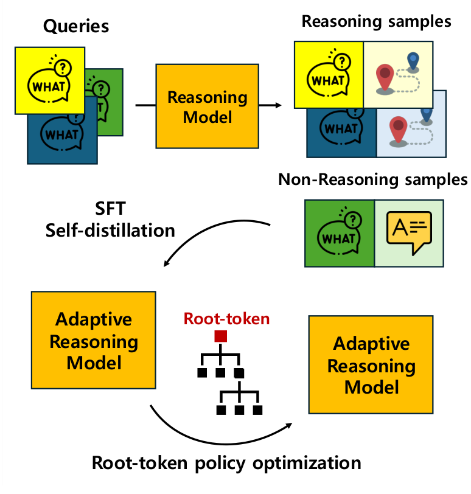
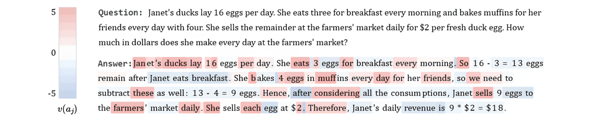
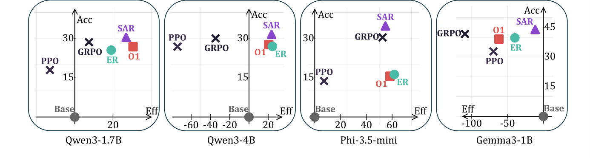
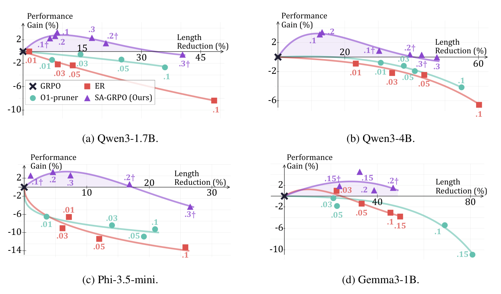
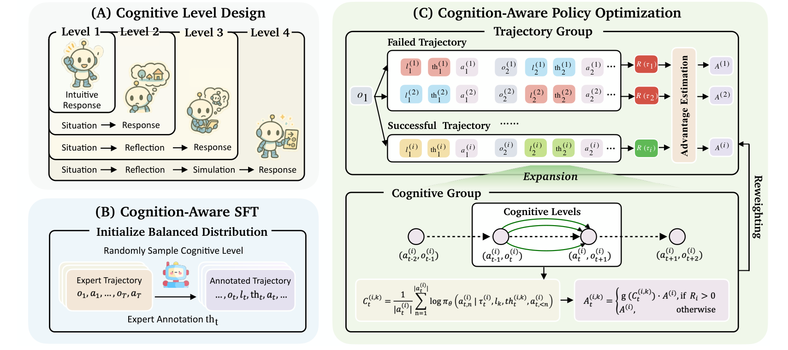
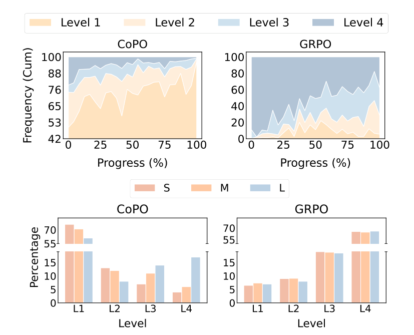
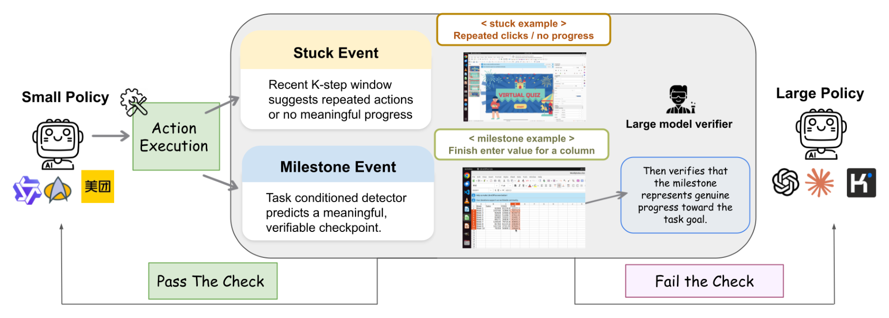

# Adaptive Reasoning: From Computer Use to Robot Use

## Why Robot Use Needs Adaptive Reasoning

考虑一个闭环：模型读入相机画面与机器人状态，生成末端位姿 JSON，控制器执行，再把实际结果送回模型。夹爪顺利接近杯子时，下一步可能只需要沿用已有计划；抓取落空、杯子被碰动时，模型需要重新判断位置、接触状态与后续动作。

如果每一步都完整思考，常规动作会反复支付推理成本。如果一直采用短推理，异常状态又可能沿着旧计划继续执行。**我们想控制的是计算在执行过程中的分布：何时思考、思考多少，以及何时重新检查。**

这里的 dynamic reasoning 指根据当前上下文、推理进度或执行反馈调整计算。本文聚焦有外部反馈的 agent；不展开连续 latent 推理。上述控臂接口也只是讨论对象，不能代表所有 VLA 的执行方式。

computer-use 是一个值得先看的相邻领域。点击与机械臂移动都遵循“观察 → 决策 → 执行 → 新观察”，任务成功取决于整条交互轨迹。两者也有实质差别：机器人动作受接触、动力学和感知误差影响，生成一个正确格式的坐标，并不能保证达到预期物理状态。

下面保留五个有区分度的切入点：**RPO** 缩小训练的决策位置；**SAR** 为推理质量与效率提供内容相关奖励；**CogRouter** 在每一步选择认知深度；**RACE** 判断哪些跨轮思考可以省略；**STEPWISE** 在卡住或关键节点时升级核验。它们覆盖从单轮路由到多轮交互，STEPWISE 最直接研究 computer-use。

选文核对至 2026-11-25。前三篇按 2026 年顶会正式版本选取：RPO（ACL）、SAR（ICLR）、CogRouter（ICML）；SAR 的预印本首次发表于 2025 年。RACE 和 STEPWISE 保留文末指定的预印本版本。算法沿用原文：SAR 实际测试 actor–critic PPO，RPO、CogRouter、RACE 使用组相对信号，STEPWISE 训练分类监测器。最后再讨论 robot-use 的 PPO 适配。

## RPO — Learn the Root Decision

### Problem

模型可能已经具备长推理和直接回答两种能力，却不擅长选择。若目标主要是改善这个选择，对整段长 CoT 反向传播会花费大量显存与计算。

RPO 将问题收窄到**生成开头的分支决策**：当前输入应该进入长推理，还是直接回答？

### Method and RL Recipe

原文先用同一个模型强制生成 SHORT、LONG 两种输出，筛出格式正确且答案正确的样本做自蒸馏 SFT，让两个分支都能工作。SFT 数据分别从两个池中采样，并不要求同一道题在两个分支都答对。

分支使用模型原有的 tokenization：固定 `<think>` 前缀后，以不同换行 token 选择长短路径。这里将分支 token 记为 $z$，输入记为 $x$，策略参数为 $\theta$。

RL 的流程是：

1. 每道题各采样相同数量的 SHORT、LONG 完整回答。
2. 用答案验证器统计两种模式各自答对的次数 $C_S(x),C_L(x)$。
3. 把该模式的成功次数作为这道题的分支奖励，并给 SHORT 一个较小的偏好系数。
4. 在整个 minibatch 内，按模式分别标准化奖励。
5. **只对根 token 的 log-probability 求策略损失**，加上根分布相对 SFT checkpoint 的 KL。

对于第 $i$ 条采样，原文的奖励是：

$$
\begin{aligned}
r_i(x)&=\alpha_{z_i}C_{z_i}(x),\\
\alpha_L&=1,\qquad \alpha_S=1+\frac{1}{n}.
\end{aligned}
$$

$n$ 是每道题两种模式合计的采样数。$C_z(x)$ 来自完整回答的正确性检查，后续回答仍需实际生成。

$$
\widehat A_i(x)
=\frac{r_i(x)-\mu_{z_i}}{\sigma_{z_i}+\varepsilon}.
$$

$\mu_z,\sigma_z$ 从 **minibatch 中所有题目的模式 $z$ 样本**计算。这个统计范围很关键：同一道题、同一种强制模式下的奖励完全一样，在该小组内部标准化会得到零方差。

最终优化根分布：

$$
\begin{aligned}
K_\theta(x)&=D_{\mathrm{KL}}\!\left(
 p_\theta(\cdot\mid x)\,\Vert\,p_{\mathrm{ref}}(\cdot\mid x)
\right),\\
J_{\mathrm{RPO}}
&=\mathbb E_x\!\left[
\frac1n\sum_i\widehat A_i(x)\log p_\theta(z_i\mid x)
\right]\\
&\quad-\beta\,\mathbb E_x[K_\theta(x)].
\end{aligned}
$$

为排版将根分布的 KL 项记为 $K_\theta(x)$。这里沿用原文的根策略梯度目标，没有额外添加 PPO clipping。$p_{\mathrm{ref}}$ 是 SFT 后冻结的参考分支分布，$\beta$ 控制偏离幅度。根 token 后的生成不进入直接策略损失。

**特点是把完整回答作为评价分支的依据，把反向传播集中到选择点。** 原文 §3.3、Table 2 和 Table 5 分别讨论优势、显存与计算开销；其中显存估算与训练计算口径需要分开阅读。论文约 2% 的计算结论对应其匹配配置，不能推成所有模型都能加速 50 倍。

### Transfer to Robot Use

可借鉴的是先建立“短推理／完整推理都能输出有效动作”的底座，再学习每轮的分支选择。整条机器人任务的成功可用于评价这些选择，但终局奖励如何分配到多个分支，仍需另外设计。

还需要区分**损失位置**与**可训练参数**。RPO 只在根位置计算损失，共享模型参数仍会更新，后续动作分布可能随之改变。若实验要隔离调度作用，可以冻结动作模型、训练独立选择器；这属于迁移设计，不能当成 RPO 已验证的配置。

它主要解决训练成本，未直接证明多轮控臂性能。机器人 rollout、环境复位和长短分支采样的成本仍然存在。

## SAR — Reward Query-Specific Reasoning

### Problem

只按答案对错给奖励，正确但冗长的回答和正确且简洁的回答可能同分。直接按长度收费，又可能同时压低必要推导与重复解释。

SAR 增加一个内容相关的信号：**当前问题给这段回答带来的可预测性增益。** 它用这个差异补充最终正确性，而不预先指定每道题应该写多长。

这篇采用 ICLR 2026 正式版本；预印本首次发布于 2025 年 9 月。它属于 efficient reasoning 的奖励方法，原文没有训练多轮机器人或 GUI 预算路由器。

### Method and RL Recipe

对采样得到的完整回答 $y_i$，用同一个当前策略分别打两次分：一次保留问题 $q$，一次移除用户问题。实现中仍保留 system prompt，答案和 padding 的 mask 保持一致。

把每个回答 token 在两种上下文中的平均 log-probability 记为：

$$
\begin{aligned}
\ell_q(y_i)&=\frac1{K_i}\sum_{k=1}^{K_i}
\log\pi_\theta(y_{i,k}\mid q,y_{i,<k}),\\
\ell_0(y_i)&=\frac1{K_i}\sum_{k=1}^{K_i}
\log\pi_\theta(y_{i,k}\mid y_{i,<k}).
\end{aligned}
$$

$K_i$ 是回答的有效 token 数；下标 0 表示去掉用户问题后的评分上下文，并非完全无条件模型。两项均由 teacher-forced scoring 获得，无需再次采样一段回答。

原文式 (6)–(7) 用 perplexity 定义奖励。将它写成上述 log-probability 的等价形式，数值关系更清楚：

$$
\begin{aligned}
\Delta_i&=\ell_q(y_i)-\ell_0(y_i),\\
R_{\mathrm{SA},i}
&=\operatorname{clip}\!\left(1-e^{-\Delta_i},-1,1\right),\\
R_i&=R_{\mathrm{VR},i}+\alpha R_{\mathrm{SA},i}.
\end{aligned}
$$

$R_{\mathrm{VR},i}$ 来自答案验证，正确为 1，否则为 0；$\alpha$ 控制 SAR 的权重。如果问题明显提高了回答概率，$\Delta_i$ 为正，SAR 也为正。泛化套话即使本身很流畅，保留和删除问题时的概率差也可能较小。

上图的颜色展示 token 对问题的依赖差异。原文把这作为解释整体奖励的分析；**训练仍使用回答级 SAR，不能把图中的颜色直接称为已经验证的逐 token 过程奖励。**

SA-PPO 的训练链条是：

1. 从数学训练问题采样完整回答，取得最终正确性。
2. 复用已有的条件 log-probability，额外计算去掉问题后的 log-probability。
3. 计算 $R_{\mathrm{SA},i}$，与正确性合成 $R_i$，作为这条回答的任务奖励。
4. 使用 PPO 的价值基线估计优势，更新 actor 与 critic，并保留相对参考模型的 KL 约束。

其 actor 更新采用逐 token 的 clipped surrogate。为突出奖励接入位置，记 $h_{i,k}$ 为生成前缀：

$$
\begin{aligned}
\rho_{i,k}
&=\frac{\pi_\theta(y_{i,k}\mid h_{i,k})}
{\pi_{\mathrm{old}}(y_{i,k}\mid h_{i,k})},\\
\overline\rho_{i,k}
&=\operatorname{clip}(\rho_{i,k},1-\epsilon,1+\epsilon),\\
F_{i,k}&=\min\!\left(
\rho_{i,k}\widehat A_{i,k},
\overline\rho_{i,k}\widehat A_{i,k}\right),\\
J_{\mathrm{SA\text{-}PPO}}
&=\mathbb E_i\!\left[\frac1{K_i}\sum_kF_{i,k}\right]
-\beta D_{\mathrm{KL}}.
\end{aligned}
$$

$\widehat A_{i,k}$ 是由合成奖励进入回报估计后得到的 PPO 优势，$\epsilon$ 为裁剪宽度，$\beta$ 为参考策略 KL 权重。这里沿用原文 §3.1 的 PPO 目标；SAR 的变化发生在奖励端，没有另造一个模式选择损失。

原文 Appendix B.3 明确列出 critic 学习率，因此这里确实包含价值学习。其配置中 actor 学习率为 $10^{-6}$、critic 为 $2\times10^{-6}$，PPO 与 SA-PPO 保持同一训练配置。论文还测试 SA-GRPO，采用 Dr. GRPO 的中心化优势，不能与 PPO 的 critic 混写。

上图给跨模型结果，下图给奖励权重变化时的准确率与长度折中。下图对应 SA-GRPO，不应归到 SA-PPO 名下。原文主要测试数学与逻辑推理；附录的视觉语言扩展收益较有限，因此不能假定这个文本概率信号会直接迁移到控臂。

### Transfer to Robot Use

可以借鉴的是**用内容相关的评分补充粗粒度成功信号**，以及把这类评分直接接入现有 PPO，而非重新设计整个优化器。

机器人中需要先确定“删掉什么上下文”才有意义：任务要求、历史反馈和当前视觉状态分别承担不同信息。简单移除任务文本，可能鼓励模型重复目标名称；移除视觉信息，又会改变模型对坐标的预测条件。

SAR 奖励的是概率差，无法直接保证物理有效性。它甚至可能压低某些正确的无思考回答：原文 Table 2 就分析了这种现象。因此，针对每轮可以直接输出动作的 robot-use agent，应该先验证评分与实际成功、恢复能力的关系，再决定是否用来塑造奖励。

## CogRouter — Adapt Cognitive Depth at Each Step

### Problem

多轮 agent 的终局奖励会强化整条成功轨迹，但其中可能既有必要的规划，也有机械地重复长思考。统一强化所有步骤，容易让模型固定使用某一种推理模式。

CogRouter 让模型每一步选择认知深度，并用**不同思考对同一个动作的预测置信度**重新分配训练权重。它已发表于 ICML 2026，实验是 ALFWorld 和 ScienceWorld 的文本交互，尚未直接测试 GUI 或末端坐标控制。

### Method and RL Recipe

四个层级具有不同输出结构：L1 直接响应；L2 分析当前状态与可用动作；L3 结合目标和执行历史做反思；L4 进一步评价候选动作的未来影响。每轮依次输出 `<level>`、`<think>` 和 `<action>`。

先做 CoSFT：收集专家成功轨迹，在各步骤均衡随机指定四个层级，再让专家模型根据历史和固定参考动作补写对应思考。这样先建立四种可用的输出模式，避免 RL 一开始就失去某个分支。

CoPO 的训练顺序如下：

1. 当前策略与环境交互，采样完整任务轨迹。
2. 用任务成功和输出格式计算轨迹奖励：任一步格式不合要求，格式项为 0。
3. 同一任务的轨迹组计算组相对优势。
4. 对成功轨迹的每一步，固定已有观察与动作，重新生成四个层级的思考，形成 cognitive group。
5. 对固定动作做 teacher-forced scoring，按四种思考下的动作置信度分配该步优势；失败轨迹保持原始轨迹优势。
6. 用这些优势优化层级、思考和动作 token 的 clipped policy loss，保留参考策略 KL。

轨迹奖励与优势仍是组相对形式：

$$
\begin{aligned}
R_i&=R_i^{\mathrm{task}}R_i^{\mathrm{format}},\\
\widehat A_i
&=\frac{R_i-\operatorname{mean}_{j\in\mathcal G(x)}R_j}
{\operatorname{std}_{j\in\mathcal G(x)}R_j}.
\end{aligned}
$$

两个奖励因子均为 0/1。$\mathcal G(x)$ 是同一任务的轨迹组；CoPO 沿用 GRPO 的组相对信号，没有引入 PPO critic。

对成功轨迹 $i$ 的第 $t$ 步，将其固定参考动作记为 $a_{i,t}$，长度为 $M_{i,t}$。在第 $c$ 个认知层级生成的思考和历史共同构成上下文 $h_{i,t}^{(c)}$，动作置信度为：

$$
C_{i,t}^{(c)}
=\frac1{M_{i,t}}\sum_{k=1}^{M_{i,t}}
\log\pi_\theta\!\left(
 a_{i,t,k}\mid h_{i,t}^{(c)},a_{i,t,<k}
\right).
$$

这里 $c\in\{1,2,3,4\}$ 表示层级，$k$ 表示动作 token。四个分数都在**同一历史、同一动作**上比较，因此能减少不同动作本身难度的干扰。

在这四个分数内部标准化，再做 softmax：

$$
\begin{aligned}
\widetilde C_{i,t}^{(c)}
&=\frac{C_{i,t}^{(c)}-\mu_{i,t}}{\sigma_{i,t}},\\
w_{i,t}^{(c)}
&=\frac{\exp(\eta\widetilde C_{i,t}^{(c)})}
{\sum_{b=1}^{4}\exp(\eta\widetilde C_{i,t}^{(b)})},\\
\widehat A_{i,t}^{(c)}
&=w_{i,t}^{(c)}\widehat A_i\qquad(R_i>0).
\end{aligned}
$$

$\mu_{i,t},\sigma_{i,t}$ 仅由该步四个层级的分数计算；$\eta$ 控制权重分布的尖锐程度，原文设为 2。四个权重之和为 1，分数高的层级分到更多正向权重。失败轨迹不扩展四组思考，继续使用 $\widehat A_i$。

这些权重**并未增加新的环境成功奖励**。当轨迹优势本来就是 0 时，乘上权重仍然是 0。它解决的是已有学习信号如何分配，不能自动解决无奖励启动。

上图比较不同任务进度与任务复杂度下的层级使用。它检验模型是否一直选最深层，而不只看平均 token 是否减少。原文 §3.4、Algorithm 1 和 Table 5 分别给出优势加权、完整流程与置信度消融。

### Transfer to Robot Use

这是新名单中最接近我们“每轮根据状态调整思考”的训练先例。可以把其层级化输出映射到直接动作、状态核验、失败反思与候选动作规划，随后检验这些层级是否真的带来不同执行行为。

但固定成功动作、为它补写不同思考，更接近对已知行为的解释与打分。若四个层级重新闭环执行，它们未必选择同一动作，也未必有同样的后续结果。**动作置信度仍是代理信号，不能直接当作物理因果贡献。**

对坐标 JSON，还需排查格式、数值编码和动作等价性是否支配置信度。若高置信度只表示“更容易复述这串坐标”，CoPO 的信号可能无法选出更可靠的推理深度。迁移对照应同时检验实际执行反馈，并计入训练中额外生成四种思考的成本。

## RACE — Preserve Cross-Turn Reasoning Support

### Problem

前一轮形成的计划可以支持后面几轮动作。逐轮独立删掉看似多余的思考，可能忽略它对后续动作的作用；每次都重新采样动作来验证，又会增加训练成本。

RACE 用**参考动作的似然变化**近似判断思考的跨轮作用。

### Method and RL Recipe

LoGiC 从已有轨迹出发，保留第一轮思考，从第二轮起依次尝试删除。一次删除需要同时通过当前及后续参考动作的检查；已接受的删除会进入下一次评估的上下文。

先对固定参考动作做 teacher-forced scoring：

$$
\ell(a_j^*\mid h)
=\frac1{M_j}\sum_{k=1}^{M_j}
\log\pi_\theta(a_{j,k}^*\mid h,a_{j,<k}^*).
$$

$a_j^*$ 是原轨迹第 $j$ 轮动作，$M_j$ 是其 token 数。这个量来自已有动作的前向打分，无需重新生成多个候选动作。

在当前已经压缩的轨迹上，尝试删除第 $t$ 轮思考。定义：

$$
\begin{aligned}
d_j^{(t)}&=
\ell_{j,\mathrm{before}}^{(t)}
-\ell_{j,\mathrm{after}}^{(t)},\\
\mathrm{SKIP}_t=1
&\iff \max_{j\ge t}d_j^{(t)}\le\varepsilon_{\mathrm{del}}.
\end{aligned}
$$

before、after 分别表示本次删除前后的上下文，后续参考动作和观察保持原样。阈值 $\varepsilon_{\mathrm{del}}$ 控制允许的似然下降。每次比较针对当前压缩状态，并非始终针对完整原轨迹。

这些信号进入两个训练阶段：

1. **SFT：** 删除通过检查的思考，得到有些轮次直接行动的示范。
2. **On-policy RL：** 先采样完整任务轨迹，对成功轨迹运行 LoGiC；失败轨迹继续普通 GRPO。
3. **Reasoning masking：** SKIP 轮次的思考 token 不进入 GRPO 策略梯度，动作 token 仍参与优化。原有 token 数继续用于损失归一化。
4. **Reasoning closure：** 在 SKIP 轮次的压缩上下文上，监督模型输出结束思考的 token。

仅仅 mask 会停止强化冗余思考，closure 则提供主动结束它的信号：

$$
\begin{aligned}
\mathcal L_{\mathrm{close}}
&=-\frac1{\sum_iT_i}
\sum_{i\in\mathcal I_{\mathrm{succ}}}
\sum_{t\in\mathcal S_i}
\log\pi_\theta(e\mid\widetilde h_{i,t}),\\
\mathcal L_{\mathrm{actor}}
&=\mathcal L_{\mathrm{GRPO,masked}}
+\lambda_{\mathrm{close}}\mathcal L_{\mathrm{close}}.
\end{aligned}
$$

$T_i$ 是轨迹轮数，$\mathcal I_{\mathrm{succ}}$ 是成功轨迹集合，$\mathcal S_i$ 是 LoGiC 判为 SKIP 的轮次；$e$ 是思考终止 token，$\widetilde h_{i,t}$ 是对应压缩上下文。这里是训练目标的变化，并未另加统一长度奖励。

相对普通 SFT＋GRPO，论文在四个 agent 基准上报告约 32%–80% 的推理 token 减少，成功率变化不超过 1.4 个百分点。应以这个同底座消融评价删减机制，不能把相对未训练底座的全部提升都归给它。方法见 §3，消融见 Table 2、Figure 4。

### Transfer to Robot Use

它给出了一个适合机器人验证的具体假设：**计划已经覆盖的常规动作可以省略重复思考，新的执行信息可能使原计划失效。** 是否发生这种行为，需要通过异常执行实验检验。

其似然信号也有物理迁移风险。JSON 中数值的 token 概率不能直接衡量抓取质量；不同坐标可能产生等效动作，相似坐标也可能落在不同接触区域。

LoGiC 评估时保留原来的后续观察，因此它提供的是固定轨迹上的支持度代理。删掉思考后重新闭环执行，动作分布和后续状态都可能改变。迁移实验应把似然代理与实际任务结果对照，额外计算也需要计入训练成本。

## STEPWISE — Escalate at Events

### Problem

computer-use 的失败经常表现为两类：重复操作却没有进展，或操作看起来连贯，最终结果却偏离用户目标。每步都调用强模型核验很贵，等终局才发现错误又可能太晚。

STEPWISE 用轻量监测器寻找值得增加计算的时刻。

### Method and Training Recipe

小模型默认执行，两个 ModernBERT 监测器分析最近的推理与动作记录：

- **Stuck Monitor** 读局部历史，检测循环、重复与停滞。
- **Milestone Monitor** 额外读任务要求，选择有意义的进展检查点。

Stuck 超阈值后，下一步交给强策略恢复。Milestone 超阈值后，先让强验证器检查“上次核验到现在”的任务进展：输入包括任务、分段动作记录，以及当前和上次检查点的截图；检查通过就继续使用小模型，失败才升级。

所以 checkpoint 的作用是**选择核验位置**。这里没有把完成 checkpoint 直接当成 RL 过程奖励。

训练流程与前四篇不同：

1. 收集小模型执行轨迹，切出局部历史窗口。
2. 用强 LLM 多次标注 stuck 与 milestone，保留高一致性标签。
3. 用带类别平衡的交叉熵训练两个分类器。
4. 在部署时选择阈值，权衡成功率与强模型使用成本。

原文使用约 300 条 GUI 轨迹训练监测器，未对整个级联系统做 PPO。始终在线的轻量监测器只读文本记录；截图在触发 milestone 的强核验中使用。这个输入差别影响它对实际执行状态的可见性。

论文在 OSWorld 与 WebArena 比较了小模型、强模型和级联，另做 stuck-only、milestone-only、两者结合与固定间隔核验的对照。它提供的是系统成本与成功率的折中，不能归结为单模型学出了更短的 CoT。方法见 §4，事件与固定间隔比较见 §6.2。

### Transfer to Robot Use

最有价值的是把**异常恢复**和**阶段核验**分开。抓取持续失败可以触发恢复；抓住物体、放入容器之后，可以核验实际状态是否符合下一阶段的前提。

但相同的末端动作重复几次，既可能是卡住，也可能是正常接触操作。只看模型自己的文本描述容易遗漏“它认为抓住了，实际上没有”的情况。机器人监测需要考虑图像、本体状态或实际动作结果。

这篇也适合作为简单而有力的基线：固定动作模型，按可观测异常触发长推理。若学习式调度不能胜过这个规则方案，其额外训练与模块成本就需要重新解释。

## Synthesis — What Transfers, What Must Be Tested

五篇给出的经验可以沿执行链连接起来。**RPO** 帮我们缩小需要优化的决策位置；**SAR** 补充内容相关的推理奖励；**CogRouter** 将轨迹信号分配到具体步骤和思考层级；**RACE** 检验已有思考的跨轮支持；**STEPWISE** 提供异常和阶段检查的触发方式。

这些经验还没有自动组成一个有效的 robot-use 方法。优先验证的主张可以收窄为：

> 在同一动作底座、同一可见信息和相近成本下，执行反馈能否帮助模型把额外推理用于会改变后续任务结果的时刻？

### A PPO Transfer Recipe

如果我们采用 actor–critic PPO，一个容易解释的起点是冻结已有闭环动作模型，只训练推理预算策略 $\pi_\phi(m_t\mid h_t)$ 与价值函数 $V_\psi(h_t)$。$h_t$ 包含当前观察、历史与实际执行反馈，$m_t$ 是推理强度选择。以下是拟议迁移配方，尚未训练验证。

每轮执行“选强度 → 生成动作 → 实际执行 → 接收反馈”，保存预算决策的 old log-probability、价值估计与成本。可以先使用清楚的任务回报与计算成本：

$$
r_t=-\lambda_C C_t+\mathbb 1[t=T]S.
$$

$C_t$ 是当前决策周期测得的计算成本，$S$ 是完整任务成功标记，$T$ 是终止轮次。训练前选择 token、GPU 时间等明确成本单位；评测另外报告端到端任务时间。不同单位不能直接相加后仍称为“推理长度”。

预算决策在轮级形成 PPO 样本，优势由执行后的状态价值变化计算：

$$
\begin{aligned}
\delta_t
&=r_t+\gamma(1-d_t)V_\psi(h_{t+1})-V_\psi(h_t),\\
\widehat A_t
&=\delta_t+\gamma\lambda_{\mathrm{GAE}}(1-d_t)
\widehat A_{t+1},\\
\rho_t
&=\frac{\pi_\phi(m_t\mid h_t)}
{\pi_{\phi_{\mathrm{old}}}(m_t\mid h_t)}.
\end{aligned}
$$

$d_t$ 表示该轮后是否终止，$\gamma$ 是轮级折扣，$\lambda_{\mathrm{GAE}}$ 控制优势估计。用 $\rho_t,\widehat A_t$ 做 PPO clipped 更新，价值头拟合相应回报目标。冻结的动作生成 token 不加入预算策略的 PPO loss。

SAR 已经在原文中采用 PPO，但其任务是单轮数学与逻辑；这里改为闭环预算决策，观察、动作和回报粒度都发生了变化。CogRouter 则提供了必须认真比较的多轮 CoPO 基线。引入 critic 增加了价值学习误差，采用 PPO 本身不构成新贡献。

### The Smallest Useful Comparison

先固定同一个能完成任务的动作底座，保留四类对照：固定推理强度、匹配预算的随机选择、基于异常或置信度的简单触发，以及学习式预算选择。再比较选择器能否读取实际执行反馈，隔离反馈的作用。

任务至少包含正常执行与受控扰动两类，例如抓取落空、目标物体移动；按任务或场景划分训练与测试。评测同时统计完整成功率、异常恢复率、决策延迟与任务总耗时，计入选择器、核验、重试和失败轨迹。

如果成功率下降或重试增加，少生成 token 还不足以支持加速结论。若成功率接近、总耗时降低，而且收益集中在反馈改变后续计划的情境，才支持继续研究这一迁移机制。

## References

- Taehyeon Kim et al. **Efficiently Learning To Reason or Not to Reason: Root-token Policy Optimization for Adaptive Thinking.** ACL 2026. [Paper](https://aclanthology.org/2026.acl-long.816/). Methods §3.2–3.3; Tables 2–5.
- Peixuan Han et al. **Self-Aligned Reward: Towards Effective and Efficient Reasoners.** ICLR 2026. [Proceedings](https://proceedings.iclr.cc/paper_files/paper/2026/hash/fc30caeb45721bab13507c50199e6403-Abstract-Conference.html). Methods §3; Appendix B.1 and B.3. Preprint first released 2025-09-05.
- Ruihan Yang et al. **Think Fast and Slow: Step-Level Cognitive Depth Adaptation for LLM Agents.** ICML 2026, PMLR 306. [Proceedings](https://proceedings.mlr.press/v306/yang26cz.html). Methods §3.3–3.4; Algorithm 1; Table 5.
- Yiruo Cheng et al. **When Should Agents Think? Adaptive Reasoning via Cross-Turn Estimation.** arXiv:2610.12061v1, 2026-10-08. [Paper](https://arxiv.org/html/2610.12061v1). Methods §3.1–3.3; Table 2 and Figure 4.
- Jinbiao Wei et al. **Step-level Optimization for Efficient Computer-use Agents.** arXiv:2604.27151v1, 2026-04-29. [Paper](https://arxiv.org/html/2604.27151v1). Methods §4; ablations §6; Appendix B.
