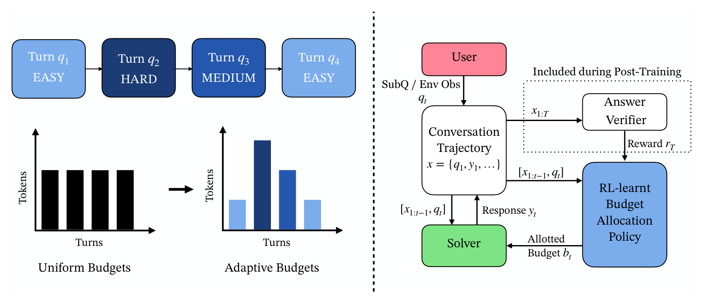
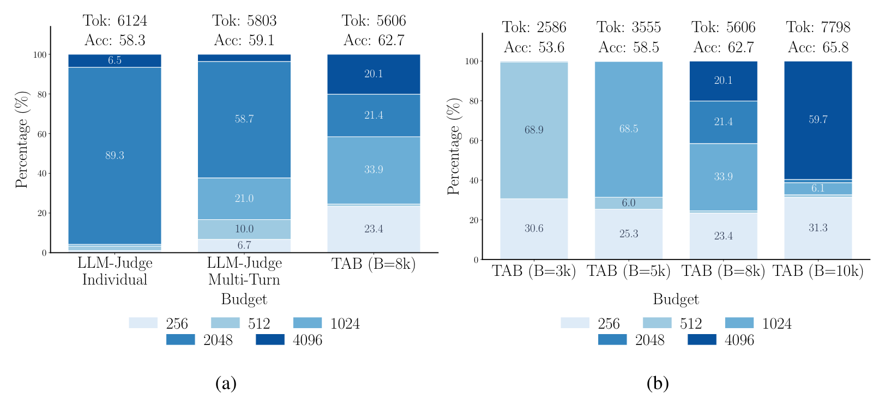
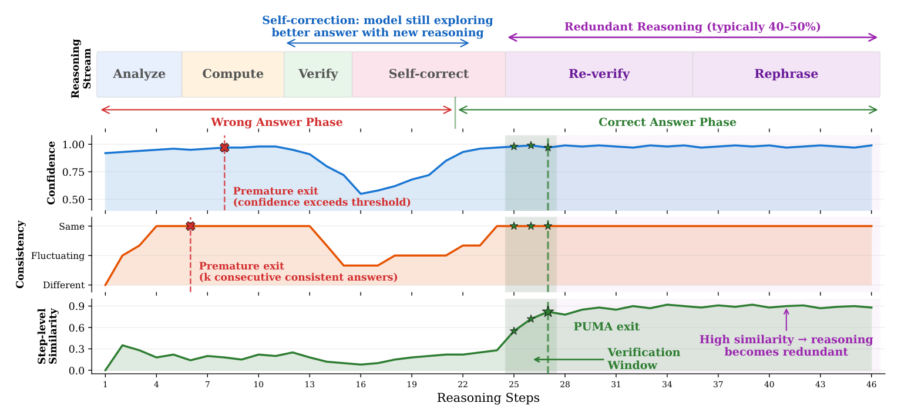
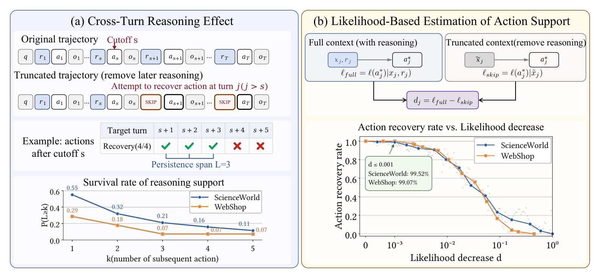
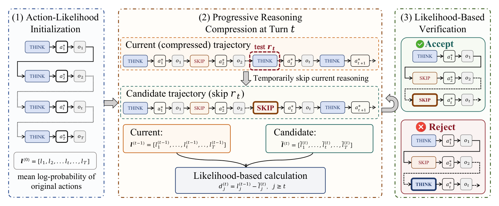
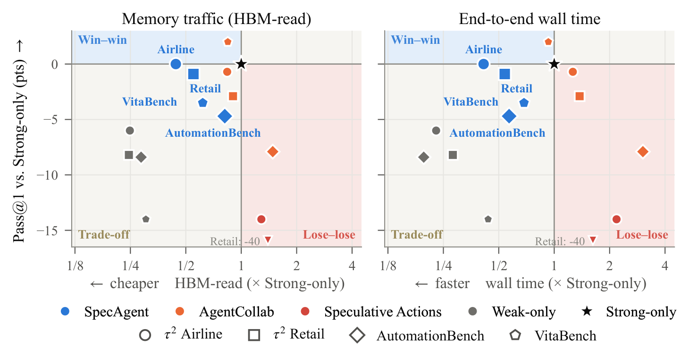

# Adaptive Reasoning: From Computer Use to Robot Use

## Why Robot Use Needs Adaptive Reasoning

在直接输出末端位姿的 robot-use 闭环中，模型读取图像与机器人状态，生成动作 JSON，控制器执行后返回新观察。抓取失败和物体位移会改变后续决策所需的信息。

推理调度的目标是根据执行状态分配计算，同时保持完整任务的成功率。

computer-use 与 robot-use 都通过“观察 → 决策 → 执行 → 新观察”推进任务。机器人还受到接触、动力学和感知误差的影响，动作结果需要通过新的观察确认。

## Where Acceleration Comes From

- **Adaptive Budgets — TAB：** 根据交互历史分配每轮推理预算。
- **Early Exit — PUMA：** 检测推理冗余，在答案通过核验后提前停止。
- **Cross-Turn Reuse — RACE：** 利用历史推理对后续动作的支持，省略重复思考。
- **Selective Escalation — STEPWISE：** 小模型执行常规步骤，强模型处理异常与关键核验。
- **Speculative Verification — SpecAgent：** 小模型起草多步，强模型批量审核。

TAB、PUMA、RACE 减少重复或过量推理；STEPWISE、SpecAgent 调整大小模型的分工。生成量、成功率与耗时共同决定加速收益。

## Adaptive Budgets — TAB

### Problem

多轮任务中，一轮预算会影响回答质量，也会影响后续交互。TAB 将这些依赖建模为序贯决策，用整条轨迹的终局结果评价预算分配。

TAB 将整条交互视为预算分配问题，优化**完成任务与总预算之间的折中**。

### Method and RL Recipe

TAB 分开使用 Budgeter 和 Solver。每轮 Budgeter 根据历史与当前输入输出难度档位，再映射成 Solver 的 token 预算或 reasoning-effort 设置。Solver 在这个设置下生成回答，新的反馈进入下一轮。

每轮的预算选择与回答生成分别为：

$$
b_t\sim\pi_\phi(\cdot\mid h_t),
\qquad
y_t\sim f_\theta(\cdot\mid h_t;b_t).
$$

$t$ 是交互轮次；$h_t$ 包括当前输入与之前的交互；$\phi$ 是预算策略参数，$\theta$ 是 Solver 参数。RL 更新 Budgeter，Solver 提供预算动作后的反馈。

训练数据来自 MATH 训练集的 Level-5 问题。Planner 先分解问题，Budgeter 逐轮选择档位，固定的 Solver 在对应预算下生成回答。训练只更新 Budgeter。完成训练后，同一预算策略直接用于 BFCL、Tau-Bench 和 Terminal-Bench。

训练用 GRPO：

1. 同一道训练题采样多条完整交互，每条使用不同的预算分配序列。
2. 到终局检查答案，同时统计实际消耗的 Solver token。
3. 根据全局预算计算奖励，在同题轨迹组内标准化。
4. 将轨迹优势用于该轨迹中所有预算决策的 clipped policy 更新。

训练使用实际消耗的 token。记第 $t$ 轮消耗为 $n_t$，轨迹奖励为：

$$
R_i=S_i-\lambda\max\!\left(0,\sum_t n_{i,t}-B\right).
$$

$S_i$ 是终局正确性，$B$ 是整项任务的目标预算，$\lambda$ 是超额成本系数。低于 $B$ 时成本项为零，策略可以把预算集中到关键轮次。

$$
\widehat A_i
=\frac{R_i-\operatorname{mean}_{j\in\mathcal G(x)}R_j}
{\operatorname{std}_{j\in\mathcal G(x)}R_j}.
$$

$\mathcal G(x)$ 是同一道题的完整轨迹组。**同一条轨迹的各轮共享这个优势**；它学习哪些整体分配方案更好，尚未给每一轮提供独立的因果贡献估计。

Qwen3-4B Budgeter 使用 LoRA rank 64、学习率 $10^{-5}$，训练 125 个更新。全局预算 $B\in\{3k,5k,8k,10k\}$ 各自对应一个独立策略。模型输出 0–4 五个档位，映射到 Solver 的 256–4096 token 预算。

数学任务中的预算分布如下；全局预算收紧时，小预算档位的使用比例上升。

迁移实验最多节省约 20% token 与 15% 延迟，计时包含 Budgeter 开销。两张图分别给出准确率与总 token、准确率与端到端延迟的关系。

## Early Exit — PUMA

### Problem

PUMA 观察到，高置信度和重复出现的答案可以早于推理收敛。模型此时仍在探索或自我修正，直接截断会损失后续推理。

原文用示意图区分答案就绪与推理收敛：置信度和答案一致性可能较早变高，步骤语义相似度则在重复验证阶段持续升高。

PUMA 据此用语义冗余定位候选退出点，再核验答案，截去收敛之后的重复生成。

### Method and Training Recipe

#### Redundancy Detector Training

PUMA 的主推理模型保持冻结，另行训练 Qwen3-Embedding-0.6B 冗余检测器。Appendix B.2 的数据与训练流程为：

1. 从四个长推理模型收集 AMC23、GSM8K 推理轨迹，并加入 Open-Thoughts-114K，覆盖约 5,098 道不同问题。
2. 切分推理步骤，用 GPT-5-mini 标注当前步骤相对前文是否带来新信息，得到 40,844 条种子样例。
3. 用 GPT-4o-mini 将新颖步骤改写为语义冗余版本，扩充重复、重述和无进展验证等模式。
4. 整理为 anchor、冗余正样本、新颖负样本，去重后得到 701,641 条对比训练数据。
5. 用 InfoNCE 训练检测器：LoRA rank 32、学习率 $10^{-4}$、5 epochs。冗余步骤被拉近，有新进展的步骤被拉远。

#### Inference-Time Exit

在线流程是：

1. 按自然段或步骤边界切分当前 CoT。
2. 检测器比较当前步骤与最近的历史步骤，标出可能冗余的位置。
3. 仅在这些候选位置，从当前前缀诱导一个试答，取得答案及其 token 置信度。
4. 在后续候选位置继续试答，检查答案一致、置信度足够且没有明显下降。
5. 检查通过就结束思考；否则继续生成。晚期持续重复时，另有带最低置信度门槛的 Loop Breaker。

将当前推理步骤记为 $r_t$，检测器记为 $f$，回看窗口为 $k$：

$$
s_t=\max_{\max(1,t-k)\le j<t}
\cos\!\left(f(r_j),f(r_t)\right).
$$

$s_t$ 超过相似度阈值时，只产生候选退出点。原文默认 $k=1$。试答的置信度来自其 token 概率的几何平均；连续候选之间还要比较答案一致性。这个二阶段结构把较便宜的检测放在前面，减少试答调用。

原文同时统计检测、试答和总耗时。在 DS-7B、DS-14B 上，平均加速分别约为 1.40×、1.28×。部分对照因频繁试答而更慢，说明检测触发频率直接影响时间收益。

退出行为进一步分为核验通过、Loop Breaker 和完整生成。上图同时比较各分组的答案正确性，检查早停是否打断自我修正。

#### Model Internalization

§6.2 与 Appendix F 使用 12K 道数学训练题，让底座生成完整 CoT，再运行 PUMA 记录候选退出点与通过核验的停止点。随后分别构造：

- **SFT：** 保留提前退出后仍正确、且前缀长度低于完整 CoT 的 60% 的样例，约 6.5K 条；训练目标是截断推理与答案。
- **DPO：** 长短版本都正确时，以 PUMA 截断链为 chosen、完整链为 rejected，约 5.8K 对。
- **GRPO：** 将问题、候选位置前缀和结束思考标记拼成输入，约 15K 条；每个输入采样 4 个答案 completion。

三种训练均在 DS-R1-Distill-Qwen-7B 上使用 LoRA rank 64。GRPO 的 rollout 从给定前缀后的答案阶段开始，奖励为：

$$
R_i=c_i\!\left[1+0.5\!\left(1-\frac{\ell_i}{4096}\right)\right]
+b_i^{\mathrm{rank}}.
$$

$c_i$ 表示答案正确性，$\ell_i$ 是该前缀之后的 completion 长度，$b_i^{\mathrm{rank}}$ 是组内排序奖励，取值为 $\{0.5,0.25,0,-0.25\}$，偏好更短的正确 completion。原文用 GRPO 更新，比较相同 recipe 下的固定位置前缀。

GRPO 训练最多 1,500 个更新，学习率 $10^{-6}$，completion 上限为 4,096 token。训练后的变体直接用 vLLM 推理，不调用冗余检测器和答案核验模块。训练中的长度项统计给定前缀之后的答案阶段。

## Cross-Turn Reuse — RACE

### Problem

RACE 研究推理的跨轮支持：一轮思考会持续影响后续动作，删减时需要同时检查这些动作。逐个上下文重新采样动作验证，会增加训练成本。

原文先删除部分思考，检查后续参考动作是否仍能生成，再比较动作恢复率与似然下降的关系。

似然下降较小时，参考动作通常仍可恢复。RACE 用这个关系构造跨轮推理删减信号。

### Method and RL Recipe

LoGiC 从已有轨迹出发，保留第一轮思考，从第二轮起依次尝试删除。一次删除需要同时通过当前及后续参考动作的检查；已接受的删除会进入下一次评估的上下文。

先对固定参考动作做 teacher-forced scoring：

$$
\ell(a_j^*\mid h)
=\frac1{M_j}\sum_{k=1}^{M_j}
\log\pi_\theta(a_{j,k}^*\mid h,a_{j,<k}^*).
$$

$a_j^*$ 是原轨迹第 $j$ 轮动作，$M_j$ 是其 token 数。这个量来自已有动作的前向打分，无需重新生成多个候选动作。

在当前已经压缩的轨迹上，尝试删除第 $t$ 轮思考。定义：

$$
\begin{aligned}
d_j^{(t)}&=
\ell_{j,\mathrm{before}}^{(t)}
-\ell_{j,\mathrm{after}}^{(t)},\\
\mathrm{SKIP}_t=1
&\iff \max_{j\ge t}d_j^{(t)}\le\varepsilon_{\mathrm{del}}.
\end{aligned}
$$

before、after 分别表示本次删除前后的上下文，后续参考动作和观察保持原样。阈值 $\varepsilon_{\mathrm{del}}$ 控制允许的似然下降。已接受的删除会保留在下一次检查的上下文中。

#### Supervised Fine-Tuning

1. 使用 DeepSeek-V4-Pro-0813 标注的成功轨迹。
2. 由 Qwen3.5-9B 运行 LoGiC，似然下降阈值设为 $0.001$。
3. 删除通过检查的思考，保留动作和观察，构成 THINK／SKIP 混合轨迹。
4. 对模型生成的思考与动作 token 计算交叉熵，得到 RACE-SFT checkpoint。

#### Agentic Reinforcement Learning

1. 从 RACE-SFT 初始化，在同一任务上采样多条完整轨迹。每批 16 个任务、每个任务 8 条，共 128 条轨迹。
2. 计算任务回报和组相对优势。对成功轨迹运行 LoGiC，得到 SKIP 轮次；失败轨迹沿用普通 GRPO。
3. **Reasoning masking：** SKIP 轮次的思考 token 不进入 GRPO 策略损失，动作 token 继续参与。归一化分母保留原始 token 数。
4. **Reasoning closure：** 在 SKIP 轮次的压缩上下文上，将结束思考 token 作为监督目标，提高立即结束当前思考段的概率，随后继续生成动作。
5. 联合计算 masked GRPO 与 closure 损失，更新同一策略模型。

仅仅 mask 会停止强化冗余思考，closure 则提供主动结束它的信号：

$$
\begin{aligned}
\mathcal L_{\mathrm{close}}
&=-\frac1{\sum_iT_i}
\sum_{i\in\mathcal I_{\mathrm{succ}}}
\sum_{t\in\mathcal S_i}
\log\pi_\theta(e\mid\widetilde h_{i,t}),\\
\mathcal L_{\mathrm{actor}}
&=\mathcal L_{\mathrm{GRPO,masked}}
+\lambda_{\mathrm{close}}\mathcal L_{\mathrm{close}}.
\end{aligned}
$$

$T_i$ 是轨迹轮数，$\mathcal I_{\mathrm{succ}}$ 是成功轨迹集合，$\mathcal S_i$ 是 LoGiC 判为 SKIP 的轮次；$e$ 是思考终止 token，$\widetilde h_{i,t}$ 是对应压缩上下文。closure 使用目标 token 的交叉熵。其权重在 ScienceWorld、WebShop、AppWorld 中设为 0.02，在 DeepSearch 中设为 0.01。RL 学习率为 $10^{-6}$，每批 rollout 更新 1 epoch。

在相同底座的消融中，RACE 相对普通 SFT＋GRPO 减少约 32%–80% 的推理 token，四个基准上的成功率变化不超过 1.4 个百分点。效率指标是推理 token 数。

## Selective Escalation — STEPWISE

### Problem

computer-use 的失败经常表现为两类：重复操作却没有进展，或操作看起来连贯，最终结果却偏离用户目标。每步都调用强模型核验很贵，等终局才发现错误又可能太晚。

STEPWISE 用轻量监测器寻找值得增加计算的时刻。

### Method and Training Recipe

小模型默认执行，两个 ModernBERT 监测器分析最近的推理与动作记录：

- **Stuck Monitor** 读局部历史，检测循环、重复与停滞。
- **Milestone Monitor** 额外读任务要求，选择有意义的进展检查点。

Stuck 超阈值后，下一步交给强策略恢复。Milestone 超阈值后，先让强验证器检查“上次核验到现在”的任务进展：输入包括任务、分段动作记录，以及当前和上次检查点的截图；检查通过就继续使用小模型，失败才升级。

checkpoint 用于选择核验位置。监测器的训练目标是事件分类。

Appendix B 使用 300 条 GUI 执行轨迹训练两个 ModernBERT-base 分类器：

1. 每条轨迹由 GPT-5.2 独立标注 5 次，分别识别 stuck 和 milestone。
2. 至少 3 次标为正例的步骤保留为正例；5 次都未标中的保留为负例；只出现 1–2 次的样例丢弃。
3. 输入包含当前步骤及最多 5 个前序步骤；milestone 输入额外包含任务描述。
4. 在 `[CLS]` 表征上接二分类头，用逆类别频率加权的交叉熵训练。
5. 两个分类器各训练 5 epochs，AdamW 学习率为 $5\times10^{-5}$，最大序列长度为 2,048。

运行时，两个监测器读取文本推理与动作记录；只有触发 milestone 后的强核验才读取截图。

OSWorld 与 WebArena 的消融分别启用 stuck、milestone 和两种监测器，完整配置取得最高成功率。原文还比较固定间隔核验；成本表中的延迟按单次请求统计。

## Speculative Verification — SpecAgent

### Problem

长工具链中，强模型逐步生成动作会累积串行解码时间。小模型成本较低，但任务成功率低于强模型。SpecAgent 利用强模型的核验与修复能力保留小模型的有效进展。

SpecAgent 把强模型的主要工作改为**审核小模型已经写出的多步片段**。核验一次读入整段，强模型只需生成短判定与必要修复，因而有机会减少串行解码。

### Execution Protocol

两个模型保持冻结，按以下协议交互：

1. **Draft：** 小模型连续起草；只读工具调用可以执行并取得真实结果，后续步骤依赖这些实际观察。
2. **Hold：** 遇到第一个会修改环境的动作，将其暂存，并结束当前草稿段。
3. **Verify：** 强模型读历史和整段草稿，返回语义上可接受的最长前缀，以及首个错误的解释和可选替换动作。
4. **Commit or repair：** 全部通过才执行暂存动作；被拒绝的后缀丢弃，必要时由强模型补一个修复步骤，再从已提交历史重新起草。

纯只读片段达到长度上限时，原文允许不经强核验直接提交。核验标准是动作能否合理推进任务，允许接受与强模型自身选择不同的有效动作。

原文用强模型的权重读取次数近似解码成本。设一段有 $n$ 步、每步被接受的概率约为 $p$，强模型完整生成一步需 $d$ 次权重读取，而短核验需 $v$ 次。若拒绝后额外调用强模型修复的概率为 $q$，强模型成本相对值为：

$$
\mathcal R=
\frac{1-p}{1-p^n}\frac{v}{d}
+q(1-p).
$$

在同一近似下，若小模型起草一步的耗时是强模型生成一步的 $\kappa$ 倍，总延迟相对值为：

$$
\mathcal L=
\mathcal R+
\kappa\frac{n(1-p)}{1-p^n}.
$$

$q$ 表示额外修复调用的概率。成本模型假设强模型处于 decode-bound 的服务区间、片段内接受近似独立，并忽略工具时间。较短判定、较高接受率和更快的小模型都会降低相对延迟。

原文用相同大小模型部署和相同并发比较不同协议，并计入草稿、拒绝片段、核验、修复与重试。其 Table 2 中，Airline 的成功率均为 86.0%，平均任务时间从 305.2 秒降至 126.2 秒；其他任务的质量恢复程度不一致。

FLOPs 和 HBM-read 按请求 token 与模型架构估算，耗时实际计量。SpecAgent 的估算 FLOPs 可以上升：强模型对草稿做较大的并行 prefill，同时减少反复读取权重的逐 token 解码。下图进一步改变核验边界、修复方式和语义接受标准：额外核验每个片段会增加开销，取消融合修复或语义核验也会降低成功率。

## Transfer to Robot Use

五种机制分别作用于预算、停止位置、跨轮推理、模型升级和批量核验。迁移到 robot-use 时，输入扩展为图像、本体状态与执行反馈，输出对应实际动作。

动作置信度、文本冗余和 JSON 一致性需要与物理执行结果共同评价。机械臂动作改变环境，后续观察依赖真实执行；SpecAgent 连续执行只读工具调用的条件因此受到限制。

采用 PPO 训练调度策略时，需要明确调度动作、可见反馈、任务回报及计算成本。评测统一报告完整任务成功率、异常恢复率和总耗时，并计入调度、核验、重试及失败轨迹的成本。

## References

- Neharika Jali et al. **Not All Turns Are Equally Hard: Adaptive Thinking Budgets For Efficient Multi-Turn Reasoning in Agents.** First released 2026-04-06; reviewed version 2604.05164v4, 2026-11-15. [Paper](https://arxiv.org/html/2604.05164v4). §3.3, §4.3, Appendix A.
- Dehai Min et al. **Stop When Reasoning Converges: Semantic-Preserving Early Exit for Reasoning Models.** 2605.17672v1, 2026-05-17. [Paper](https://arxiv.org/html/2605.17672v1). §3, §5.2, §6.2, Appendix F.
- Yiruo Cheng et al. **When Should Agents Think? Adaptive Reasoning via Cross-Turn Estimation.** 2610.12061v1, 2026-10-08. [Paper](https://arxiv.org/html/2610.12061v1). §3.1–3.3, Table 2, Figure 4.
- Jinbiao Wei et al. **Step-level Optimization for Efficient Computer-use Agents.** 2604.27151v1, 2026-04-29. [Paper](https://arxiv.org/html/2604.27151v1). §4, §6, Appendix B.
- Zilin Wang et al. **Trajectory-Level Speculation with Semantic Verification for Tool-Using Agents.** 2610.21463v1, 2026-10-15. [Paper](https://arxiv.org/html/2610.21463v1). §3.2–3.3, Table 2, §5.
