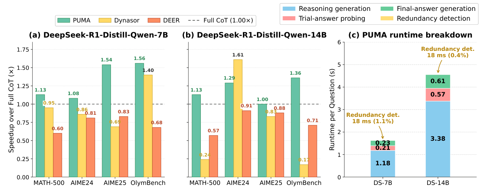
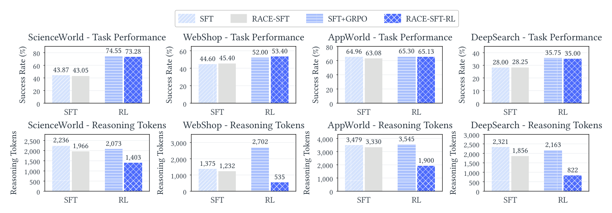

# Adaptive Reasoning: From Computer Use to Robot Use

## Why Robot Use Needs Adaptive Reasoning

考虑一个闭环：模型读取相机画面与机器人状态，生成末端位姿 JSON，控制器执行，再把实际结果送回模型。夹爪顺利接近杯子时，下一步可能只需沿用计划；抓取落空、杯子被碰动时，模型需要重新判断位置、接触状态与后续动作。

每轮完整思考会给常规动作重复付费，一直压缩思考又可能使异常状态下的错误持续累积。我们想研究的是：**根据任务进展与实际反馈，把必要计算放到能够改善后续执行的时刻。** 本文讨论 LLM 生成文本动作的 robot-use 接口，不将这种执行方式推广到所有 VLA，也不展开连续 latent 推理。

computer-use 提供了接近的交互结构：观察、决策、执行、新观察。其执行时间、错误恢复和多轮约束与机器人有关；差别在于机械臂每次移动都会改变物理状态，动作结果又受接触与感知误差影响。迁移需要保留闭环，而不是只把工具名改成坐标。

## Where Acceleration Comes From

先确定省掉了什么，再选代表论文。对串行执行的 agent，可以用下面的近似分解建立成本直觉：

$$
\begin{aligned}
T_{\mathrm{serial}}\approx\sum_t\Big(
&T_{\mathrm{obs},t}+T_{\mathrm{prefill},t}
+\frac{N_t}{\nu_t}\\
&+T_{\mathrm{aux},t}+T_{\mathrm{exec},t}\Big).
\end{aligned}
$$

$t$ 是交互轮次，$N_t$ 是解码 token 数，$\nu_t$ 是有效解码速率。其余各项分别是观察处理、上下文 prefill、路由与核验等辅助计算、工具或动作执行的秒数。这是解释用的串行近似；有重叠执行时，需要测实际关键路径。

按主要加速来源，下面选择五篇：

- **Adaptive Budgets — TAB：** 生成前，根据历史给不同轮次分配计算预算。
- **Early Exit — PUMA：** 生成中，发现推理趋于冗余且答案稳定时提前结束。
- **Cross-Turn Reuse — RACE：** 前面推理已经支持后续动作时，省掉重复思考。
- **Selective Escalation — STEPWISE：** 默认使用小模型，把强模型留给异常恢复和关键核验。
- **Speculative Verification — SpecAgent：** 小模型起草多步，强模型批量核验，减少昂贵的串行解码。

这些类别按主要干预位置组织，机制可以交叉。前两类主要控制一次生成的计算量，第三类利用交互历史，后两类改变大小模型的分工。**少 token、少 FLOPs、少等待时间是三个不同结论。** SpecAgent 就展示了 FLOPs 上升而耗时下降的情况。

选文核对至 2026-11-25，优先考虑 2026 年首次公开、方法清楚、消融与成本口径可追踪的工作。TAB 首发于 4 月，采用 11 月 v4；PUMA 为 5 月工作；RACE 和 SpecAgent 为 10 月工作；STEPWISE 是保留的 4 月 computer-use 工作。会议状态作为辅助信息，不用会议年份替代首次发布日期。

PPO 保留为 robot-use 迁移时的算法选择。原论文中的 GRPO、对比学习、监督分类和推理时协议分别解释，不把优化器名称当作分类轴。五篇结果均是原论文报告，本文没有复现其训练或加速数值。

## Adaptive Budgets — TAB

### Problem

多轮任务的预算存在前后依赖：前面少花一点，可能节省计算，也可能因为漏掉约束导致后面反复补救。每轮独立估计难度，无法充分评价这种影响。

TAB 将整条交互视为预算分配问题，优化**完成任务与总预算之间的折中**。

### Method and RL Recipe

TAB 分开使用 Budgeter 和 Solver。每轮 Budgeter 根据历史与当前输入输出难度档位，再映射成 Solver 的 token 预算或 reasoning-effort 设置。Solver 在这个设置下生成回答，新的反馈进入下一轮。

可将其写为：

$$
b_t\sim\pi_\phi(\cdot\mid h_t),
\qquad
y_t\sim f_\theta(\cdot\mid h_t;b_t).
$$

$t$ 是交互轮次；$h_t$ 包括当前输入与之前的交互；$\phi$ 是预算策略参数，$\theta$ 是 Solver 参数。RL 更新 Budgeter，Solver 提供预算动作后的反馈。

原文只在便宜的多轮数学任务上训练 Budgeter，随后不再微调，迁移到 BFCL、Tau-Bench、Terminal-Bench。这个设置直接检验了**预算策略的跨任务迁移**。

训练用 GRPO：

1. 同一道训练题采样多条完整交互，每条使用不同的预算分配序列。
2. 到终局检查答案，同时统计实际消耗的 Solver token。
3. 根据全局预算计算奖励，在同题轨迹组内标准化。
4. 将轨迹优势用于该轨迹中所有预算决策的 clipped policy 更新。

为区分“分配量”与“消耗量”，这里把第 $t$ 轮实际消耗记为 $n_t$。原文式 (2) 的脚注明确，训练计分使用实际 token：

$$
R_i=S_i-\lambda\max\!\left(0,\sum_t n_{i,t}-B\right).
$$

$S_i$ 是终局正确性，$B$ 是整项任务的目标预算，$\lambda$ 是超额成本系数。低于 $B$ 时成本项为零，策略可以把预算集中到关键轮次。

$$
\widehat A_i
=\frac{R_i-\operatorname{mean}_{j\in\mathcal G(x)}R_j}
{\operatorname{std}_{j\in\mathcal G(x)}R_j}.
$$

$\mathcal G(x)$ 是同一道题的完整轨迹组。**同一条轨迹的各轮共享这个优势**；它学习哪些整体分配方案更好，尚未给每一轮提供独立的因果贡献估计。

recipe 的一个可复现配置是 Qwen3-4B Budgeter、LoRA rank 64、125 个训练更新；对不同全局目标预算分别训练策略。原文 §3.3 与 Appendix A 给出奖励、映射、训练和计时口径。

两图需要一起看：上图检验 token，下面检验时间。原文迁移实验报告最多约 20% token 与 15% 延迟节省；计时包含 Budgeter 开销。它支持这些测试环境中的迁移，尚未覆盖物理控臂。

### Transfer to Robot Use

这篇最直接支持“先学调度，再尝试跨域迁移”的研究路线。可以先让预算策略读历史、当前视觉信息与执行反馈，再决定控臂模型下一轮的推理强度。

不过，TAB 的跨域实验仍主要使用文本交互状态。相机变化、接触与物体位移需要合适的表征；同一个难度档位对不同控臂模型是否具有一致含义，也要测试。

Budgeter 本身还会增加延迟。对小型控臂模型，额外跑一次 4B Budgeter 可能不划算。冻结同一动作底座、比较轻量选择器与固定预算，并统计整项任务真实耗时，才容易解释收益来自哪里。

## Early Exit — PUMA

### Problem

模型可能很早就给出一个稳定答案，但后面的推理仍在发现约束或修正漏洞。只看答案置信度，会把“已经有答案”和“已经完成必要推理”混在一起。

PUMA 先检查最近的推理是否开始重复，再核验停止时的答案。它希望省掉的是**收敛之后的冗余生成**，同时避免在有效探索中途截断。

### Method and Training Recipe

主方法在推理时运行，底座模型保持冻结。训练对象是一个从 Qwen3-Embedding-0.6B 初始化的冗余检测器：用对比学习区分“语义接近但有新进展”和“重复已有结论”的推理步骤，避免直接把通用 embedding 相似度当作逻辑冗余。

在线流程是：

1. 按自然段或步骤边界切分当前 CoT。
2. 检测器比较当前步骤与最近的历史步骤，标出可能冗余的位置。
3. 仅在这些候选位置，从当前前缀诱导一个试答，取得答案及其 token 置信度。
4. 在后续候选位置继续试答，检查答案一致、置信度足够且没有明显下降。
5. 检查通过就结束思考；否则继续生成。晚期持续重复时，另有带最低置信度门槛的 Loop Breaker。

将当前推理步骤记为 $r_t$，检测器记为 $f$，回看窗口为 $k$：

$$
s_t=\max_{\max(1,t-k)\le j<t}
\cos\!\left(f(r_j),f(r_t)\right).
$$

$s_t$ 超过相似度阈值时，只产生候选退出点。原文默认 $k=1$。试答的置信度来自其 token 概率的几何平均；连续候选之间还要比较答案一致性。这个二阶段结构把较便宜的检测放在前面，减少试答调用。

这篇进入主线的一个原因是它实际核算了时间。原文 §5.2 与 Appendix C.5 报告检测、试答和总耗时，在 DS-7B、DS-14B 上分别得到约 1.40×、1.28× 加速。它也报告部分对照虽然减少 token，却因频繁试答而更慢。收益仍受模型、任务与实现影响，不能直接套到控臂系统。

原文 §6.2 进一步比较 SFT、DPO、GRPO 内化停止信号，其中有一个容易忽略的实现细节：

- PUMA-SFT 训练正确的截断推理与答案。
- PUMA-DPO 在长短回答都正确时，偏好 PUMA 截断版本。
- **PUMA-RL 的 Appendix F 配方提供已经截断并闭合思考的前缀，让模型只生成答案阶段。** 它没有在这段训练中重新采样整条 CoT 来自主选择退出位置。

RL 的四条同前缀采样使用：

$$
R_i=c_i\!\left[1+0.5\!\left(1-\frac{\ell_i}{4096}\right)\right]
+b_i^{\mathrm{rank}}.
$$

$c_i$ 表示答案正确性，$\ell_i$ 是该前缀之后的 completion 长度，$b_i^{\mathrm{rank}}$ 是组内排序奖励，取值为 $\{0.5,0.25,0,-0.25\}$，偏好更短的正确 completion。原文用 GRPO 更新，比较相同 recipe 下的固定位置前缀。

因此，这组实验支持“PUMA 选出的前缀能提供有用的训练信号”。它没有单独证明模型学到了一个与外部检测器等价的在线停止策略。RL 配方中的长度也不能误读成训练时重新生成的完整 CoT 长度。

### Transfer to Robot Use

可借鉴的是**先检测推理是否仍有新进展，再决定是否值得继续支付解码成本**。对固定当前观察的一轮决策，可以测试在部分 CoT 后诱导动作，比较动作稳定性与最终执行结果。

但两个坐标 JSON 很相似，不代表动作正确；文本推理重复，也可能是反复检查关键接触条件。机器人中的“可停止”最终需要与完整任务成功和异常恢复联系起来。反复试动作或试答本身也有成本，不能只汇报截断后的 token。

如果目标是用 PPO 学习自主停止，需要明确增加继续／停止决策，并从它之后的实际动作结果学习。这属于新的迁移实验，不能直接称为复现 PUMA-RL。

## Cross-Turn Reuse — RACE

### Problem

前一轮形成的计划可以支持后面几轮动作。逐轮独立删掉看似多余的思考，可能忽略它对后续动作的作用；每次都重新采样动作来验证，又会增加训练成本。

RACE 用**参考动作的似然变化**近似判断思考的跨轮作用。

### Method and RL Recipe

LoGiC 从已有轨迹出发，保留第一轮思考，从第二轮起依次尝试删除。一次删除需要同时通过当前及后续参考动作的检查；已接受的删除会进入下一次评估的上下文。

先对固定参考动作做 teacher-forced scoring：

$$
\ell(a_j^*\mid h)
=\frac1{M_j}\sum_{k=1}^{M_j}
\log\pi_\theta(a_{j,k}^*\mid h,a_{j,<k}^*).
$$

$a_j^*$ 是原轨迹第 $j$ 轮动作，$M_j$ 是其 token 数。这个量来自已有动作的前向打分，无需重新生成多个候选动作。

在当前已经压缩的轨迹上，尝试删除第 $t$ 轮思考。定义：

$$
\begin{aligned}
d_j^{(t)}&=
\ell_{j,\mathrm{before}}^{(t)}
-\ell_{j,\mathrm{after}}^{(t)},\\
\mathrm{SKIP}_t=1
&\iff \max_{j\ge t}d_j^{(t)}\le\varepsilon_{\mathrm{del}}.
\end{aligned}
$$

before、after 分别表示本次删除前后的上下文，后续参考动作和观察保持原样。阈值 $\varepsilon_{\mathrm{del}}$ 控制允许的似然下降。每次比较针对当前压缩状态，并非始终针对完整原轨迹。

这些信号进入两个训练阶段：

1. **SFT：** 删除通过检查的思考，得到有些轮次直接行动的示范。
2. **On-policy RL：** 先采样完整任务轨迹，对成功轨迹运行 LoGiC；失败轨迹继续普通 GRPO。
3. **Reasoning masking：** SKIP 轮次的思考 token 不进入 GRPO 策略梯度，动作 token 仍参与优化。原有 token 数继续用于损失归一化。
4. **Reasoning closure：** 在 SKIP 轮次的压缩上下文上，监督模型输出结束思考的 token。

仅仅 mask 会停止强化冗余思考，closure 则提供主动结束它的信号：

$$
\begin{aligned}
\mathcal L_{\mathrm{close}}
&=-\frac1{\sum_iT_i}
\sum_{i\in\mathcal I_{\mathrm{succ}}}
\sum_{t\in\mathcal S_i}
\log\pi_\theta(e\mid\widetilde h_{i,t}),\\
\mathcal L_{\mathrm{actor}}
&=\mathcal L_{\mathrm{GRPO,masked}}
+\lambda_{\mathrm{close}}\mathcal L_{\mathrm{close}}.
\end{aligned}
$$

$T_i$ 是轨迹轮数，$\mathcal I_{\mathrm{succ}}$ 是成功轨迹集合，$\mathcal S_i$ 是 LoGiC 判为 SKIP 的轮次；$e$ 是思考终止 token，$\widetilde h_{i,t}$ 是对应压缩上下文。这里是训练目标的变化，并未另加统一长度奖励。

相对普通 SFT＋GRPO，论文在四个 agent 基准上报告约 32%–80% 的推理 token 减少，成功率变化不超过 1.4 个百分点。应以这个同底座消融评价删减机制，不能把相对未训练底座的全部提升都归给它。这部分直接证据是推理 token 数，尚不能等同于机器人闭环的实测加速。方法见 §3，消融见 Table 2、Figure 4。

### Transfer to Robot Use

它给出了一个适合机器人验证的具体假设：**计划已经覆盖的常规动作可以省略重复思考，新的执行信息可能使原计划失效。** 是否发生这种行为，需要通过异常执行实验检验。

其似然信号也有物理迁移风险。JSON 中数值的 token 概率不能直接衡量抓取质量；不同坐标可能产生等效动作，相似坐标也可能落在不同接触区域。

LoGiC 评估时保留原来的后续观察，因此它提供的是固定轨迹上的支持度代理。删掉思考后重新闭环执行，动作分布和后续状态都可能改变。迁移实验应把似然代理与实际任务结果对照，额外计算也需要计入训练成本。

## Selective Escalation — STEPWISE

### Problem

computer-use 的失败经常表现为两类：重复操作却没有进展，或操作看起来连贯，最终结果却偏离用户目标。每步都调用强模型核验很贵，等终局才发现错误又可能太晚。

STEPWISE 用轻量监测器寻找值得增加计算的时刻。

### Method and Training Recipe

小模型默认执行，两个 ModernBERT 监测器分析最近的推理与动作记录：

- **Stuck Monitor** 读局部历史，检测循环、重复与停滞。
- **Milestone Monitor** 额外读任务要求，选择有意义的进展检查点。

Stuck 超阈值后，下一步交给强策略恢复。Milestone 超阈值后，先让强验证器检查“上次核验到现在”的任务进展：输入包括任务、分段动作记录，以及当前和上次检查点的截图；检查通过就继续使用小模型，失败才升级。

所以 checkpoint 的作用是**选择核验位置**。这里没有把完成 checkpoint 直接当成 RL 过程奖励。

训练流程与前四篇不同：

1. 收集小模型执行轨迹，切出局部历史窗口。
2. 用强 LLM 多次标注 stuck 与 milestone，保留高一致性标签。
3. 用带类别平衡的交叉熵训练两个分类器。
4. 在部署时选择阈值，权衡成功率与强模型使用成本。

原文使用约 300 条 GUI 轨迹训练监测器，未对整个级联系统做 PPO。始终在线的轻量监测器只读文本记录；截图在触发 milestone 的强核验中使用。这个输入差别影响它对实际执行状态的可见性。

论文在 OSWorld 与 WebArena 比较了小模型、强模型和级联，另做 stuck-only、milestone-only、两者结合与固定间隔核验的对照。它提供的是系统成本与成功率的折中，不能归结为单模型学出了更短的 CoT。表中的延迟列是每次请求的 Lat./Req.，需要与整项任务耗时区分。方法见 §4，事件与固定间隔比较见 §6.2。

### Transfer to Robot Use

最有价值的是把**异常恢复**和**阶段核验**分开。抓取持续失败可以触发恢复；抓住物体、放入容器之后，可以核验实际状态是否符合下一阶段的前提。

但相同的末端动作重复几次，既可能是卡住，也可能是正常接触操作。只看模型自己的文本描述容易遗漏“它认为抓住了，实际上没有”的情况。机器人监测需要考虑图像、本体状态或实际动作结果。

这篇也适合作为简单而有力的基线：固定动作模型，按可观测异常触发长推理。若学习式调度不能胜过这个规则方案，其额外训练与模块成本就需要重新解释。

## Speculative Verification — SpecAgent

### Problem

长工具链中，让强模型逐步生成所有动作很慢。直接换成小模型可能损失质量；每步再请强模型重新生成一次，又容易付出两份解码成本。

SpecAgent 把强模型的主要工作改为**审核小模型已经写出的多步片段**。核验一次读入整段，强模型只需生成短判定与必要修复，因而有机会减少串行解码。

### Method and Training Recipe

这篇的主方法是推理时协议，没有用 PPO 或 GRPO 更新模型。理解它的核心是跟踪哪些动作已经执行、哪些动作尚未提交：

1. **Draft：** 小模型连续起草；只读工具调用可以执行并取得真实结果，后续步骤依赖这些实际观察。
2. **Hold：** 遇到第一个会修改环境的动作，将其暂存，并结束当前草稿段。
3. **Verify：** 强模型读历史和整段草稿，返回语义上可接受的最长前缀，以及首个错误的解释和可选替换动作。
4. **Commit or repair：** 全部通过才执行暂存动作；被拒绝的后缀丢弃，必要时由强模型补一个修复步骤，再从已提交历史重新起草。

纯只读片段达到长度上限时，原文允许不经强核验直接提交。核验也不要求草稿与强模型自己会写出的动作逐字一致，而是评价它是否合理推进任务。

为什么可能加速，可以用原文 §3.3 的近似成本模型理解。设一段有 $n$ 步、每步被接受的概率约为 $p$，强模型完整生成一步需 $d$ 次权重读取，而短核验需 $v$ 次。若拒绝后额外调用强模型修复的概率为 $q$，强模型成本相对值为：

$$
\mathcal R=
\frac{1-p}{1-p^n}\frac{v}{d}
+q(1-p).
$$

在同一近似下，若小模型起草一步的耗时是强模型生成一步的 $\kappa$ 倍，总延迟相对值为：

$$
\mathcal L=
\mathcal R+
\kappa\frac{n(1-p)}{1-p^n}.
$$

这里把原文的修复概率换记为 $q$，避免与 PPO 概率比混淆。公式假设强模型处于 decode-bound 的服务区间、片段内接受近似独立，并忽略工具时间。它说明：较短判定、较高接受率和更快的小模型都会改善收益；若小模型很慢或修复频繁，整项任务未必更快。

原文用相同大小模型部署和相同并发比较不同协议，并计入草稿、拒绝片段、核验、修复与重试。其 Table 2 中，Airline 的成功率均为 86.0%，平均任务时间从 305.2 秒降至 126.2 秒；其他任务的质量恢复程度不一致。

值得注意的是，FLOPs 和 HBM-read 来自请求 token 与架构的估算，耗时则实际计量。SpecAgent 的估算 FLOPs 可以上升：强模型对草稿做较大的并行 prefill，同时减少反复读取权重的逐 token 解码。**它主要改变计算形态与时间成本，不能概括为总计算量必然减少。**

### Transfer to Robot Use

可以借鉴“小模型提案、强模型核验”的角色分工，也可以研究把多步候选计划一次送给强模型检查。但原文的加速依赖能连续执行若干只读操作，并在修改环境的边界停下来。

机械臂每次移动通常都会改变状态。若每个动作都是这样的边界，能够批量核验的片段就会很短；尚未执行动作后的相机画面也不能当成已知观察。因此，多步工具草稿无法直接变成多步真实控臂动作。

更合适的初步迁移对象是读传感器、检索物体信息、规划候选等片段，或有明确验证接口的仿真规划。是否能省掉真实控臂的关键路径时间，需要单独测量；未完成执行前，不能把未来动作对应的反馈补写成实际观察。

## Synthesis — What Transfers, What Must Be Tested

五类方法对应不同的干预：TAB 在生成前分配预算，PUMA 在生成中决定退出，RACE 判断历史推理能否继续支持动作，STEPWISE 选择需要强模型介入的时刻，SpecAgent 把强模型的生成转成批量核验。可以组合这些机制，但每多一个模块都增加成本与归因难度。

这些经验还没有自动组成一个有效的 robot-use 方法。优先验证的主张可以收窄为：

> 在同一动作底座、同一可见信息和相近成本下，执行反馈能否帮助模型把额外推理用于会改变后续任务结果的时刻？

### A PPO Transfer Recipe

如果我们采用 actor–critic PPO，一个容易解释的起点是冻结已有闭环动作模型，只训练推理预算策略 $\pi_\phi(m_t\mid h_t)$ 与价值函数 $V_\psi(h_t)$。$h_t$ 包含当前观察、历史与实际执行反馈，$m_t$ 是推理强度选择。以下是拟议迁移配方，尚未训练验证。

每轮执行“选强度 → 生成动作 → 实际执行 → 接收反馈”，保存预算决策的 old log-probability、价值估计与成本。可以先使用清楚的任务回报与计算成本：

$$
r_t=-\lambda_C C_t+\mathbb 1[t=T]S.
$$

$C_t$ 是当前决策周期测得的计算成本，$S$ 是完整任务成功标记，$T$ 是终止轮次。训练前选择 token、GPU 时间等明确成本单位；评测另外报告端到端任务时间。不同单位不能直接相加后仍称为“推理长度”。

预算决策在轮级形成 PPO 样本，优势由执行后的状态价值变化计算：

$$
\begin{aligned}
\delta_t
&=r_t+\gamma(1-d_t)V_\psi(h_{t+1})-V_\psi(h_t),\\
\widehat A_t
&=\delta_t+\gamma\lambda_{\mathrm{GAE}}(1-d_t)
\widehat A_{t+1},\\
\rho_t
&=\frac{\pi_\phi(m_t\mid h_t)}
{\pi_{\phi_{\mathrm{old}}}(m_t\mid h_t)}.
\end{aligned}
$$

$d_t$ 表示该轮后是否终止，$\gamma$ 是轮级折扣，$\lambda_{\mathrm{GAE}}$ 控制优势估计。用 $\rho_t,\widehat A_t$ 做 PPO clipped 更新，价值头拟合相应回报目标。冻结的动作生成 token 不加入预算策略的 PPO loss。

TAB 和 RACE 的原文采用组相对信号；PUMA 的外部早停及其前缀条件化 GRPO 也各有不同训练边界。这里的轮级 actor–critic PPO 是拟议迁移配方。引入 critic 增加了价值学习误差，采用 PPO 本身不构成新贡献。

### The Smallest Useful Comparison

先固定同一个能完成任务的动作底座，保留四类对照：固定推理强度、匹配预算的随机选择、基于异常或置信度的简单触发，以及学习式预算选择。再比较选择器能否读取实际执行反馈，隔离反馈的作用。

任务至少包含正常执行与受控扰动两类，例如抓取落空、目标物体移动；按任务或场景划分训练与测试。评测同时统计完整成功率、异常恢复率、决策延迟与任务总耗时，计入选择器、核验、重试和失败轨迹。

如果成功率下降或重试增加，少生成 token 还不足以支持加速结论。若成功率接近、总耗时降低，而且收益集中在反馈改变后续计划的情境，才支持继续研究这一迁移机制。

## References

- Neharika Jali et al. **Not All Turns Are Equally Hard: Adaptive Thinking Budgets For Efficient Multi-Turn Reasoning in Agents.** First released 2026-04-06; reviewed version 2604.05164v4, 2026-11-15. [Paper](https://arxiv.org/html/2604.05164v4). §3.3, §4.3, Appendix A.
- Dehai Min et al. **Stop When Reasoning Converges: Semantic-Preserving Early Exit for Reasoning Models.** 2605.17672v1, 2026-05-17. [Paper](https://arxiv.org/html/2605.17672v1). §3, §5.2, §6.2, Appendix F.
- Yiruo Cheng et al. **When Should Agents Think? Adaptive Reasoning via Cross-Turn Estimation.** 2610.12061v1, 2026-10-08. [Paper](https://arxiv.org/html/2610.12061v1). §3.1–3.3, Table 2, Figure 4.
- Jinbiao Wei et al. **Step-level Optimization for Efficient Computer-use Agents.** 2604.27151v1, 2026-04-29. [Paper](https://arxiv.org/html/2604.27151v1). §4, §6, Appendix B.
- Zilin Wang et al. **Trajectory-Level Speculation with Semantic Verification for Tool-Using Agents.** 2610.21463v1, 2026-10-15. [Paper](https://arxiv.org/html/2610.21463v1). §3.2–3.3, Table 2, §5.
