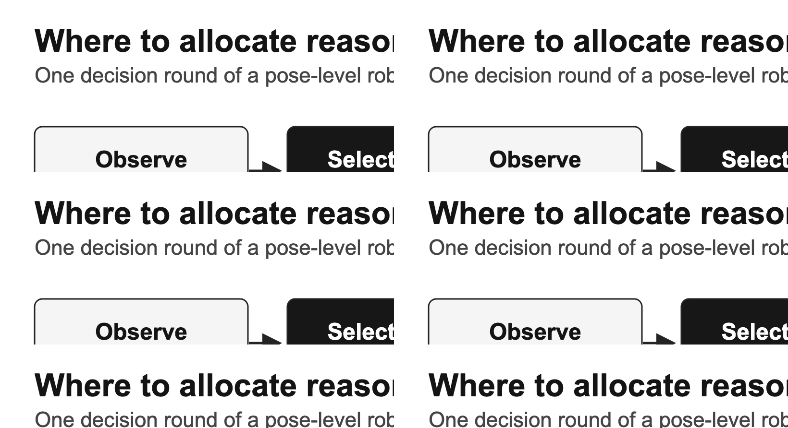
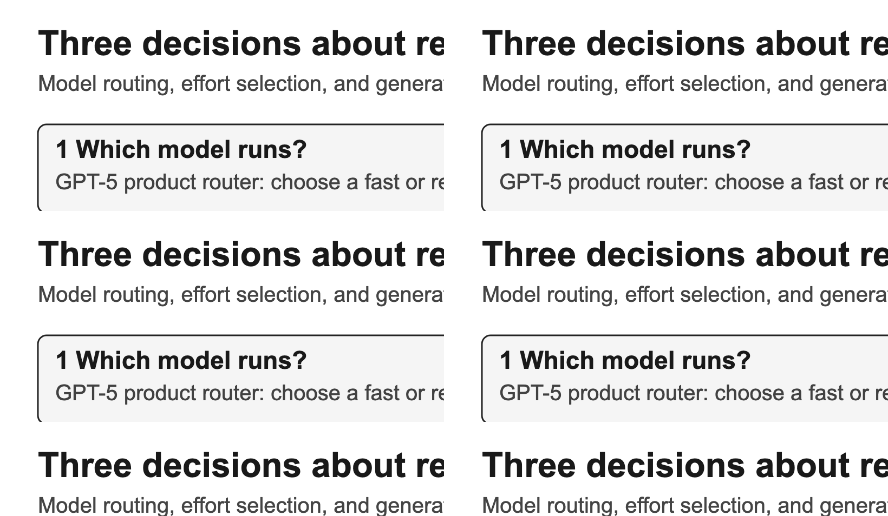
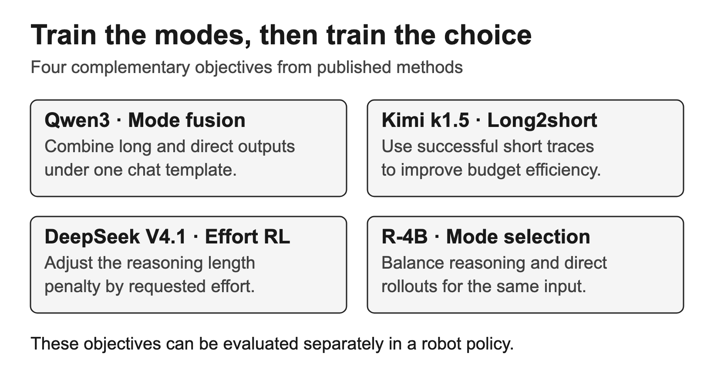
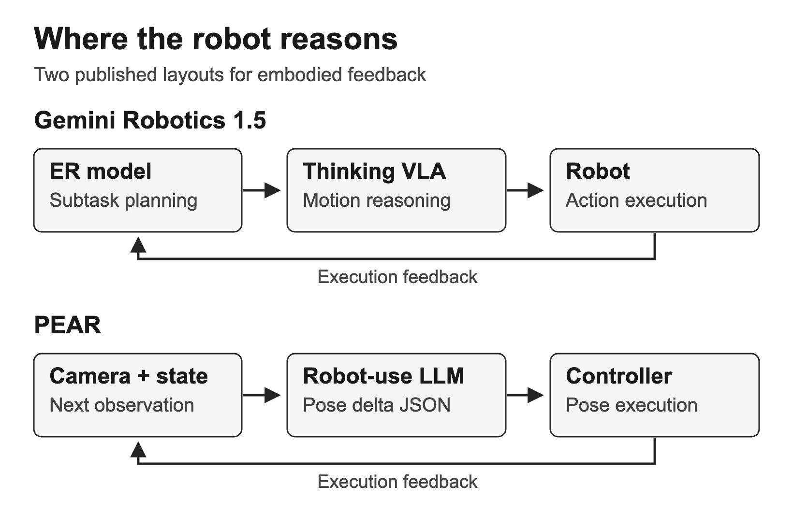
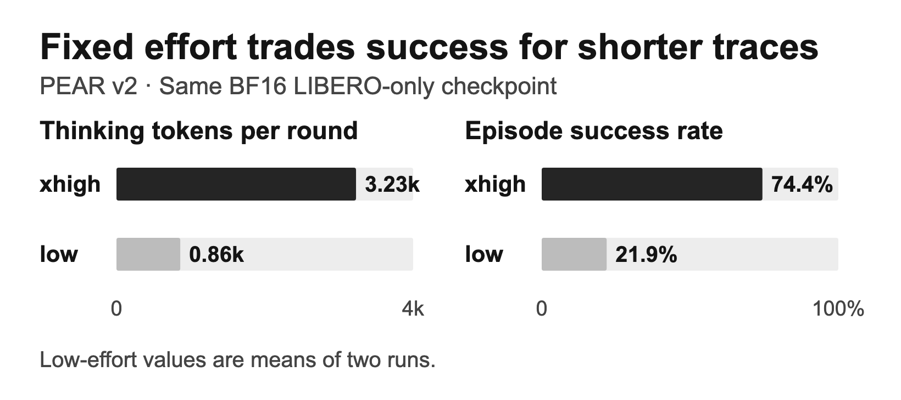
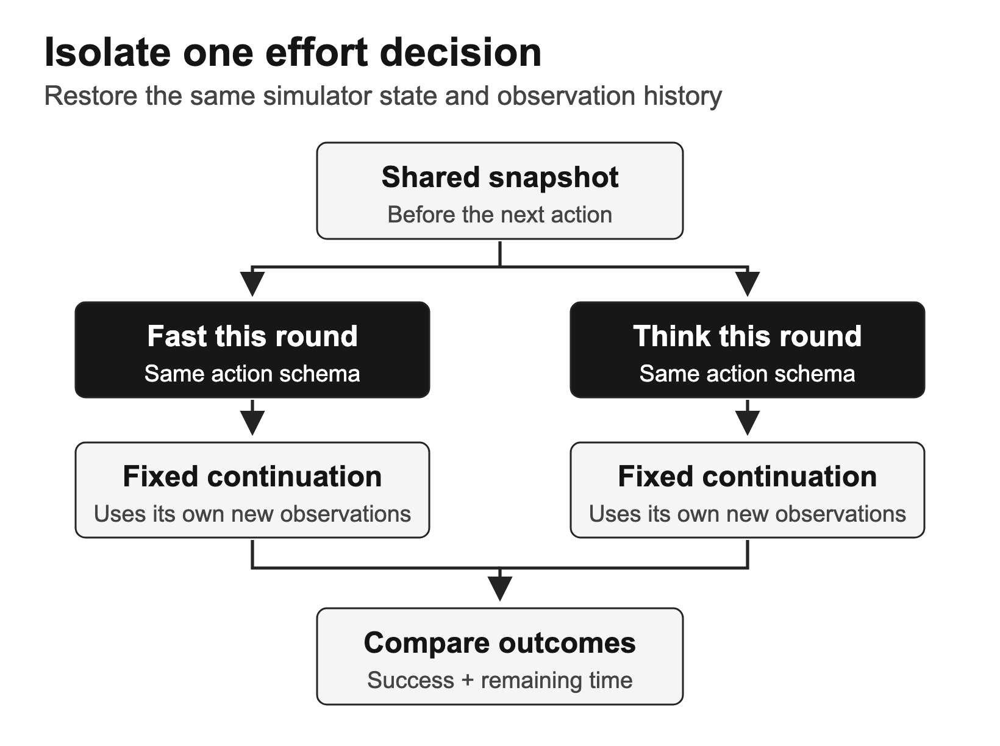
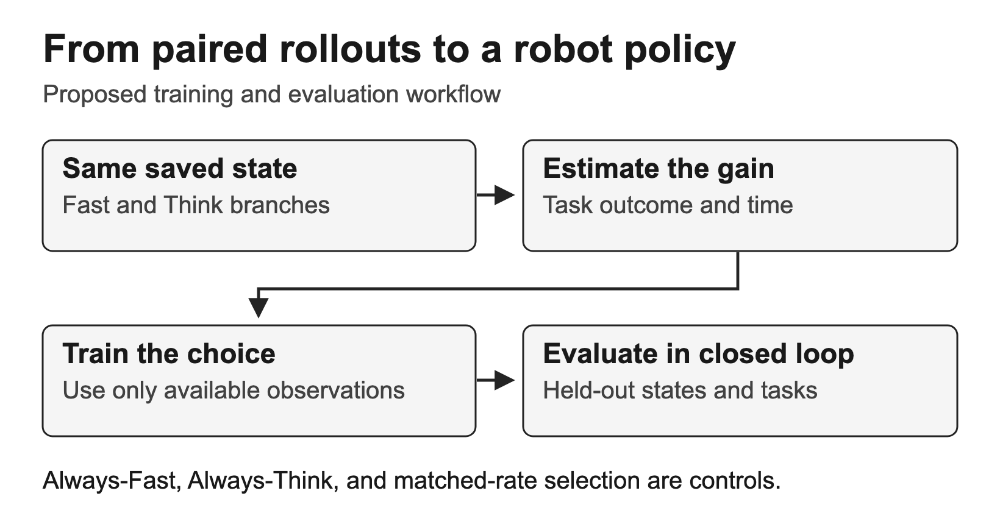

# Adaptive Reasoning for Robot-Use LLMs: From Frontier Models to a Training Recipe

## Abstract

在闭环机器人操作中，推理型大语言模型根据相机图像和机械臂状态生成动作，并在执行后接收新的观测。推理计算的价值随决策而变：额外思考可能改善遮挡下的目标判断或失败后的恢复，却会给重复的位姿修正增加延迟。当关键状态在当前观测中不可辨识，或者末端执行器无法到达所选位姿时，推理收益还受到感知与控制能力的限制。

Hybrid reasoning 将推理深度视为随观测历史变化的决策变量。在观测接口和控制器固定的条件下，增加本轮推理计算的价值可以由两项结果衡量：完整任务的成功概率变化，以及从当前决策到任务终止的耗时变化。只有当这种收益在同一任务的不同状态之间存在差异，并且可以在执行前根据可用观测辨识，逐轮分配计算才有机会在维持任务成功率的同时缩短执行时间。

## The Capability Boundary in Closed-Loop Robot Use

考虑一个把碗放入指定区域的任务。固定相机提供全局位置，腕部相机提供抓取附近的几何线索。夹爪闭合后，物体可能被完全遮挡。模型可以继续推理，也可以执行一个受限的观察动作，再用新画面核对是否抓住。前者增加 decode 成本，后者消耗机器人时间，但可能提供原先不存在的证据。二者对任务的作用需要通过后续状态验证。

这里的 hybrid reasoning 指同一 episode 内按决策改变推理模式或深度。下图将三个可独立改变的环节放回闭环：决策前选择 effort，生成中决定思考深度，执行后更新下一轮历史。固定动作接口与控制器，才能将观察到的差异归因到推理设置。

## Claude and GPT — Allocating Inference Compute

同一个机器人任务可以有三种计算分配方式：切换模型、对同一个模型改变 effort，或让模型在固定 effort 下决定思考多久。下图把三种选择放在请求到输出的顺序里。外部系统控制前两层，生成长度则取决于模型看到的输入与本次设置。

Claude Opus 4.6 的 system card 描述了一种模型内的 adaptive thinking。API 调用方开启 adaptive 模式并传入 effort，模型根据请求内容决定是否使用 extended thinking、以及思考多久。降低 effort 会改变模型调用长思考的倾向。这个接口把产品要承担的延迟和成本交给调用方设定，同时允许不同输入在同一个 effort 下花费不同的 token 数。Opus 5.5 的公开结果仍标明所用的 adaptive thinking 与 effort 设置，复现实验时这两项也应与模型版本一起记录。公开材料解释了接口和可观察行为，足以作为运行时参考。其具体 gating 训练信号仍是未知量。 [Opus 4.6 System Card][claude46] · [Opus 5.5 Model Notes][claude55]

**关于 Claude 训练的假设。** 一条可复现的路线是在同一 decoder 中联合训练两类决策：输出开始时选择进入 thinking 或直接回答，进入 thinking 后决定何时结束。对同一输入及 effort 采样短答与长答，用可验证的结果监督质量，再在低 effort 下施加更强的长度代价。SFT 可以先让两个分支都能完成任务，随后用配对结果训练选择。另一种实现是由独立 router 在 decode 前选路径。两者都能解释同一 effort 下思考触发率与深度随输入变化的公开行为。公开资料不足以辨别它们，也未披露 Claude 使用了这样的损失或架构。

这个假设可以做黑盒检验。固定模型、任务和 effort，改变清晰、遮挡或误抓三个 observation 条件，测量 thinking 出现率、可用的 usage 字段、动作有效率和最终结果。随后固定观测、改变 effort，分别比较触发率与触发后的耗时。再将异常执行结果作为工具反馈注入，检验在同一调用链中收到新证据后是否重新投入推理。Claude 的文档区分软性的 effort 与包含最终输出的硬上限，并说明调整 effort 可能影响 prompt cache。比较延迟时应记录 cache 命中，也应将可见的 thinking 摘要视为观测代理。 [Steering Thinking][claude-steering] · [Thinking in Tool Workflows][claude-tools]

GPT-5 system card 披露了另一个层次的选择。ChatGPT 的 router 根据任务复杂度、工具需求和用户意图在快模型与深度 reasoning 模型之间分流。GPT-5.1 进一步报告模型内的动态分配：Thinking 版本对简单问题更快，对较难问题投入更多计算。后续 API 用 `reasoning.effort` 调节同一模型的计算倾向，档位和默认值随版本变化。这三个层次分别对应系统选择 checkpoint、调用方设定 effort、模型在该设置下决定实际生成长度。对于一个固定 checkpoint 的机器人实验，后两层即可形成可控对照，外置 router 也可以只选择同一 checkpoint 的档位。 [GPT-5 System Card][gpt5] · [GPT-5.1 System Card][gpt51] · [Reasoning API Guide][gpt-api]

o1 的公开报告将 RL 训练计算与测试时思考量分别作为扩展轴。GPT-5 system card 也说明 reasoning 模型通过 RL 学习推理。公开证据覆盖训练范式、effort 的可观察行为与产品分流，尚不足以重建 GPT-5.1 的提前停止信号。迁移时可分别保留三个对照：固定 checkpoint 改 effort、固定 effort 改训练、固定动作接口改 router，以判断收益来自哪一层。 [Learning to Reason with LLMs][o1] · [GPT-5 System Card][gpt5]

## Qwen, GLM and DeepSeek — Training Controllable Modes

Qwen3 报告给出了让一个 checkpoint 同时保持快慢两种能力的顺序。先用 long-CoT cold start 和 Reasoning RL 获得 thinking 能力，再用 continual SFT 融合两种模式。Thinking 数据由 Reasoning RL checkpoint rejection sampling 得到，non-thinking 数据使用独立整理的直接回答。Chat template 用模式标记区分两类样本，direct answer 保留空 thinking block。报告还通过在指定长度结束 thinking 后继续生成答案来做 budget control。迁移到机器人时，训练样本可以用同一 observation 和 action schema 表达两类成功轨迹。需要实测短预算的输出能否闭合为合法动作，因为 completion 被截断时甚至可能没有 JSON。Qwen3.8-27B 的 model card 单独列出 `enable_thinking`、`preserve_thinking` 和 `reasoning_effort`。三者分别控制是否生成思考、历史思考是否保留，以及本轮的推理倾向。 [Qwen3 Technical Report, sections 4.1–4.4][qwen3] · [Qwen3.8-27B Model Card][qwen38]

Qwen 接口实验应分别记录上下文窗口、单次 completion 上限、thinking 停止方式和请求超时。对固定的多模态输入依次跑关闭 thinking、低 effort、高 effort，观察实际 reasoning 与动作字段、finish reason 和耗时。模型模板支持切档，部署端是否正确处理字段需要实测。若某档因截断没有交付动作，任务失败应归入该设置的结果，同时单独记录截断类型。

GLM-4.5 先训练 Reasoning、Agent 和 General Chat experts，再通过 unified training 将它们蒸馏进一个支持 deliberative 和 direct response 的模型。Agentic RL 用可验证的任务结果监督整条轨迹，错误的工具调用格式会令轨迹停止并得到零分。训练对模型生成的位置计算 loss，环境反馈作为 context。这个区分可直接用于仿真数据：控制器返回的实际位姿和成功信号需要进入下一轮输入，policy 更新只针对模型选择的 mode、reasoning 和 action。GLM 的交互轮数实验也提示，增加一次观测可以提供额外证据，机器人应分别计量多看一轮和多生成一段 CoT 的成本。 [GLM-4.5 Technical Report, sections 3.1 and 3.3][glm]

DeepSeek-V3.2 在同一段工具交互中保留 reasoning，收到新的 user message 后清除 reasoning，并保留工具调用和结果。V4.1-Flash 又公开了一套训练档位的配方：在输入中加入标量 effort $b$，对同一任务和同一档位采样多条轨迹，在该组内做 reward mean centering。设 $\ell$ 为一条轨迹的 reasoning token 数，$L_{\mathrm{norm}}$ 为参考长度，$C_{\max}$ 为扣分上限。报告使用以下长度项：

$$
r_{\mathrm{len}}(\ell,b)=-\min\left(C_{\max}, k(b)\frac{\ell}{L_{\mathrm{norm}}}\right).
$$

$k(b)$ 随 effort 指数递减，高档位因而承担更小的长度惩罚。组内比较会让同档轨迹争取更好的结果和成本折中，部署时仍需要从外部指定档位。报告也发现，在不同 coding scaffolds 上增加 effort 一致地拉长轨迹，成功率的变化却会出现平台和回落。迁移到机器人时，effort 的训练与在线分配应分别验证。同样，机器人每一步的 camera frame 都属于同一 episode，历史 reasoning 是否随新 frame 保留需要根据目标 checkpoint 的 template 验证。可以先用完整历史作为基线，把压缩已失效计划作为独立消融。 [DeepSeek-V3.2 Technical Report, section 3.2][deepseek32] · [DeepSeek-V4.1-Flash Technical Report, section 5.1.4 and Appendix B][deepseek41]

Kimi k1.5 的 long2short 提供了低成本行为的数据来源。Shortest rejection sampling 对同一问题多次采样，保留最短正确解做 SFT；DPO 将短正确解与更长的候选配对；long2short RL 在已有长思考能力的 checkpoint 上施加长度代价并缩小 rollout 上限。迁移时用闭环执行结果筛选短轨迹，在只有长分支成功的状态保存长轨迹作为恢复样本。动作合法与操作完成分别记录。 [Kimi k1.5 Technical Report, sections 2.4 and 3.4][kimi]

R-4B 展示了双模训练之后怎样继续训练自主选档。它先经 bi-mode annealing 获得 thinking 和 direct answer 两套行为，再通过 Bi-mode Policy Optimization 对同一输入强制两种模式等量采样，避免早期偏向某一模式导致另一分支缺少探索。Qwen3 的双模 SFT、DeepSeek 的同档位预算约束和 R-4B 的跨模式对照分别提供了行为覆盖、深度控制和模式选择的训练依据。 [R-4B, sections 2–3][r4b]

下图把可分开验证的训练目标放在一起。训练出能用的 Fast 和 Think 之后，还要检验模型能否在它们之间选对。比如在挪动目标后继续沿用原抓取计划的状态里，短轨迹即使格式正确，也可能因为没有重新定位而失败。配对 rollout 能让这种差异进入监督信号。

## Gemini Robotics and PEAR — Where Thinking Pays Off

两套具身系统都根据执行反馈更新下一步，但把思考放在了不同接口。图的上半部分把任务规划与动作生成拆开，下半部分由同一个 robot-use LLM 直接生成位姿增量。选择在哪一层调节 effort，决定了要冻结哪些组件，以及一次试验要测量哪段延迟。

Gemini Robotics 1.5 将 embodied reasoning 和 action generation 放在两处。ER 模型读场景、规划子任务并根据反馈更新计划，Thinking VLA 可以在生成动作前用语言把当前子任务拆成短动作。报告的 ER budget sweep 显示，相同的 budget 下，指点任务平均用掉的 thinking tokens 少于视频问答，指点的得分也更早趋于平缓。VLA 的独立 thinking on/off 实验则在多步操作中观察到 task progress 改善。这两组观测对应不同决策粒度，ER benchmark 的预算曲线无法直接给出 pose-level 控制的阈值。Gemini Robotics 2.5 的公开实例继续由 ER 跟踪任务进展、VLA 执行动作，提供了另一种闭环分工的实例。 [Gemini Robotics 1.5 Technical Report, thinking VLA and ER scaling experiments][gemini15] · [Gemini Robotics 2.5 Release][gemini25]

PEAR 则把 camera frames 和机器人 state 交给同一个 Qwen3.8-27B，每轮产出下一步末端位姿增量，再交给 controller 执行。其 system prompt 规定具名 JSON、厘米与弧度、相机坐标方向以及动作何时结束。训练全程用 `xhigh`，仿真成功给 episode-level reward。同任务、同初始状态的 rollouts 组成 GRPO 的 advantage 组，整条轨迹的 reasoning 和 action token 共享该轨迹的 advantage，更新采用不含 PPO clipping 的 REINFORCE policy loss。论文 v2 的固定档位对照里，LIBERO-only checkpoint 从 `xhigh` 切到 `low` 后，思考由每轮约 3.23k 降至 0.86k tokens，成功率从 74.4% 降到 21.9%。这是同一个 BF16 checkpoint 的全程降档结果。它表明直接压低每轮预算的代价很大，至于哪些轮次贡献了这段差距，需要对相同状态做局部干预才能回答。 [PEAR v2, sections 3.1–3.2 and 4.6, Appendices A and H][pear]

下图将 PEAR v2 的两项测量放在不同坐标轴上。低 effort 明显减少每轮 thinking，同时大幅降低任务成功率。对照是在整条 episode 内统一设档，因此需要下一节的局部分叉来定位损失来自哪些决策。 [PEAR v2, section 4.6][pear]

## A Turn-Level Recipe for Robot-Use LLMs

### Establish the Closed Loop

先用 LIBERO 跑通同一套 feedback loop。每轮提供任务描述、相机 RGB、当前末端位姿和夹爪状态，让模型输出一个固定 schema 的位姿增量。用 schema 和工作空间检查过滤无效动作，由 controller 执行并返回实际位姿与下一帧。若复用归一化的 OSC action，保留适配层的轴向、旋转、范围和 gripper 约定；若复现 PEAR，改用它的物理单位、逐量增量和停止条件。两种接口都可以做 effort 对照，动作含义或执行时长的变化会形成另一项实验因素。以 simulator success 结束 episode，并记录 timeout、context 耗尽与非法 action 等失败。对本地 Qwen 先在固定输入上核对实际 reasoning token、中止原因和动作格式，确认部署端对不同 effort 的响应。保存原始输出供排查，训练视图单列 reasoning text 和对应 action 参数，并用记录 ID 关联观测、单位与任务结果。

### Collect Matched Branches

用同一 checkpoint、prompt、controller 和观测历史先跑 Always-Fast 与 Always-Think。然后从两类策略访问过的状态抽样，保存可恢复的仿真与 controller state、随机数状态和相同的模型 context。从每个 snapshot 分叉，本轮分别用 Fast 和 Think 采样下一动作，随后用预先固定的 continuation policy 跑到结束，跨多个随机种子估计结果。固定 continuation 可以隔离当前一轮的 effort，重复采样可以区分真实的对照信号与单次动作的随机性。开局定位、持续靠近、接触后验证和失败恢复都值得覆盖。单看位移大小会漏掉夹爪已经闭合、但物体仍留在桌上的情况，因而应同时保存动作前后的图像与可用的进展信号。仿真对象真值用于离线评分，在线 router 的输入限于部署时可获得的观测。

保存状态应发生在动作执行之前。除 MuJoCo state 外，还要恢复 controller 目标、episode 步数、随机数与终止状态，并核对恢复后两路相机对应相同观测。两个分支只改变当前轮选档。执行后分别保留各分支实际产生的动作、历史和观测，再用同一个 continuation policy 完成任务。后续轨迹不同是干预影响结果的路径。训练集与验证集按任务或场景拆分，避免同一 episode 的相邻帧泄露到验证集。

还可以为部分状态加一个观察分支：执行预定义的观察动作，获取新图像，再用固定 effort 生成下一步操作。若额外观察恢复成功但增加 effort 无效，原观测的证据可能不足。若两种模式经常能输出合法目标，而 controller 到达误差同样较大，则需分开测量执行误差。

设 $h_t$ 是第 $t$ 轮的观测及历史，$\Delta p(h_t)$ 是这轮切换为 Think 后估计的 episode 成功概率增量，$\Delta T(h_t)$ 是分叉后剩余总耗时的增量。一个可校准的 router 判据是：

$$
\Delta p(h_t) > \lambda \Delta T(h_t).
$$

$\lambda$ 表示愿意用每秒额外时间换取多少成功概率。因为多想一轮也可能省掉后续重试，$\Delta T$ 应计入分叉后的总耗时，允许为负。实际拟合可以先用靠近状态、上一动作执行结果、进展停滞等可观察特征训练小 router，在验证集调阈值。估计效用差的区间覆盖零时，将该状态保留为不确定样本。在线运行还需要为动作输出预留 completion 空间，并在决策超时或观测失效时重新获取状态。高频 actuator loop 由 controller 维持，LLM 的 budget 作用在下一次 pose-level 决策。

以一组假设数字说明标签如何产生。同一状态下，各做十次 rollout。Fast 成功四次，平均剩余耗时 12 秒。Think 成功七次，平均剩余耗时 16 秒。若每秒时间代价折合 0.05 的成功概率，则 0.30 的成功概率增量超过 0.20 的时间代价。十次 rollout 得到的区间可能仍跨零，此时可补采配对种子，或将状态留作不确定样本。

### Train and Evaluate the Switch

配对采样和闭环评估各有用途。配对采样估计当前状态升档的收益，训练后的策略则会访问一批新的状态。下图把两者连起来：先从配对结果学习何时升档，再到独立任务里运行整个策略，观察这些局部判断能否转化为更好的任务结果。

第一轮实验可以冻结 Qwen，只训练 router。若同一个 checkpoint 在两档都能生成有效动作，而且 learned router 在独立验证任务上超过匹配 Think 比例的随机策略，再把选择蒸馏进模型。SFT 数据包含同一接口下成功的 Fast 直接动作与 Think 轨迹；筛选依据来自 simulator outcome 和动作有效性，轨迹长度用于衡量成本。对接着做的 simulator RL，可以用 matched states 对 mode 选择提供分叉后效用差，用完整 episode 的 success 评估后续行为。若借用 DeepSeek 的 effort-conditioned 长度项，只给 reasoning tokens 计长度成本，并报告各档位的成功率和实际使用比例。只对 switch token 计算一项 loss 时，共享参数仍可能改变动作生成，需要保留固定档位评测来检查退化。

在线 RL 可先从小规模 snapshot 集合开始。强制双模等量采样，用配对轨迹的效用差监督 mode，用各分支的执行结果监督后续生成。相机信息和环境反馈作为条件输入，更新作用于模型生成的位置。持续追踪两种模式的采样量、使用率、固定档位任务表现和非法动作率。若选档趋近单一模式，配对收益可帮助判断是双模能力退化、训练缺少探索，还是第二档确实很少有收益。

在 held-out 实验加入仅依赖可见状态的规则 router，例如在首次接触、连续无进展或目标消失时升档。加入只用于离线分析的分叉 oracle，估计固定 continuation 下能通过选档获得的收益空间。这个 oracle 使用分叉后的结果，部署效果由闭环线上可用观测下的 router 决定。

最终把 Adaptive 与 Always-Fast、Always-Think、Random-Matched-Rate 在相同初始状态上成对评估。先于测试定下相对 Always-Think 可接受的成功率差，再报告配对区间、端到端 median 和 p95、reasoning tokens、观察与重试次数，以及 invalid action 和未检测到的失败。把 router、prefill、decode、controller 执行与重试都记入总耗时；分析按任务和初始状态分组，避免将同一 episode 内的多轮当成独立样本。如果低 effort 只在极少状态能保住成功，或者选档的开销抵消了节省，固定高档位仍是这个 checkpoint 的合理基线。这套 recipe 的可行性取决于同一机器人任务中是否存在足够多能被提前识别的低成本决策。

相关研究方法可以参见 [Towards Efficient Closed-Loop Agents via Hybrid Reasoning](../dynamic-reasoning-robot-use/index.html)。

[claude46]: https://www-cdn.anthropic.com/c788cbc0a3da9135112f97cdf6dcd06f2c16cee2.pdf
[claude55]: https://www.anthropic.com/claude/opus
[gpt5]: https://cdn.openai.com/gpt-5-system-card.pdf
[gpt51]: https://cdn.openai.com/pdf/4173ec8d-1229-47db-96de-06d87147e07e/5_1_system_card.pdf
[gpt-api]: https://developers.openai.com/api/docs/guides/reasoning
[qwen3]: https://arxiv.org/html/2505.09388v1#S4.SS3
[qwen38]: https://huggingface.co/Qwen/Qwen3.8-27B
[glm]: https://arxiv.org/html/2508.06471v1#S3
[deepseek32]: https://arxiv.org/html/2512.02556v1#S3.SS2
[deepseek41]: https://arxiv.org/html/2609.19969v1#S5.SS1.SSS4
[gemini15]: https://arxiv.org/html/2510.03342v3
[gemini25]: https://deepmind.google/blog/gemini-robotics-2-5-accelerates-real-world-physical-intelligence/
[pear]: https://arxiv.org/html/2611.18562v2
[claude-steering]: https://platform.claude.com/docs/en/build-with-claude/adaptive-thinking
[claude-tools]: https://platform.claude.com/docs/en/build-with-claude/thinking-tool-workflows
[o1]: https://openai.com/index/learning-to-reason-with-llms/
[kimi]: https://arxiv.org/html/2501.12599v1#S2.SS4
[r4b]: https://arxiv.org/html/2508.21113v2#S3
